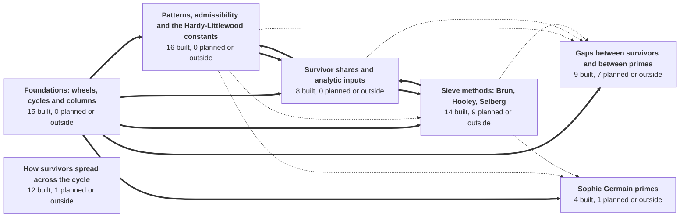
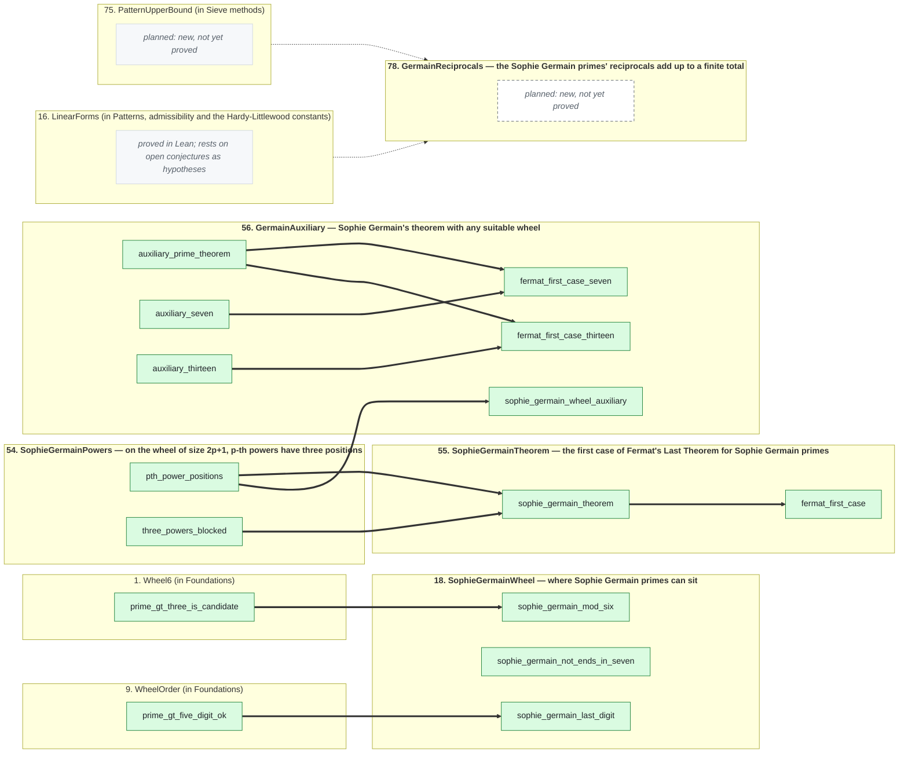

# The network

**Generated file — do not edit.** Regenerated by `python scripts/graph.py`.

This is a map of a Lean 4 / Mathlib formalization of a residue-number-system
(RNS) wheel sieve for primes. Each **node** is a group of related claims.
For each claim the network records what it says, what other claims it rests
on, and how it is justified. You can read off what any result depends on
without opening a single proof.

**Where things stand:** 78 of 96 nodes are built, holding 235 claims: 230 proved in Lean and 5 cited from a published paper. They are joined by 123 arrows, each a Lean-checked step. Of the other 18 nodes, drawn dashed or purple, 15 are new work, stated or scoped but not yet proved; 3 are outside sources, proved in Lean in other projects and cited here.

## How to read the graph

- **Each panel is a node** — a group of related results, numbered and named.
  **Each box inside it is one claim.** Click a box to open that claim: its
  exact Lean statement, what it rests on, and where its proof lives.
- **Green box:** proved in Lean. Every proof uses only the standard axioms
  `propext`, `Classical.choice` and `Quot.sound`.
- **White box with a dotted green border:** a proof is drafted but has not
  yet been built with `lake build`; not counted as proved.
- **Green box with an amber border:** proved in Lean, but the claim is an
  implication whose hypotheses include an open conjecture. What is proved is
  "if the conjecture holds, then …" — never the conjecture.
- **Blue box:** cited from a published paper; stated precisely in Lean but
  not proved there.
- **Yellow hexagon:** an open conjecture. It is never claimed; the dotted
  arrow shows which claim assumes it as a hypothesis.
- **Thick arrow `A ==> B`:** claim B assumes claim A, and Lean checks the
  step. Each proof file imports only claims, never another node's proof;
  each arrow is proved as a separate `…_step` theorem with the upstream claim
  as a named hypothesis, and `RNSSolutions/Assemble.lean` joins the steps up.
- **A panel with no arrows in or out** rests on nothing but Mathlib and the
  shared Vocabulary.
- **Dashed box or dotted arrow between panels:** planned, not yet built. A
  grey dashed box is new work begun in this repository.
- **Purple box:** an outside source — a result proved in Lean in another
  project, linked from its page. Nodes here cite it as a named hypothesis
  rather than re-proving it or importing that project.

## The network

The families and how they lean on each other (thick arrow: a Lean-checked step crosses between them; dotted: only planned ones do). Click a family to jump to its diagram. A panel titled "(in …)" in a family's diagram is a node from another family, shown so that every arrow appears; its boxes keep their own colours (green when proved).

### Foundations: wheels, cycles and columns

Nodes: [`Wheel6`](docs/nodes/Wheel6.md), [`CRT`](docs/nodes/CRT.md), [`SquareRootShield`](docs/nodes/SquareRootShield.md), [`SurvivorCount`](docs/nodes/SurvivorCount.md), [`Pruning`](docs/nodes/Pruning.md), [`WheelOrder`](docs/nodes/WheelOrder.md), [`ShieldCertificates`](docs/nodes/ShieldCertificates.md), [`Infinitude`](docs/nodes/Infinitude.md), [`ColumnStructure`](docs/nodes/ColumnStructure.md), [`DirichletColumns`](docs/nodes/DirichletColumns.md), [`ColumnAction`](docs/nodes/ColumnAction.md), [`BonseCeiling`](docs/nodes/BonseCeiling.md), [`Schatunowsky`](docs/nodes/Schatunowsky.md), [`FortunateCeiling`](docs/nodes/FortunateCeiling.md), [`RandomRotation`](docs/nodes/RandomRotation.md).

```mermaid
graph LR
  subgraph s1["<b>1. Wheel6 — the 6n±1 wheel</b>"]
    c1["prime_gt_three_is_candidate"]
  end
  subgraph s2["<b>2. CRT — one big cycle is the same as many small wheels</b>"]
    c2["crt_map_bijective"]
  end
  subgraph s3["<b>3. SquareRootShield — trial division only needs small wheels</b>"]
    c3["square_root_shield"]
  end
  subgraph s4["<b>5. SurvivorCount — the exact number of open positions</b>"]
    c4["twin_survivor_count"]
    c5["local_survivor_count"]
    c6["general_survivor_count"]
  end
  subgraph s5["<b>8. Pruning — which starting positions are worth testing</b>"]
    c7["valid_starting_residues_card_formula"]
  end
  subgraph s6["<b>9. WheelOrder — what each wheel adds when wheels arrive in order</b>"]
    c8["wheel_marginal_new_formula"]
    c9["prime_gt_five_digit_ok"]
    c10["wheel_gap_floor"]
  end
  subgraph s7["<b>10. ShieldCertificates — certifying primes, and why prime runs stop</b>"]
    c11["prime_of_shield_cover"]
    c12["active_primes_cover"]
    c13["family_prime_of_shield_cover"]
    c14["forward_ap_prime_of_active_shield"]
    c15["backward_ap_prime_of_active_shield"]
    c16["tuple_prime_of_active_shield"]
    c17["ap_hits_wheel"]
    c18["ap_prime_run_length_lt_of_lt_start"]
    c19["ap_prime_run_forces_divisibility"]
    c20["window_prime_iff"]
    c21["window_twin_iff"]
    c22["backward_ap_hits_wheel"]
    c23["backward_ap_prime_run_length_lt_of_above"]
    c24["backward_ap_prime_run_forces_divisibility"]
  end
  subgraph s8["<b>11. Infinitude — two independent proofs that primes never run out</b>"]
    c25["euclid_primes_unbounded"]
    c26["squarefree_counting_no_finite_supply"]
  end
  subgraph s9["<b>12. ColumnStructure — how the two columns multiply</b>"]
    c27["columns_multiply"]
    c28["col_minus_periodicity"]
    c29["col_minus_has_minus_prime_factor"]
    c30["col_minus_composite_has_proper_minus_factor"]
  end
  subgraph s10["<b>13. DirichletColumns — both columns hold infinitely many primes</b>"]
    c31["col_minus_primes_infinite"]
    c32["col_plus_primes_infinite"]
    c33["col_minus_primes_unbounded"]
    c34["col_plus_primes_unbounded"]
  end
  subgraph s11["<b>25. ColumnAction — how a wheel moves the columns</b>"]
    c35["column_action"]
  end
  subgraph s12["<b>44. BonseCeiling — from four wheels on, the ceiling sits inside one cycle</b>"]
    c36["ceiling_inside_cycle"]
  end
  subgraph s13["<b>57. Schatunowsky — 30 is the largest number whose survivors are all prime</b>"]
    c37["ceiling_forces_wheels"]
    c38["thirty_survivors_all_prime"]
    c39["schatunowsky_bound"]
  end
  subgraph s14["<b>59. FortunateCeiling — what lands on a prime just above the cycle (Fortune's conjecture, OEIS A038771)</b>"]
    c40["shift_avoids_wheels"]
    c41["shift_prime_below_ceiling"]
    c42["composite_shift_at_least_ceiling"]
    c43["composite_shift_semiprime_below_cube"]
    c44["first_primes_eq_cycle"]
    c45["primorial_eq_cycle"]
    c46["fortunate_spec"]
    c47["fortunate_at_least_next_prime"]
    c48["fortunate_prime_below_ceiling"]
    c49["fortune_of_ceiling"]
    c50["smallest_composite_shift_spec"]
    c51["smallest_composite_shift_floor"]
    c52["smallest_composite_shift_semiprime_below_cube"]
    c53["semiprime_conjecture_of_cube"]
  end
  subgraph s15["<b>91. RandomRotation — rotating every wheel at random</b>"]
    c54["rotation_is_shift"]
    c55["random_rotation_survival"]
  end
  subgraph s16["6. SingularSeries (in Patterns, admissibility and the Hardy-Littlewood constants)"]
    c56["local_density_factorization"]
  end
  subgraph s17["18. SophieGermainWheel (in Sophie Germain primes)"]
    c57["sophie_germain_mod_six"]
    c58["sophie_germain_last_digit"]
  end
  subgraph s18["19. GapTracks (in Gaps between survivors and between primes)"]
    c59["twin_prime_mod_six"]
    c60["cousin_prime_mod_six"]
    c61["prime_gap_forbidden_four_from_six_minus_one"]
    c62["prime_gap_forbidden_two_from_six_plus_one"]
    c63["prime_gap_same_track_of_six_dvd"]
  end
  subgraph s19["26. ShareBounds (in Survivor shares and analytic inputs)"]
    c64["survivor_share_le_inv_log"]
    c65["twin_share_le_two_inv_log_sq"]
  end
  subgraph s20["27. TwinShare (in Patterns, admissibility and the Hardy-Littlewood constants)"]
    c66["twin_share_eq_prod"]
  end
  subgraph s21["30. BlockingRuns (in Gaps between survivors and between primes)"]
    c67["blocked_run_is_shift"]
  end
  subgraph s22["64. ShareAsymptotics (in Survivor shares and analytic inputs)"]
    c68["survivor_share_asymptotic"]
    c69["twin_share_asymptotic"]
    c70["twin_share_asymptotic_classical"]
  end
  subgraph s23["69. BrunAnalytic (in Sieve methods)"]
    c71["twin_product_bound"]
  end
  subgraph s24["82. RailBrunTitchmarsh (in Sieve methods)"]
    p1["<i>proved in Lean</i>"]
  end
  c2 ==> c4
  c2 ==> c6
  c6 ==> c56
  c6 ==> c7
  c3 ==> c11
  c3 ==> c13
  c3 ==> c14
  c3 ==> c15
  c3 ==> c16
  c3 ==> c20
  c3 ==> c21
  c1 ==> c29
  c1 ==> c30
  c1 ==> c57
  c9 ==> c58
  c1 ==> c59
  c1 ==> c60
  c1 ==> c61
  c1 ==> c62
  c1 ==> c63
  c6 ==> c64
  c4 ==> c65
  c6 ==> c65
  c4 ==> c66
  c6 ==> c66
  c2 ==> c67
  c6 ==> c68
  c6 ==> c69
  c6 ==> c70
  c4 ==> c71
  c36 ==> c39
  c20 ==> c41
  c20 ==> c48
  c20 ==> c49
  s1 -.-> s24
  c2 ==> c54
  c6 ==> c55
  classDef verified fill:#dafbe1,stroke:#1a7f37,color:#1f2328;
  classDef conditional_built fill:#dafbe1,stroke:#9a6700,color:#1f2328,stroke-width:2px;
  classDef cited_built fill:#ddf4ff,stroke:#0969da,color:#1f2328;
  classDef planned fill:#ffffff,stroke:#1a7f37,color:#57606a,stroke-dasharray: 5 4;
  classDef conditional fill:#ffffff,stroke:#9a6700,color:#57606a,stroke-dasharray: 5 4;
  classDef cited fill:#ffffff,stroke:#0969da,color:#57606a,stroke-dasharray: 5 4;
  classDef new fill:#ffffff,stroke:#57606a,color:#57606a,stroke-dasharray: 5 4;
  classDef draft fill:#ffffff,stroke:#1a7f37,color:#1f2328,stroke-width:2px,stroke-dasharray: 2 2;
  classDef external fill:#fbefff,stroke:#8250df,color:#1f2328;
  classDef openconj fill:#fff8c5,stroke:#9a6700,color:#1f2328;
  classDef stub fill:#f6f8fa,stroke:#d0d7de,color:#57606a;
  class c1,c2,c3,c4,c5,c6,c7,c8,c9,c10,c11,c12,c13,c14,c15,c16,c17,c18,c19,c20,c21,c22,c23,c24,c25,c26,c27,c28,c29,c30,c31,c32,c33,c34,c35,c36,c37,c38,c39,c40,c41,c42,c43,c44,c45,c46,c47,c48,c49,c50,c51,c52,c53,c54,c55,c56,c57,c58,c59,c60,c61,c62,c63,c64,c65,c66,c67,c68,c69,c70,c71 verified;
  class p1 stub;
  click c1 href "https://github.com/golfbum71/RNS-Sieve-Network/blob/main/docs/nodes/Wheel6.md#prime_gt_three_is_candidate" _blank
  click c2 href "https://github.com/golfbum71/RNS-Sieve-Network/blob/main/docs/nodes/CRT.md#crt_map_bijective" _blank
  click c3 href "https://github.com/golfbum71/RNS-Sieve-Network/blob/main/docs/nodes/SquareRootShield.md#square_root_shield" _blank
  click c4 href "https://github.com/golfbum71/RNS-Sieve-Network/blob/main/docs/nodes/SurvivorCount.md#twin_survivor_count" _blank
  click c5 href "https://github.com/golfbum71/RNS-Sieve-Network/blob/main/docs/nodes/SurvivorCount.md#local_survivor_count" _blank
  click c6 href "https://github.com/golfbum71/RNS-Sieve-Network/blob/main/docs/nodes/SurvivorCount.md#general_survivor_count" _blank
  click c56 href "https://github.com/golfbum71/RNS-Sieve-Network/blob/main/docs/nodes/SingularSeries.md#local_density_factorization" _blank
  click c7 href "https://github.com/golfbum71/RNS-Sieve-Network/blob/main/docs/nodes/Pruning.md#valid_starting_residues_card_formula" _blank
  click c8 href "https://github.com/golfbum71/RNS-Sieve-Network/blob/main/docs/nodes/WheelOrder.md#wheel_marginal_new_formula" _blank
  click c9 href "https://github.com/golfbum71/RNS-Sieve-Network/blob/main/docs/nodes/WheelOrder.md#prime_gt_five_digit_ok" _blank
  click c10 href "https://github.com/golfbum71/RNS-Sieve-Network/blob/main/docs/nodes/WheelOrder.md#wheel_gap_floor" _blank
  click c11 href "https://github.com/golfbum71/RNS-Sieve-Network/blob/main/docs/nodes/ShieldCertificates.md#prime_of_shield_cover" _blank
  click c12 href "https://github.com/golfbum71/RNS-Sieve-Network/blob/main/docs/nodes/ShieldCertificates.md#active_primes_cover" _blank
  click c13 href "https://github.com/golfbum71/RNS-Sieve-Network/blob/main/docs/nodes/ShieldCertificates.md#family_prime_of_shield_cover" _blank
  click c14 href "https://github.com/golfbum71/RNS-Sieve-Network/blob/main/docs/nodes/ShieldCertificates.md#forward_ap_prime_of_active_shield" _blank
  click c15 href "https://github.com/golfbum71/RNS-Sieve-Network/blob/main/docs/nodes/ShieldCertificates.md#backward_ap_prime_of_active_shield" _blank
  click c16 href "https://github.com/golfbum71/RNS-Sieve-Network/blob/main/docs/nodes/ShieldCertificates.md#tuple_prime_of_active_shield" _blank
  click c17 href "https://github.com/golfbum71/RNS-Sieve-Network/blob/main/docs/nodes/ShieldCertificates.md#ap_hits_wheel" _blank
  click c18 href "https://github.com/golfbum71/RNS-Sieve-Network/blob/main/docs/nodes/ShieldCertificates.md#ap_prime_run_length_lt_of_lt_start" _blank
  click c19 href "https://github.com/golfbum71/RNS-Sieve-Network/blob/main/docs/nodes/ShieldCertificates.md#ap_prime_run_forces_divisibility" _blank
  click c20 href "https://github.com/golfbum71/RNS-Sieve-Network/blob/main/docs/nodes/ShieldCertificates.md#window_prime_iff" _blank
  click c21 href "https://github.com/golfbum71/RNS-Sieve-Network/blob/main/docs/nodes/ShieldCertificates.md#window_twin_iff" _blank
  click c22 href "https://github.com/golfbum71/RNS-Sieve-Network/blob/main/docs/nodes/ShieldCertificates.md#backward_ap_hits_wheel" _blank
  click c23 href "https://github.com/golfbum71/RNS-Sieve-Network/blob/main/docs/nodes/ShieldCertificates.md#backward_ap_prime_run_length_lt_of_above" _blank
  click c24 href "https://github.com/golfbum71/RNS-Sieve-Network/blob/main/docs/nodes/ShieldCertificates.md#backward_ap_prime_run_forces_divisibility" _blank
  click c25 href "https://github.com/golfbum71/RNS-Sieve-Network/blob/main/docs/nodes/Infinitude.md#euclid_primes_unbounded" _blank
  click c26 href "https://github.com/golfbum71/RNS-Sieve-Network/blob/main/docs/nodes/Infinitude.md#squarefree_counting_no_finite_supply" _blank
  click c27 href "https://github.com/golfbum71/RNS-Sieve-Network/blob/main/docs/nodes/ColumnStructure.md#columns_multiply" _blank
  click c28 href "https://github.com/golfbum71/RNS-Sieve-Network/blob/main/docs/nodes/ColumnStructure.md#col_minus_periodicity" _blank
  click c29 href "https://github.com/golfbum71/RNS-Sieve-Network/blob/main/docs/nodes/ColumnStructure.md#col_minus_has_minus_prime_factor" _blank
  click c30 href "https://github.com/golfbum71/RNS-Sieve-Network/blob/main/docs/nodes/ColumnStructure.md#col_minus_composite_has_proper_minus_factor" _blank
  click c31 href "https://github.com/golfbum71/RNS-Sieve-Network/blob/main/docs/nodes/DirichletColumns.md#col_minus_primes_infinite" _blank
  click c32 href "https://github.com/golfbum71/RNS-Sieve-Network/blob/main/docs/nodes/DirichletColumns.md#col_plus_primes_infinite" _blank
  click c33 href "https://github.com/golfbum71/RNS-Sieve-Network/blob/main/docs/nodes/DirichletColumns.md#col_minus_primes_unbounded" _blank
  click c34 href "https://github.com/golfbum71/RNS-Sieve-Network/blob/main/docs/nodes/DirichletColumns.md#col_plus_primes_unbounded" _blank
  click c57 href "https://github.com/golfbum71/RNS-Sieve-Network/blob/main/docs/nodes/SophieGermainWheel.md#sophie_germain_mod_six" _blank
  click c58 href "https://github.com/golfbum71/RNS-Sieve-Network/blob/main/docs/nodes/SophieGermainWheel.md#sophie_germain_last_digit" _blank
  click c59 href "https://github.com/golfbum71/RNS-Sieve-Network/blob/main/docs/nodes/GapTracks.md#twin_prime_mod_six" _blank
  click c60 href "https://github.com/golfbum71/RNS-Sieve-Network/blob/main/docs/nodes/GapTracks.md#cousin_prime_mod_six" _blank
  click c61 href "https://github.com/golfbum71/RNS-Sieve-Network/blob/main/docs/nodes/GapTracks.md#prime_gap_forbidden_four_from_six_minus_one" _blank
  click c62 href "https://github.com/golfbum71/RNS-Sieve-Network/blob/main/docs/nodes/GapTracks.md#prime_gap_forbidden_two_from_six_plus_one" _blank
  click c63 href "https://github.com/golfbum71/RNS-Sieve-Network/blob/main/docs/nodes/GapTracks.md#prime_gap_same_track_of_six_dvd" _blank
  click c35 href "https://github.com/golfbum71/RNS-Sieve-Network/blob/main/docs/nodes/ColumnAction.md#column_action" _blank
  click c64 href "https://github.com/golfbum71/RNS-Sieve-Network/blob/main/docs/nodes/ShareBounds.md#survivor_share_le_inv_log" _blank
  click c65 href "https://github.com/golfbum71/RNS-Sieve-Network/blob/main/docs/nodes/ShareBounds.md#twin_share_le_two_inv_log_sq" _blank
  click c66 href "https://github.com/golfbum71/RNS-Sieve-Network/blob/main/docs/nodes/TwinShare.md#twin_share_eq_prod" _blank
  click c67 href "https://github.com/golfbum71/RNS-Sieve-Network/blob/main/docs/nodes/BlockingRuns.md#blocked_run_is_shift" _blank
  click c68 href "https://github.com/golfbum71/RNS-Sieve-Network/blob/main/docs/nodes/ShareAsymptotics.md#survivor_share_asymptotic" _blank
  click c69 href "https://github.com/golfbum71/RNS-Sieve-Network/blob/main/docs/nodes/ShareAsymptotics.md#twin_share_asymptotic" _blank
  click c70 href "https://github.com/golfbum71/RNS-Sieve-Network/blob/main/docs/nodes/ShareAsymptotics.md#twin_share_asymptotic_classical" _blank
  click c36 href "https://github.com/golfbum71/RNS-Sieve-Network/blob/main/docs/nodes/BonseCeiling.md#ceiling_inside_cycle" _blank
  click c71 href "https://github.com/golfbum71/RNS-Sieve-Network/blob/main/docs/nodes/BrunAnalytic.md#twin_product_bound" _blank
  click c37 href "https://github.com/golfbum71/RNS-Sieve-Network/blob/main/docs/nodes/Schatunowsky.md#ceiling_forces_wheels" _blank
  click c38 href "https://github.com/golfbum71/RNS-Sieve-Network/blob/main/docs/nodes/Schatunowsky.md#thirty_survivors_all_prime" _blank
  click c39 href "https://github.com/golfbum71/RNS-Sieve-Network/blob/main/docs/nodes/Schatunowsky.md#schatunowsky_bound" _blank
  click c40 href "https://github.com/golfbum71/RNS-Sieve-Network/blob/main/docs/nodes/FortunateCeiling.md#shift_avoids_wheels" _blank
  click c41 href "https://github.com/golfbum71/RNS-Sieve-Network/blob/main/docs/nodes/FortunateCeiling.md#shift_prime_below_ceiling" _blank
  click c42 href "https://github.com/golfbum71/RNS-Sieve-Network/blob/main/docs/nodes/FortunateCeiling.md#composite_shift_at_least_ceiling" _blank
  click c43 href "https://github.com/golfbum71/RNS-Sieve-Network/blob/main/docs/nodes/FortunateCeiling.md#composite_shift_semiprime_below_cube" _blank
  click c44 href "https://github.com/golfbum71/RNS-Sieve-Network/blob/main/docs/nodes/FortunateCeiling.md#first_primes_eq_cycle" _blank
  click c45 href "https://github.com/golfbum71/RNS-Sieve-Network/blob/main/docs/nodes/FortunateCeiling.md#primorial_eq_cycle" _blank
  click c46 href "https://github.com/golfbum71/RNS-Sieve-Network/blob/main/docs/nodes/FortunateCeiling.md#fortunate_spec" _blank
  click c47 href "https://github.com/golfbum71/RNS-Sieve-Network/blob/main/docs/nodes/FortunateCeiling.md#fortunate_at_least_next_prime" _blank
  click c48 href "https://github.com/golfbum71/RNS-Sieve-Network/blob/main/docs/nodes/FortunateCeiling.md#fortunate_prime_below_ceiling" _blank
  click c49 href "https://github.com/golfbum71/RNS-Sieve-Network/blob/main/docs/nodes/FortunateCeiling.md#fortune_of_ceiling" _blank
  click c50 href "https://github.com/golfbum71/RNS-Sieve-Network/blob/main/docs/nodes/FortunateCeiling.md#smallest_composite_shift_spec" _blank
  click c51 href "https://github.com/golfbum71/RNS-Sieve-Network/blob/main/docs/nodes/FortunateCeiling.md#smallest_composite_shift_floor" _blank
  click c52 href "https://github.com/golfbum71/RNS-Sieve-Network/blob/main/docs/nodes/FortunateCeiling.md#smallest_composite_shift_semiprime_below_cube" _blank
  click c53 href "https://github.com/golfbum71/RNS-Sieve-Network/blob/main/docs/nodes/FortunateCeiling.md#semiprime_conjecture_of_cube" _blank
  click p1 href "https://github.com/golfbum71/RNS-Sieve-Network/blob/main/docs/nodes/RailBrunTitchmarsh.md" _blank
  click c54 href "https://github.com/golfbum71/RNS-Sieve-Network/blob/main/docs/nodes/RandomRotation.md#rotation_is_shift" _blank
  click c55 href "https://github.com/golfbum71/RNS-Sieve-Network/blob/main/docs/nodes/RandomRotation.md#random_rotation_survival" _blank
```

### Patterns, admissibility and the Hardy-Littlewood constants

Nodes: [`Admissibility`](docs/nodes/Admissibility.md), [`SingularSeries`](docs/nodes/SingularSeries.md), [`TwinConstant`](docs/nodes/TwinConstant.md), [`HardyLittlewood`](docs/nodes/HardyLittlewood.md), [`HensleyRichards`](docs/nodes/HensleyRichards.md), [`LinearForms`](docs/nodes/LinearForms.md), [`TwinShare`](docs/nodes/TwinShare.md), [`InadmissibleOccurrences`](docs/nodes/InadmissibleOccurrences.md), [`BirdseySchay`](docs/nodes/BirdseySchay.md), [`GallagherAverage`](docs/nodes/GallagherAverage.md), [`PrimeGapsBridge`](docs/nodes/PrimeGapsBridge.md), [`GapConstant`](docs/nodes/GapConstant.md), [`PolyaCutoff`](docs/nodes/PolyaCutoff.md), [`BadWheels`](docs/nodes/BadWheels.md), [`PolynomialPatterns`](docs/nodes/PolynomialPatterns.md), [`GallagherLocal`](docs/nodes/GallagherLocal.md).

```mermaid
graph LR
  subgraph s1["<b>4. Admissibility — which offset patterns can repeat forever</b>"]
    c1["admissible_of_large_primes"]
    c2["zero_two_admissible"]
    c3["zero_two_four_not_admissible"]
    c4["ap_offsets_admissible_iff"]
  end
  subgraph s2["<b>6. SingularSeries — the correction constant exists and is positive</b>"]
    c5["delta_bound"]
    c6["factor_multipliable"]
    c7["hardy_littlewood_constant_pos"]
    c8["local_density_factorization"]
  end
  subgraph s3["<b>7. TwinConstant — the classical twin-prime constant is recovered</b>"]
    c9["twin_prime_constant_eq_classical"]
  end
  subgraph s4["<b>14. HardyLittlewood — the conjecture, and what it would give</b>"]
    c10["twin_prime_conjecture_implies_infinite_twin_primes"]
  end
  subgraph s5["<b>15. HensleyRichards — Hardy and Littlewood's two conjectures clash</b>"]
    c11["HL_A_and_B_incompatible"]
  end
  subgraph s6["<b>16. LinearForms — Dickson's conjecture gives Sophie Germain primes</b>"]
    c12["sophieGermainSystem_admissible"]
    c13["sophie_germain_of_LinearForms_conjecture"]
  end
  subgraph s7["<b>27. TwinShare — the twin share of the cycle</b>"]
    c14["twin_share_eq_prod"]
    c15["twin_share_split"]
  end
  subgraph s8["<b>28. InadmissibleOccurrences — inadmissible patterns sit next to their blocking wheel</b>"]
    c16["inadmissible_occurrence_contains_prime"]
    c17["gap_block_24242_unique"]
  end
  subgraph s9["<b>32. BirdseySchay — the twin share carried below the ceiling</b>"]
    c18["corrected_share_limit"]
    c19["next_prime_ratio"]
    c20["twin_count_at_squares"]
    c21["birdsey_schay_implies_twin_asymptotic"]
  end
  subgraph s10["<b>48. GallagherAverage — the wheel correction is 1 on average</b>"]
    c22["singular_series_average_one"]
  end
  subgraph s11["<b>50. PrimeGapsBridge — the network's admissibility is PrimeGapsLib's</b>"]
    c23["admissible_iff_primegaps"]
  end
  subgraph s12["<b>71. GapConstant — the constant for any even gap</b>"]
    c24["gap_constant_eq_twin_mul"]
    c25["gap_constant_classical"]
    c26["sexy_constant_eq_two_twin"]
    c27["goldbach_constant"]
  end
  subgraph s13["<b>72. PolyaCutoff — sifting to Polya's cutoff gives the Hardy-Littlewood constant exactly</b>"]
    c28["polya_cutoff_share"]
  end
  subgraph s14["<b>73. BadWheels — which wheels block fewer positions for linear forms</b>"]
    c29["blocked_le_card"]
    c30["blocked_eq_card_iff"]
    c31["twin_columns_bad_wheels"]
    c32["divisors_pairwise_coprime"]
  end
  subgraph s15["<b>89. PolynomialPatterns — polynomial patterns: admissibility and the Bateman-Horn conjecture</b>"]
    c33["poly_admissible_iff"]
    c34["sq_add_one_admissible"]
    c35["landau_of_bateman_horn"]
  end
  subgraph s16["<b>99. GallagherLocal — one wheel's correction averages to 1</b>"]
    c36["one_wheel_average"]
  end
  subgraph s17["5. SurvivorCount (in Foundations)"]
    c37["general_survivor_count"]
    c38["twin_survivor_count"]
  end
  subgraph s18["41. PrimeNumberTheorem (in Survivor shares and analytic inputs)"]
    c39["prime_number_theorem"]
  end
  subgraph s19["64. ShareAsymptotics (in Survivor shares and analytic inputs)"]
    c40["twin_share_asymptotic"]
    c41["twin_share_asymptotic_classical"]
    c42["pattern_share_asymptotic"]
    c43["survivor_share_asymptotic"]
  end
  subgraph s20["75. PatternUpperBound (in Sieve methods)"]
    p1["<i>planned: new, not yet proved</i>"]
  end
  subgraph s21["76. GapPairs (in Gaps between survivors and between primes)"]
    p2["<i>planned: new, not yet proved</i>"]
  end
  subgraph s22["78. GermainReciprocals (in Sophie Germain primes)"]
    p3["<i>planned: new, not yet proved</i>"]
  end
  subgraph s23["87. SelbergTwinRails (in Sieve methods)"]
    p4["<i>planned: new, not yet proved</i>"]
  end
  o1{{"<i>open conjecture</i><br/>hardy_littlewood_conjecture"}}
  o2{{"<i>open conjecture</i><br/>HL_conjecture_A"}}
  o3{{"<i>open conjecture</i><br/>HL_conjecture_B"}}
  o4{{"<i>open conjecture</i><br/>LinearForms_conjecture"}}
  o5{{"<i>open conjecture</i><br/>birdsey_schay_heuristic"}}
  o6{{"<i>open conjecture</i><br/>sq_add_one_constant_converges"}}
  o7{{"<i>open conjecture</i><br/>bateman_horn_sq_add_one"}}
  c37 ==> c8
  c6 ==> c9
  c7 ==> c10
  c2 ==> c10
  o1 -.-> c10
  o2 -.-> c11
  o3 -.-> c11
  o4 -.-> c13
  c38 ==> c14
  c37 ==> c14
  c14 ==> c40
  c15 ==> c40
  c14 ==> c41
  c15 ==> c41
  c8 ==> c42
  c6 ==> c42
  c14 ==> c18
  c43 ==> c18
  c41 ==> c18
  c39 ==> c19
  c18 ==> c20
  c39 ==> c20
  c9 ==> c20
  c7 ==> c20
  c2 ==> c20
  o5 -.-> c20
  c20 ==> c21
  c19 ==> c21
  c7 ==> c21
  c2 ==> c21
  o5 -.-> c21
  c6 ==> c24
  c6 ==> c25
  c9 ==> c25
  c6 ==> c26
  c6 ==> c27
  c42 ==> c28
  s14 -.-> s20
  s12 -.-> s21
  s6 -.-> s22
  s3 -.-> s23
  o6 -.-> c35
  o7 -.-> c35
  classDef verified fill:#dafbe1,stroke:#1a7f37,color:#1f2328;
  classDef conditional_built fill:#dafbe1,stroke:#9a6700,color:#1f2328,stroke-width:2px;
  classDef cited_built fill:#ddf4ff,stroke:#0969da,color:#1f2328;
  classDef planned fill:#ffffff,stroke:#1a7f37,color:#57606a,stroke-dasharray: 5 4;
  classDef conditional fill:#ffffff,stroke:#9a6700,color:#57606a,stroke-dasharray: 5 4;
  classDef cited fill:#ffffff,stroke:#0969da,color:#57606a,stroke-dasharray: 5 4;
  classDef new fill:#ffffff,stroke:#57606a,color:#57606a,stroke-dasharray: 5 4;
  classDef draft fill:#ffffff,stroke:#1a7f37,color:#1f2328,stroke-width:2px,stroke-dasharray: 2 2;
  classDef external fill:#fbefff,stroke:#8250df,color:#1f2328;
  classDef openconj fill:#fff8c5,stroke:#9a6700,color:#1f2328;
  classDef stub fill:#f6f8fa,stroke:#d0d7de,color:#57606a;
  class c1,c2,c3,c4,c5,c6,c7,c8,c9,c12,c14,c15,c16,c17,c18,c19,c23,c24,c25,c26,c27,c28,c29,c30,c31,c32,c33,c34,c36,c37,c38,c39,c40,c41,c42,c43 verified;
  class c10,c11,c13,c20,c21,c35 conditional_built;
  class c22 cited_built;
  class p1,p2,p3,p4 stub;
  class o1,o2,o3,o4,o5,o6,o7 openconj;
  click c1 href "https://github.com/golfbum71/RNS-Sieve-Network/blob/main/docs/nodes/Admissibility.md#admissible_of_large_primes" _blank
  click c2 href "https://github.com/golfbum71/RNS-Sieve-Network/blob/main/docs/nodes/Admissibility.md#zero_two_admissible" _blank
  click c3 href "https://github.com/golfbum71/RNS-Sieve-Network/blob/main/docs/nodes/Admissibility.md#zero_two_four_not_admissible" _blank
  click c4 href "https://github.com/golfbum71/RNS-Sieve-Network/blob/main/docs/nodes/Admissibility.md#ap_offsets_admissible_iff" _blank
  click c37 href "https://github.com/golfbum71/RNS-Sieve-Network/blob/main/docs/nodes/SurvivorCount.md#general_survivor_count" _blank
  click c38 href "https://github.com/golfbum71/RNS-Sieve-Network/blob/main/docs/nodes/SurvivorCount.md#twin_survivor_count" _blank
  click c5 href "https://github.com/golfbum71/RNS-Sieve-Network/blob/main/docs/nodes/SingularSeries.md#delta_bound" _blank
  click c6 href "https://github.com/golfbum71/RNS-Sieve-Network/blob/main/docs/nodes/SingularSeries.md#factor_multipliable" _blank
  click c7 href "https://github.com/golfbum71/RNS-Sieve-Network/blob/main/docs/nodes/SingularSeries.md#hardy_littlewood_constant_pos" _blank
  click c8 href "https://github.com/golfbum71/RNS-Sieve-Network/blob/main/docs/nodes/SingularSeries.md#local_density_factorization" _blank
  click c9 href "https://github.com/golfbum71/RNS-Sieve-Network/blob/main/docs/nodes/TwinConstant.md#twin_prime_constant_eq_classical" _blank
  click c10 href "https://github.com/golfbum71/RNS-Sieve-Network/blob/main/docs/nodes/HardyLittlewood.md#twin_prime_conjecture_implies_infinite_twin_primes" _blank
  click c11 href "https://github.com/golfbum71/RNS-Sieve-Network/blob/main/docs/nodes/HensleyRichards.md#hl_a_and_b_incompatible" _blank
  click c12 href "https://github.com/golfbum71/RNS-Sieve-Network/blob/main/docs/nodes/LinearForms.md#sophiegermainsystem_admissible" _blank
  click c13 href "https://github.com/golfbum71/RNS-Sieve-Network/blob/main/docs/nodes/LinearForms.md#sophie_germain_of_linearforms_conjecture" _blank
  click c14 href "https://github.com/golfbum71/RNS-Sieve-Network/blob/main/docs/nodes/TwinShare.md#twin_share_eq_prod" _blank
  click c15 href "https://github.com/golfbum71/RNS-Sieve-Network/blob/main/docs/nodes/TwinShare.md#twin_share_split" _blank
  click c16 href "https://github.com/golfbum71/RNS-Sieve-Network/blob/main/docs/nodes/InadmissibleOccurrences.md#inadmissible_occurrence_contains_prime" _blank
  click c17 href "https://github.com/golfbum71/RNS-Sieve-Network/blob/main/docs/nodes/InadmissibleOccurrences.md#gap_block_24242_unique" _blank
  click c39 href "https://github.com/golfbum71/RNS-Sieve-Network/blob/main/docs/nodes/PrimeNumberTheorem.md#prime_number_theorem" _blank
  click c40 href "https://github.com/golfbum71/RNS-Sieve-Network/blob/main/docs/nodes/ShareAsymptotics.md#twin_share_asymptotic" _blank
  click c41 href "https://github.com/golfbum71/RNS-Sieve-Network/blob/main/docs/nodes/ShareAsymptotics.md#twin_share_asymptotic_classical" _blank
  click c42 href "https://github.com/golfbum71/RNS-Sieve-Network/blob/main/docs/nodes/ShareAsymptotics.md#pattern_share_asymptotic" _blank
  click c43 href "https://github.com/golfbum71/RNS-Sieve-Network/blob/main/docs/nodes/ShareAsymptotics.md#survivor_share_asymptotic" _blank
  click c18 href "https://github.com/golfbum71/RNS-Sieve-Network/blob/main/docs/nodes/BirdseySchay.md#corrected_share_limit" _blank
  click c19 href "https://github.com/golfbum71/RNS-Sieve-Network/blob/main/docs/nodes/BirdseySchay.md#next_prime_ratio" _blank
  click c20 href "https://github.com/golfbum71/RNS-Sieve-Network/blob/main/docs/nodes/BirdseySchay.md#twin_count_at_squares" _blank
  click c21 href "https://github.com/golfbum71/RNS-Sieve-Network/blob/main/docs/nodes/BirdseySchay.md#birdsey_schay_implies_twin_asymptotic" _blank
  click c22 href "https://github.com/golfbum71/RNS-Sieve-Network/blob/main/docs/nodes/GallagherAverage.md#singular_series_average_one" _blank
  click c23 href "https://github.com/golfbum71/RNS-Sieve-Network/blob/main/docs/nodes/PrimeGapsBridge.md#admissible_iff_primegaps" _blank
  click c24 href "https://github.com/golfbum71/RNS-Sieve-Network/blob/main/docs/nodes/GapConstant.md#gap_constant_eq_twin_mul" _blank
  click c25 href "https://github.com/golfbum71/RNS-Sieve-Network/blob/main/docs/nodes/GapConstant.md#gap_constant_classical" _blank
  click c26 href "https://github.com/golfbum71/RNS-Sieve-Network/blob/main/docs/nodes/GapConstant.md#sexy_constant_eq_two_twin" _blank
  click c27 href "https://github.com/golfbum71/RNS-Sieve-Network/blob/main/docs/nodes/GapConstant.md#goldbach_constant" _blank
  click c28 href "https://github.com/golfbum71/RNS-Sieve-Network/blob/main/docs/nodes/PolyaCutoff.md#polya_cutoff_share" _blank
  click c29 href "https://github.com/golfbum71/RNS-Sieve-Network/blob/main/docs/nodes/BadWheels.md#blocked_le_card" _blank
  click c30 href "https://github.com/golfbum71/RNS-Sieve-Network/blob/main/docs/nodes/BadWheels.md#blocked_eq_card_iff" _blank
  click c31 href "https://github.com/golfbum71/RNS-Sieve-Network/blob/main/docs/nodes/BadWheels.md#twin_columns_bad_wheels" _blank
  click c32 href "https://github.com/golfbum71/RNS-Sieve-Network/blob/main/docs/nodes/BadWheels.md#divisors_pairwise_coprime" _blank
  click p1 href "https://github.com/golfbum71/RNS-Sieve-Network/blob/main/docs/nodes/PatternUpperBound.md" _blank
  click p2 href "https://github.com/golfbum71/RNS-Sieve-Network/blob/main/docs/nodes/GapPairs.md" _blank
  click p3 href "https://github.com/golfbum71/RNS-Sieve-Network/blob/main/docs/nodes/GermainReciprocals.md" _blank
  click p4 href "https://github.com/golfbum71/RNS-Sieve-Network/blob/main/docs/nodes/SelbergTwinRails.md" _blank
  click c33 href "https://github.com/golfbum71/RNS-Sieve-Network/blob/main/docs/nodes/PolynomialPatterns.md#poly_admissible_iff" _blank
  click c34 href "https://github.com/golfbum71/RNS-Sieve-Network/blob/main/docs/nodes/PolynomialPatterns.md#sq_add_one_admissible" _blank
  click c35 href "https://github.com/golfbum71/RNS-Sieve-Network/blob/main/docs/nodes/PolynomialPatterns.md#landau_of_bateman_horn" _blank
  click c36 href "https://github.com/golfbum71/RNS-Sieve-Network/blob/main/docs/nodes/GallagherLocal.md#one_wheel_average" _blank
```

### How survivors spread across the cycle

Nodes: [`UniformSubdivision`](docs/nodes/UniformSubdivision.md), [`LehmerSplit`](docs/nodes/LehmerSplit.md), [`SurvivorSymmetry`](docs/nodes/SurvivorSymmetry.md), [`SpreadBounds`](docs/nodes/SpreadBounds.md), [`LargestGap`](docs/nodes/LargestGap.md), [`LehmerExcess`](docs/nodes/LehmerExcess.md), [`GermainCriterion`](docs/nodes/GermainCriterion.md), [`Sawtooth`](docs/nodes/Sawtooth.md), [`MenonIdentity`](docs/nodes/MenonIdentity.md), [`RamanujanSums`](docs/nodes/RamanujanSums.md), [`HurwitzZetaZero`](docs/nodes/HurwitzZetaZero.md), [`TuranCycle`](docs/nodes/TuranCycle.md), [`MaierMatrix`](docs/nodes/MaierMatrix.md).

```mermaid
graph LR
  subgraph s1["<b>21. UniformSubdivision — equal shares of survivors in equal intervals</b>"]
    c1["frozen_wheels_repeat"]
    c2["one_wheel_removed"]
    c3["uniform_subdivision"]
    c4["uniform_subdivision_plus_side"]
    c5["uniform_subdivision_minus_side"]
    c6["column_frozen_repeat"]
    c7["column_one_wheel_removed"]
  end
  subgraph s2["<b>22. LehmerSplit — Lehmer's even split</b>"]
    c8["lehmer_even_split"]
    c9["lehmer_even_split_column"]
  end
  subgraph s3["<b>23. SurvivorSymmetry — survivors are mirror-symmetric</b>"]
    c10["survivor_reflection"]
    c11["survivor_count_reflection"]
  end
  subgraph s4["<b>36. Sawtooth — the survivor count minus its proportional share</b>"]
    c12["legendre_count"]
    c13["sawtooth_identity"]
    c14["even_split_iff_remainders_cancel"]
    c15["column_legendre_count"]
  end
  subgraph s5["<b>24. SpreadBounds — how unevenly survivors can spread</b>"]
    c16["interval_spread_bound"]
    c17["column_imbalance_bound"]
  end
  subgraph s6["<b>33. LargestGap — the largest gap from the proportional share</b>"]
    p1["<i>planned: new, not yet proved</i>"]
  end
  subgraph s7["<b>34. LehmerExcess — Lehmer's closed form for the 6n-1 type</b>"]
    c18["lehmer_excess_closed_form"]
  end
  subgraph s8["<b>58. HurwitzZetaZero — the Hurwitz zeta function at 0</b>"]
    c19["hurwitz_zeta_at_zero"]
    c20["sin_zeta_at_one"]
    c21["sawtooth_partial_sums"]
    c22["sin_zeta_at_one_eq_series"]
  end
  subgraph s9["<b>35. GermainCriterion — Germain's exact criterion for an even split</b>"]
    c23["two_wheel_split_of_remainders"]
    c24["odd_primitive_LFunction_zero_ne_zero"]
    c25["odd_primitive_weighted_sum_ne_zero"]
    c26["character_transform"]
    c27["weighted_sum_eq_LFunction_zero"]
    c28["odd_weighted_sum_ne_zero_iff"]
    c29["coprime_split_iff_characters"]
    c30["all_residues_split_iff_wheels"]
    c31["split_add_wheel"]
    c32["split_fewer_parts"]
    c33["split_remove_dividing_wheel"]
    c34["two_parts_exception"]
    c35["split_iff_nondividing_wheels"]
    c36["germain_theorem"]
    c37["eq_one_of_odd_characters"]
    c38["two_wheel_remainders_of_split"]
    c39["two_wheel_split_iff"]
  end
  subgraph s10["<b>47. MenonIdentity — a gcd sum over the survivors of one cycle</b>"]
    c40["menon_wheel_sum"]
  end
  subgraph s11["<b>51. RamanujanSums — the survivor pattern's frequencies, wheel by wheel</b>"]
    c41["ramanujan_wheel_product"]
  end
  subgraph s12["<b>61. TuranCycle — Turán's sieve, exactly, on the positions 1 to N</b>"]
    c42["hits_sum"]
    c43["hits_sq_sum"]
    c44["turan_inequality"]
    c45["turan_wheels"]
  end
  subgraph s13["<b>98. MaierMatrix — short windows with too many and too few primes</b>"]
    c46["maier_column_identity"]
    c47["maier_row_count"]
    c48["maier_irregularity"]
  end
  c1 ==> c8
  c2 ==> c8
  c6 ==> c9
  c7 ==> c9
  c10 ==> c11
  c12 ==> c16
  c15 ==> c17
  s4 -.-> s6
  s1 -.-> s6
  c13 ==> c18
  c14 ==> c23
  c19 ==> c25
  c19 ==> c27
  c19 ==> c28
  c19 ==> c29
  c19 ==> c30
  c14 ==> c36
  c19 ==> c36
  c14 ==> c38
  c19 ==> c38
  c14 ==> c39
  c19 ==> c39
  classDef verified fill:#dafbe1,stroke:#1a7f37,color:#1f2328;
  classDef conditional_built fill:#dafbe1,stroke:#9a6700,color:#1f2328,stroke-width:2px;
  classDef cited_built fill:#ddf4ff,stroke:#0969da,color:#1f2328;
  classDef planned fill:#ffffff,stroke:#1a7f37,color:#57606a,stroke-dasharray: 5 4;
  classDef conditional fill:#ffffff,stroke:#9a6700,color:#57606a,stroke-dasharray: 5 4;
  classDef cited fill:#ffffff,stroke:#0969da,color:#57606a,stroke-dasharray: 5 4;
  classDef new fill:#ffffff,stroke:#57606a,color:#57606a,stroke-dasharray: 5 4;
  classDef draft fill:#ffffff,stroke:#1a7f37,color:#1f2328,stroke-width:2px,stroke-dasharray: 2 2;
  classDef external fill:#fbefff,stroke:#8250df,color:#1f2328;
  classDef openconj fill:#fff8c5,stroke:#9a6700,color:#1f2328;
  classDef stub fill:#f6f8fa,stroke:#d0d7de,color:#57606a;
  class c1,c2,c3,c4,c5,c6,c7,c8,c9,c10,c11,c12,c13,c14,c15,c16,c17,c18,c19,c20,c21,c22,c23,c24,c25,c26,c27,c28,c29,c30,c31,c32,c33,c34,c35,c36,c37,c38,c39,c40,c41,c42,c43,c44,c45,c46,c47 verified;
  class c48 cited_built;
  class p1 new;
  click c1 href "https://github.com/golfbum71/RNS-Sieve-Network/blob/main/docs/nodes/UniformSubdivision.md#frozen_wheels_repeat" _blank
  click c2 href "https://github.com/golfbum71/RNS-Sieve-Network/blob/main/docs/nodes/UniformSubdivision.md#one_wheel_removed" _blank
  click c3 href "https://github.com/golfbum71/RNS-Sieve-Network/blob/main/docs/nodes/UniformSubdivision.md#uniform_subdivision" _blank
  click c4 href "https://github.com/golfbum71/RNS-Sieve-Network/blob/main/docs/nodes/UniformSubdivision.md#uniform_subdivision_plus_side" _blank
  click c5 href "https://github.com/golfbum71/RNS-Sieve-Network/blob/main/docs/nodes/UniformSubdivision.md#uniform_subdivision_minus_side" _blank
  click c6 href "https://github.com/golfbum71/RNS-Sieve-Network/blob/main/docs/nodes/UniformSubdivision.md#column_frozen_repeat" _blank
  click c7 href "https://github.com/golfbum71/RNS-Sieve-Network/blob/main/docs/nodes/UniformSubdivision.md#column_one_wheel_removed" _blank
  click c8 href "https://github.com/golfbum71/RNS-Sieve-Network/blob/main/docs/nodes/LehmerSplit.md#lehmer_even_split" _blank
  click c9 href "https://github.com/golfbum71/RNS-Sieve-Network/blob/main/docs/nodes/LehmerSplit.md#lehmer_even_split_column" _blank
  click c10 href "https://github.com/golfbum71/RNS-Sieve-Network/blob/main/docs/nodes/SurvivorSymmetry.md#survivor_reflection" _blank
  click c11 href "https://github.com/golfbum71/RNS-Sieve-Network/blob/main/docs/nodes/SurvivorSymmetry.md#survivor_count_reflection" _blank
  click c12 href "https://github.com/golfbum71/RNS-Sieve-Network/blob/main/docs/nodes/Sawtooth.md#legendre_count" _blank
  click c13 href "https://github.com/golfbum71/RNS-Sieve-Network/blob/main/docs/nodes/Sawtooth.md#sawtooth_identity" _blank
  click c14 href "https://github.com/golfbum71/RNS-Sieve-Network/blob/main/docs/nodes/Sawtooth.md#even_split_iff_remainders_cancel" _blank
  click c15 href "https://github.com/golfbum71/RNS-Sieve-Network/blob/main/docs/nodes/Sawtooth.md#column_legendre_count" _blank
  click c16 href "https://github.com/golfbum71/RNS-Sieve-Network/blob/main/docs/nodes/SpreadBounds.md#interval_spread_bound" _blank
  click c17 href "https://github.com/golfbum71/RNS-Sieve-Network/blob/main/docs/nodes/SpreadBounds.md#column_imbalance_bound" _blank
  click p1 href "https://github.com/golfbum71/RNS-Sieve-Network/blob/main/docs/nodes/LargestGap.md" _blank
  click c18 href "https://github.com/golfbum71/RNS-Sieve-Network/blob/main/docs/nodes/LehmerExcess.md#lehmer_excess_closed_form" _blank
  click c19 href "https://github.com/golfbum71/RNS-Sieve-Network/blob/main/docs/nodes/HurwitzZetaZero.md#hurwitz_zeta_at_zero" _blank
  click c20 href "https://github.com/golfbum71/RNS-Sieve-Network/blob/main/docs/nodes/HurwitzZetaZero.md#sin_zeta_at_one" _blank
  click c21 href "https://github.com/golfbum71/RNS-Sieve-Network/blob/main/docs/nodes/HurwitzZetaZero.md#sawtooth_partial_sums" _blank
  click c22 href "https://github.com/golfbum71/RNS-Sieve-Network/blob/main/docs/nodes/HurwitzZetaZero.md#sin_zeta_at_one_eq_series" _blank
  click c23 href "https://github.com/golfbum71/RNS-Sieve-Network/blob/main/docs/nodes/GermainCriterion.md#two_wheel_split_of_remainders" _blank
  click c24 href "https://github.com/golfbum71/RNS-Sieve-Network/blob/main/docs/nodes/GermainCriterion.md#odd_primitive_lfunction_zero_ne_zero" _blank
  click c25 href "https://github.com/golfbum71/RNS-Sieve-Network/blob/main/docs/nodes/GermainCriterion.md#odd_primitive_weighted_sum_ne_zero" _blank
  click c26 href "https://github.com/golfbum71/RNS-Sieve-Network/blob/main/docs/nodes/GermainCriterion.md#character_transform" _blank
  click c27 href "https://github.com/golfbum71/RNS-Sieve-Network/blob/main/docs/nodes/GermainCriterion.md#weighted_sum_eq_lfunction_zero" _blank
  click c28 href "https://github.com/golfbum71/RNS-Sieve-Network/blob/main/docs/nodes/GermainCriterion.md#odd_weighted_sum_ne_zero_iff" _blank
  click c29 href "https://github.com/golfbum71/RNS-Sieve-Network/blob/main/docs/nodes/GermainCriterion.md#coprime_split_iff_characters" _blank
  click c30 href "https://github.com/golfbum71/RNS-Sieve-Network/blob/main/docs/nodes/GermainCriterion.md#all_residues_split_iff_wheels" _blank
  click c31 href "https://github.com/golfbum71/RNS-Sieve-Network/blob/main/docs/nodes/GermainCriterion.md#split_add_wheel" _blank
  click c32 href "https://github.com/golfbum71/RNS-Sieve-Network/blob/main/docs/nodes/GermainCriterion.md#split_fewer_parts" _blank
  click c33 href "https://github.com/golfbum71/RNS-Sieve-Network/blob/main/docs/nodes/GermainCriterion.md#split_remove_dividing_wheel" _blank
  click c34 href "https://github.com/golfbum71/RNS-Sieve-Network/blob/main/docs/nodes/GermainCriterion.md#two_parts_exception" _blank
  click c35 href "https://github.com/golfbum71/RNS-Sieve-Network/blob/main/docs/nodes/GermainCriterion.md#split_iff_nondividing_wheels" _blank
  click c36 href "https://github.com/golfbum71/RNS-Sieve-Network/blob/main/docs/nodes/GermainCriterion.md#germain_theorem" _blank
  click c37 href "https://github.com/golfbum71/RNS-Sieve-Network/blob/main/docs/nodes/GermainCriterion.md#eq_one_of_odd_characters" _blank
  click c38 href "https://github.com/golfbum71/RNS-Sieve-Network/blob/main/docs/nodes/GermainCriterion.md#two_wheel_remainders_of_split" _blank
  click c39 href "https://github.com/golfbum71/RNS-Sieve-Network/blob/main/docs/nodes/GermainCriterion.md#two_wheel_split_iff" _blank
  click c40 href "https://github.com/golfbum71/RNS-Sieve-Network/blob/main/docs/nodes/MenonIdentity.md#menon_wheel_sum" _blank
  click c41 href "https://github.com/golfbum71/RNS-Sieve-Network/blob/main/docs/nodes/RamanujanSums.md#ramanujan_wheel_product" _blank
  click c42 href "https://github.com/golfbum71/RNS-Sieve-Network/blob/main/docs/nodes/TuranCycle.md#hits_sum" _blank
  click c43 href "https://github.com/golfbum71/RNS-Sieve-Network/blob/main/docs/nodes/TuranCycle.md#hits_sq_sum" _blank
  click c44 href "https://github.com/golfbum71/RNS-Sieve-Network/blob/main/docs/nodes/TuranCycle.md#turan_inequality" _blank
  click c45 href "https://github.com/golfbum71/RNS-Sieve-Network/blob/main/docs/nodes/TuranCycle.md#turan_wheels" _blank
  click c46 href "https://github.com/golfbum71/RNS-Sieve-Network/blob/main/docs/nodes/MaierMatrix.md#maier_column_identity" _blank
  click c47 href "https://github.com/golfbum71/RNS-Sieve-Network/blob/main/docs/nodes/MaierMatrix.md#maier_row_count" _blank
  click c48 href "https://github.com/golfbum71/RNS-Sieve-Network/blob/main/docs/nodes/MaierMatrix.md#maier_irregularity" _blank
```

### Gaps between survivors and between primes

Nodes: [`GapConjectures`](docs/nodes/GapConjectures.md), [`GapTracks`](docs/nodes/GapTracks.md), [`DudekJohnston`](docs/nodes/DudekJohnston.md), [`GapCertificate`](docs/nodes/GapCertificate.md), [`BlockingRuns`](docs/nodes/BlockingRuns.md), [`JacobsthalQuadratic`](docs/nodes/JacobsthalQuadratic.md), [`RoughInPrimeGaps`](docs/nodes/RoughInPrimeGaps.md), [`PillaiBrauer`](docs/nodes/PillaiBrauer.md), [`KanoldBound`](docs/nodes/KanoldBound.md), [`LongGaps`](docs/nodes/LongGaps.md), [`GapMoments`](docs/nodes/GapMoments.md), [`AlmostPrimeWindow`](docs/nodes/AlmostPrimeWindow.md), [`GapPairs`](docs/nodes/GapPairs.md), [`RomanoffTheorem`](docs/nodes/RomanoffTheorem.md), [`ErdosSmallGaps`](docs/nodes/ErdosSmallGaps.md), [`Schnirelmann`](docs/nodes/Schnirelmann.md).

```mermaid
graph LR
  subgraph s1["<b>17. GapConjectures — Legendre, Brocard, Oppermann, Andrica</b>"]
    c1["legendre_of_jacobsthal"]
    c2["brocard_of_four_survivors"]
    c3["oppermann_of_bound"]
    c4["andrica_of_oppermann"]
    c5["legendre_of_oppermann"]
  end
  subgraph s2["<b>19. GapTracks — which gaps each column allows</b>"]
    c6["twin_prime_mod_six"]
    c7["cousin_prime_mod_six"]
    c8["sexy_prime_same_track"]
    c9["sexy_middle_not_always_blocked"]
    c10["prime_gap_forbidden_four_from_six_minus_one"]
    c11["prime_gap_forbidden_two_from_six_plus_one"]
    c12["prime_gap_same_track_of_six_dvd"]
  end
  subgraph s3["<b>20. DudekJohnston — a near-prime between every pair of squares</b>"]
    c13["dudek_johnston_statement"]
  end
  subgraph s4["<b>29. GapCertificate — the Lacampagne-Selfridge counterexample</b>"]
    c14["survivor_gaps_even"]
    c15["survivor_gaps_30030_miss_20"]
    c16["survivor_gaps_30030_present"]
    c17["de_polignac_gap_guess_false"]
    c18["erdos_first_guess_fails_at_13"]
  end
  subgraph s5["<b>42. JacobsthalQuadratic — the quadratic bound on Jacobsthal's function</b>"]
    p1["<i>outside source: openai/math</i>"]
  end
  subgraph s6["<b>30. BlockingRuns — blocking runs and the largest survivor gap</b>"]
    c19["blocked_run_is_shift"]
    c20["longest_blocked_run_eq_max_gap_sub_one"]
  end
  subgraph s7["<b>43. RoughInPrimeGaps — almost every prime gap holds a survivor of the wheels below its length</b>"]
    p2["<i>outside source: plby/lean-proofs</i>"]
  end
  subgraph s8["<b>45. PillaiBrauer — runs where no member is coprime to all the others</b>"]
    c21["pillai_sixteen"]
    c22["pillai_witness_17"]
    c23["pillai_witness_17_repeats"]
  end
  subgraph s9["<b>46. KanoldBound — every stretch of 2^k numbers holds a survivor of k wheels</b>"]
    c24["stretch_holds_survivor"]
  end
  subgraph s10["<b>49. LongGaps — blocked runs become long prime gaps</b>"]
    p3["<i>outside source: openai/LongGapsBetweenPrimes</i>"]
  end
  subgraph s11["<b>53. GapMoments — the survivor gaps are spread as evenly as their average allows</b>"]
    c25["gap_moment_bound"]
  end
  subgraph s12["<b>60. AlmostPrimeWindow — survivors between the cutoff and its cube are primes or semiprimes</b>"]
    c26["window_almost_prime"]
    c27["window_composite_iff"]
    c28["window_prime_iff_odd_factors"]
  end
  subgraph s13["<b>76. GapPairs — prime pairs at any even gap, and Goldbach pairs</b>"]
    p4["<i>planned: new, not yet proved</i>"]
  end
  subgraph s14["<b>80. RomanoffTheorem — a positive share of numbers are a prime plus a power of 2</b>"]
    p5["<i>planned: new, not yet proved</i>"]
  end
  subgraph s15["<b>92. ErdosSmallGaps — some prime gaps are well below average</b>"]
    p6["<i>planned: new, not yet proved</i>"]
  end
  subgraph s16["<b>97. Schnirelmann — every number is a sum of boundedly many primes</b>"]
    p7["<i>planned: new, not yet proved</i>"]
  end
  subgraph s17["1. Wheel6 (in Foundations)"]
    c29["prime_gt_three_is_candidate"]
  end
  subgraph s18["2. CRT (in Foundations)"]
    c30["crt_map_bijective"]
  end
  subgraph s19["41. PrimeNumberTheorem (in Survivor shares and analytic inputs)"]
    p8["<i>proved in Lean</i>"]
  end
  subgraph s20["71. GapConstant (in Patterns, admissibility and the Hardy-Littlewood constants)"]
    p9["<i>proved in Lean</i>"]
  end
  subgraph s21["75. PatternUpperBound (in Sieve methods)"]
    p10["<i>planned: new, not yet proved</i>"]
  end
  subgraph s22["87. SelbergTwinRails (in Sieve methods)"]
    p11["<i>planned: new, not yet proved</i>"]
  end
  o1{{"<i>open conjecture</i><br/>jacobsthal_bound_holds"}}
  o2{{"<i>open conjecture</i><br/>four_survivors_bound_holds"}}
  o3{{"<i>open conjecture</i><br/>oppermann_bound_holds"}}
  o4{{"<i>open conjecture</i><br/>oppermann_conjecture"}}
  o1 -.-> c1
  o2 -.-> c2
  o3 -.-> c3
  o4 -.-> c4
  o4 -.-> c5
  c29 ==> c6
  c29 ==> c7
  c29 ==> c10
  c29 ==> c11
  c29 ==> c12
  c30 ==> c19
  c19 ==> c20
  s5 -.-> s6
  s21 -.-> s13
  s20 -.-> s13
  s13 -.-> s14
  s22 -.-> s15
  s19 -.-> s15
  s13 -.-> s16
  classDef verified fill:#dafbe1,stroke:#1a7f37,color:#1f2328;
  classDef conditional_built fill:#dafbe1,stroke:#9a6700,color:#1f2328,stroke-width:2px;
  classDef cited_built fill:#ddf4ff,stroke:#0969da,color:#1f2328;
  classDef planned fill:#ffffff,stroke:#1a7f37,color:#57606a,stroke-dasharray: 5 4;
  classDef conditional fill:#ffffff,stroke:#9a6700,color:#57606a,stroke-dasharray: 5 4;
  classDef cited fill:#ffffff,stroke:#0969da,color:#57606a,stroke-dasharray: 5 4;
  classDef new fill:#ffffff,stroke:#57606a,color:#57606a,stroke-dasharray: 5 4;
  classDef draft fill:#ffffff,stroke:#1a7f37,color:#1f2328,stroke-width:2px,stroke-dasharray: 2 2;
  classDef external fill:#fbefff,stroke:#8250df,color:#1f2328;
  classDef openconj fill:#fff8c5,stroke:#9a6700,color:#1f2328;
  classDef stub fill:#f6f8fa,stroke:#d0d7de,color:#57606a;
  class c6,c7,c8,c9,c10,c11,c12,c14,c15,c16,c17,c18,c19,c20,c21,c22,c23,c26,c27,c28,c29,c30 verified;
  class c1,c2,c3,c4,c5 conditional_built;
  class c13,c24,c25 cited_built;
  class p4,p5,p6,p7 new;
  class p1,p2,p3 external;
  class p8,p9,p10,p11 stub;
  class o1,o2,o3,o4 openconj;
  click c29 href "https://github.com/golfbum71/RNS-Sieve-Network/blob/main/docs/nodes/Wheel6.md#prime_gt_three_is_candidate" _blank
  click c30 href "https://github.com/golfbum71/RNS-Sieve-Network/blob/main/docs/nodes/CRT.md#crt_map_bijective" _blank
  click c1 href "https://github.com/golfbum71/RNS-Sieve-Network/blob/main/docs/nodes/GapConjectures.md#legendre_of_jacobsthal" _blank
  click c2 href "https://github.com/golfbum71/RNS-Sieve-Network/blob/main/docs/nodes/GapConjectures.md#brocard_of_four_survivors" _blank
  click c3 href "https://github.com/golfbum71/RNS-Sieve-Network/blob/main/docs/nodes/GapConjectures.md#oppermann_of_bound" _blank
  click c4 href "https://github.com/golfbum71/RNS-Sieve-Network/blob/main/docs/nodes/GapConjectures.md#andrica_of_oppermann" _blank
  click c5 href "https://github.com/golfbum71/RNS-Sieve-Network/blob/main/docs/nodes/GapConjectures.md#legendre_of_oppermann" _blank
  click c6 href "https://github.com/golfbum71/RNS-Sieve-Network/blob/main/docs/nodes/GapTracks.md#twin_prime_mod_six" _blank
  click c7 href "https://github.com/golfbum71/RNS-Sieve-Network/blob/main/docs/nodes/GapTracks.md#cousin_prime_mod_six" _blank
  click c8 href "https://github.com/golfbum71/RNS-Sieve-Network/blob/main/docs/nodes/GapTracks.md#sexy_prime_same_track" _blank
  click c9 href "https://github.com/golfbum71/RNS-Sieve-Network/blob/main/docs/nodes/GapTracks.md#sexy_middle_not_always_blocked" _blank
  click c10 href "https://github.com/golfbum71/RNS-Sieve-Network/blob/main/docs/nodes/GapTracks.md#prime_gap_forbidden_four_from_six_minus_one" _blank
  click c11 href "https://github.com/golfbum71/RNS-Sieve-Network/blob/main/docs/nodes/GapTracks.md#prime_gap_forbidden_two_from_six_plus_one" _blank
  click c12 href "https://github.com/golfbum71/RNS-Sieve-Network/blob/main/docs/nodes/GapTracks.md#prime_gap_same_track_of_six_dvd" _blank
  click c13 href "https://github.com/golfbum71/RNS-Sieve-Network/blob/main/docs/nodes/DudekJohnston.md#dudek_johnston_statement" _blank
  click c14 href "https://github.com/golfbum71/RNS-Sieve-Network/blob/main/docs/nodes/GapCertificate.md#survivor_gaps_even" _blank
  click c15 href "https://github.com/golfbum71/RNS-Sieve-Network/blob/main/docs/nodes/GapCertificate.md#survivor_gaps_30030_miss_20" _blank
  click c16 href "https://github.com/golfbum71/RNS-Sieve-Network/blob/main/docs/nodes/GapCertificate.md#survivor_gaps_30030_present" _blank
  click c17 href "https://github.com/golfbum71/RNS-Sieve-Network/blob/main/docs/nodes/GapCertificate.md#de_polignac_gap_guess_false" _blank
  click c18 href "https://github.com/golfbum71/RNS-Sieve-Network/blob/main/docs/nodes/GapCertificate.md#erdos_first_guess_fails_at_13" _blank
  click p1 href "https://github.com/golfbum71/RNS-Sieve-Network/blob/main/docs/nodes/JacobsthalQuadratic.md" _blank
  click c19 href "https://github.com/golfbum71/RNS-Sieve-Network/blob/main/docs/nodes/BlockingRuns.md#blocked_run_is_shift" _blank
  click c20 href "https://github.com/golfbum71/RNS-Sieve-Network/blob/main/docs/nodes/BlockingRuns.md#longest_blocked_run_eq_max_gap_sub_one" _blank
  click p8 href "https://github.com/golfbum71/RNS-Sieve-Network/blob/main/docs/nodes/PrimeNumberTheorem.md" _blank
  click p2 href "https://github.com/golfbum71/RNS-Sieve-Network/blob/main/docs/nodes/RoughInPrimeGaps.md" _blank
  click c21 href "https://github.com/golfbum71/RNS-Sieve-Network/blob/main/docs/nodes/PillaiBrauer.md#pillai_sixteen" _blank
  click c22 href "https://github.com/golfbum71/RNS-Sieve-Network/blob/main/docs/nodes/PillaiBrauer.md#pillai_witness_17" _blank
  click c23 href "https://github.com/golfbum71/RNS-Sieve-Network/blob/main/docs/nodes/PillaiBrauer.md#pillai_witness_17_repeats" _blank
  click c24 href "https://github.com/golfbum71/RNS-Sieve-Network/blob/main/docs/nodes/KanoldBound.md#stretch_holds_survivor" _blank
  click p3 href "https://github.com/golfbum71/RNS-Sieve-Network/blob/main/docs/nodes/LongGaps.md" _blank
  click c25 href "https://github.com/golfbum71/RNS-Sieve-Network/blob/main/docs/nodes/GapMoments.md#gap_moment_bound" _blank
  click c26 href "https://github.com/golfbum71/RNS-Sieve-Network/blob/main/docs/nodes/AlmostPrimeWindow.md#window_almost_prime" _blank
  click c27 href "https://github.com/golfbum71/RNS-Sieve-Network/blob/main/docs/nodes/AlmostPrimeWindow.md#window_composite_iff" _blank
  click c28 href "https://github.com/golfbum71/RNS-Sieve-Network/blob/main/docs/nodes/AlmostPrimeWindow.md#window_prime_iff_odd_factors" _blank
  click p9 href "https://github.com/golfbum71/RNS-Sieve-Network/blob/main/docs/nodes/GapConstant.md" _blank
  click p10 href "https://github.com/golfbum71/RNS-Sieve-Network/blob/main/docs/nodes/PatternUpperBound.md" _blank
  click p4 href "https://github.com/golfbum71/RNS-Sieve-Network/blob/main/docs/nodes/GapPairs.md" _blank
  click p5 href "https://github.com/golfbum71/RNS-Sieve-Network/blob/main/docs/nodes/RomanoffTheorem.md" _blank
  click p11 href "https://github.com/golfbum71/RNS-Sieve-Network/blob/main/docs/nodes/SelbergTwinRails.md" _blank
  click p6 href "https://github.com/golfbum71/RNS-Sieve-Network/blob/main/docs/nodes/ErdosSmallGaps.md" _blank
  click p7 href "https://github.com/golfbum71/RNS-Sieve-Network/blob/main/docs/nodes/Schnirelmann.md" _blank
```

### Sophie Germain primes

Nodes: [`SophieGermainWheel`](docs/nodes/SophieGermainWheel.md), [`SophieGermainPowers`](docs/nodes/SophieGermainPowers.md), [`SophieGermainTheorem`](docs/nodes/SophieGermainTheorem.md), [`GermainAuxiliary`](docs/nodes/GermainAuxiliary.md), [`GermainReciprocals`](docs/nodes/GermainReciprocals.md).

### Survivor shares and analytic inputs

Nodes: [`ShareBounds`](docs/nodes/ShareBounds.md), [`CeilingOvershoot`](docs/nodes/CeilingOvershoot.md), [`MertensThird`](docs/nodes/MertensThird.md), [`PrimeNumberTheorem`](docs/nodes/PrimeNumberTheorem.md), [`ShareAsymptotics`](docs/nodes/ShareAsymptotics.md), [`MertensSecond`](docs/nodes/MertensSecond.md), [`SmoothNumbers`](docs/nodes/SmoothNumbers.md), [`SmallWheelSurvivors`](docs/nodes/SmallWheelSurvivors.md).

```mermaid
graph LR
  subgraph s1["<b>26. ShareBounds — the survivor share falls like one over the logarithm</b>"]
    c1["survivor_share_le_inv_log"]
    c2["twin_share_le_two_inv_log_sq"]
  end
  subgraph s2["<b>40. MertensThird — Mertens' third theorem</b>"]
    c3["mertens_third_remainder"]
    c4["product_identity"]
    c5["mertens_third"]
  end
  subgraph s3["<b>41. PrimeNumberTheorem — the prime number theorem</b>"]
    c6["pnt_equivalent"]
    c7["prime_number_theorem"]
  end
  subgraph s4["<b>31. CeilingOvershoot — the wheel product overshoots the primes by about 12%</b>"]
    c8["ceiling_overshoot"]
  end
  subgraph s5["<b>64. ShareAsymptotics — how fast the survivor and twin shares of the cycle shrink</b>"]
    c9["survivor_share_asymptotic"]
    c10["twin_share_asymptotic"]
    c11["odd_twin_product_eq_classical"]
    c12["twin_share_asymptotic_classical"]
    c13["pattern_share_asymptotic"]
  end
  subgraph s6["<b>68. MertensSecond — the sum of the reciprocals of the primes (Mertens' second theorem)</b>"]
    c14["mertens_second_remainder"]
    c15["prime_reciprocal_upper"]
  end
  subgraph s7["<b>90. SmoothNumbers — numbers built only from the wheels</b>"]
    c16["rankin_upper"]
    c17["smooth_count_lower"]
    c18["smooth_buchstab"]
  end
  subgraph s8["<b>93. SmallWheelSurvivors — survivors match the share when the wheels stay below log x</b>"]
    c19["legendre_error"]
    c20["small_wheel_survivors"]
  end
  subgraph s9["5. SurvivorCount (in Foundations)"]
    c21["general_survivor_count"]
    c22["twin_survivor_count"]
  end
  subgraph s10["6. SingularSeries (in Patterns, admissibility and the Hardy-Littlewood constants)"]
    c23["local_density_factorization"]
    c24["factor_multipliable"]
  end
  subgraph s11["27. TwinShare (in Patterns, admissibility and the Hardy-Littlewood constants)"]
    c25["twin_share_eq_prod"]
    c26["twin_share_split"]
  end
  subgraph s12["32. BirdseySchay (in Patterns, admissibility and the Hardy-Littlewood constants)"]
    c27["corrected_share_limit"]
    c28["next_prime_ratio"]
    c29["twin_count_at_squares"]
  end
  subgraph s13["62. BrunPureSieve (in Sieve methods)"]
    c30["legendre_exact"]
  end
  subgraph s14["69. BrunAnalytic (in Sieve methods)"]
    c31["twin_product_bound"]
    c32["twin_prime_count_bound"]
  end
  subgraph s15["72. PolyaCutoff (in Patterns, admissibility and the Hardy-Littlewood constants)"]
    c33["polya_cutoff_share"]
  end
  subgraph s16["74. BrunHooley (in Sieve methods)"]
    p1["<i>proved in Lean</i>"]
  end
  subgraph s17["75. PatternUpperBound (in Sieve methods)"]
    p2["<i>planned: new, not yet proved</i>"]
  end
  subgraph s18["79. BrunSharp (in Sieve methods)"]
    p3["<i>planned: new, not yet proved</i>"]
  end
  subgraph s19["87. SelbergTwinRails (in Sieve methods)"]
    p4["<i>planned: new, not yet proved</i>"]
  end
  subgraph s20["88. ParityBarrier (in Sieve methods)"]
    p5["<i>planned: new, not yet proved</i>"]
  end
  subgraph s21["92. ErdosSmallGaps (in Gaps between survivors and between primes)"]
    p6["<i>planned: new, not yet proved</i>"]
  end
  c21 ==> c1
  c22 ==> c2
  c21 ==> c2
  c3 ==> c5
  c4 ==> c5
  c6 ==> c7
  c5 ==> c8
  c7 ==> c8
  c21 ==> c9
  c5 ==> c9
  c21 ==> c10
  c25 ==> c10
  c26 ==> c10
  c5 ==> c10
  c21 ==> c12
  c25 ==> c12
  c26 ==> c12
  c5 ==> c12
  c23 ==> c13
  c24 ==> c13
  c5 ==> c13
  c9 ==> c27
  c12 ==> c27
  c7 ==> c28
  c7 ==> c29
  c14 ==> c15
  c2 ==> c31
  c15 ==> c32
  c13 ==> c33
  s6 -.-> s16
  s5 -.-> s17
  s5 -.-> s18
  s5 -.-> s19
  s3 -.-> s20
  s3 -.-> s21
  c30 ==> c19
  c19 ==> c20
  c5 ==> c20
  classDef verified fill:#dafbe1,stroke:#1a7f37,color:#1f2328;
  classDef conditional_built fill:#dafbe1,stroke:#9a6700,color:#1f2328,stroke-width:2px;
  classDef cited_built fill:#ddf4ff,stroke:#0969da,color:#1f2328;
  classDef planned fill:#ffffff,stroke:#1a7f37,color:#57606a,stroke-dasharray: 5 4;
  classDef conditional fill:#ffffff,stroke:#9a6700,color:#57606a,stroke-dasharray: 5 4;
  classDef cited fill:#ffffff,stroke:#0969da,color:#57606a,stroke-dasharray: 5 4;
  classDef new fill:#ffffff,stroke:#57606a,color:#57606a,stroke-dasharray: 5 4;
  classDef draft fill:#ffffff,stroke:#1a7f37,color:#1f2328,stroke-width:2px,stroke-dasharray: 2 2;
  classDef external fill:#fbefff,stroke:#8250df,color:#1f2328;
  classDef openconj fill:#fff8c5,stroke:#9a6700,color:#1f2328;
  classDef stub fill:#f6f8fa,stroke:#d0d7de,color:#57606a;
  class c1,c2,c3,c4,c5,c6,c7,c8,c9,c10,c11,c12,c13,c14,c15,c16,c17,c18,c19,c20,c21,c22,c23,c24,c25,c26,c27,c28,c30,c31,c32,c33 verified;
  class c29 conditional_built;
  class p1,p2,p3,p4,p5,p6 stub;
  click c21 href "https://github.com/golfbum71/RNS-Sieve-Network/blob/main/docs/nodes/SurvivorCount.md#general_survivor_count" _blank
  click c22 href "https://github.com/golfbum71/RNS-Sieve-Network/blob/main/docs/nodes/SurvivorCount.md#twin_survivor_count" _blank
  click c23 href "https://github.com/golfbum71/RNS-Sieve-Network/blob/main/docs/nodes/SingularSeries.md#local_density_factorization" _blank
  click c24 href "https://github.com/golfbum71/RNS-Sieve-Network/blob/main/docs/nodes/SingularSeries.md#factor_multipliable" _blank
  click c1 href "https://github.com/golfbum71/RNS-Sieve-Network/blob/main/docs/nodes/ShareBounds.md#survivor_share_le_inv_log" _blank
  click c2 href "https://github.com/golfbum71/RNS-Sieve-Network/blob/main/docs/nodes/ShareBounds.md#twin_share_le_two_inv_log_sq" _blank
  click c25 href "https://github.com/golfbum71/RNS-Sieve-Network/blob/main/docs/nodes/TwinShare.md#twin_share_eq_prod" _blank
  click c26 href "https://github.com/golfbum71/RNS-Sieve-Network/blob/main/docs/nodes/TwinShare.md#twin_share_split" _blank
  click c3 href "https://github.com/golfbum71/RNS-Sieve-Network/blob/main/docs/nodes/MertensThird.md#mertens_third_remainder" _blank
  click c4 href "https://github.com/golfbum71/RNS-Sieve-Network/blob/main/docs/nodes/MertensThird.md#product_identity" _blank
  click c5 href "https://github.com/golfbum71/RNS-Sieve-Network/blob/main/docs/nodes/MertensThird.md#mertens_third" _blank
  click c6 href "https://github.com/golfbum71/RNS-Sieve-Network/blob/main/docs/nodes/PrimeNumberTheorem.md#pnt_equivalent" _blank
  click c7 href "https://github.com/golfbum71/RNS-Sieve-Network/blob/main/docs/nodes/PrimeNumberTheorem.md#prime_number_theorem" _blank
  click c8 href "https://github.com/golfbum71/RNS-Sieve-Network/blob/main/docs/nodes/CeilingOvershoot.md#ceiling_overshoot" _blank
  click c9 href "https://github.com/golfbum71/RNS-Sieve-Network/blob/main/docs/nodes/ShareAsymptotics.md#survivor_share_asymptotic" _blank
  click c10 href "https://github.com/golfbum71/RNS-Sieve-Network/blob/main/docs/nodes/ShareAsymptotics.md#twin_share_asymptotic" _blank
  click c11 href "https://github.com/golfbum71/RNS-Sieve-Network/blob/main/docs/nodes/ShareAsymptotics.md#odd_twin_product_eq_classical" _blank
  click c12 href "https://github.com/golfbum71/RNS-Sieve-Network/blob/main/docs/nodes/ShareAsymptotics.md#twin_share_asymptotic_classical" _blank
  click c13 href "https://github.com/golfbum71/RNS-Sieve-Network/blob/main/docs/nodes/ShareAsymptotics.md#pattern_share_asymptotic" _blank
  click c27 href "https://github.com/golfbum71/RNS-Sieve-Network/blob/main/docs/nodes/BirdseySchay.md#corrected_share_limit" _blank
  click c28 href "https://github.com/golfbum71/RNS-Sieve-Network/blob/main/docs/nodes/BirdseySchay.md#next_prime_ratio" _blank
  click c29 href "https://github.com/golfbum71/RNS-Sieve-Network/blob/main/docs/nodes/BirdseySchay.md#twin_count_at_squares" _blank
  click c30 href "https://github.com/golfbum71/RNS-Sieve-Network/blob/main/docs/nodes/BrunPureSieve.md#legendre_exact" _blank
  click c14 href "https://github.com/golfbum71/RNS-Sieve-Network/blob/main/docs/nodes/MertensSecond.md#mertens_second_remainder" _blank
  click c15 href "https://github.com/golfbum71/RNS-Sieve-Network/blob/main/docs/nodes/MertensSecond.md#prime_reciprocal_upper" _blank
  click c31 href "https://github.com/golfbum71/RNS-Sieve-Network/blob/main/docs/nodes/BrunAnalytic.md#twin_product_bound" _blank
  click c32 href "https://github.com/golfbum71/RNS-Sieve-Network/blob/main/docs/nodes/BrunAnalytic.md#twin_prime_count_bound" _blank
  click c33 href "https://github.com/golfbum71/RNS-Sieve-Network/blob/main/docs/nodes/PolyaCutoff.md#polya_cutoff_share" _blank
  click p1 href "https://github.com/golfbum71/RNS-Sieve-Network/blob/main/docs/nodes/BrunHooley.md" _blank
  click p2 href "https://github.com/golfbum71/RNS-Sieve-Network/blob/main/docs/nodes/PatternUpperBound.md" _blank
  click p3 href "https://github.com/golfbum71/RNS-Sieve-Network/blob/main/docs/nodes/BrunSharp.md" _blank
  click p4 href "https://github.com/golfbum71/RNS-Sieve-Network/blob/main/docs/nodes/SelbergTwinRails.md" _blank
  click p5 href "https://github.com/golfbum71/RNS-Sieve-Network/blob/main/docs/nodes/ParityBarrier.md" _blank
  click c16 href "https://github.com/golfbum71/RNS-Sieve-Network/blob/main/docs/nodes/SmoothNumbers.md#rankin_upper" _blank
  click c17 href "https://github.com/golfbum71/RNS-Sieve-Network/blob/main/docs/nodes/SmoothNumbers.md#smooth_count_lower" _blank
  click c18 href "https://github.com/golfbum71/RNS-Sieve-Network/blob/main/docs/nodes/SmoothNumbers.md#smooth_buchstab" _blank
  click p6 href "https://github.com/golfbum71/RNS-Sieve-Network/blob/main/docs/nodes/ErdosSmallGaps.md" _blank
  click c19 href "https://github.com/golfbum71/RNS-Sieve-Network/blob/main/docs/nodes/SmallWheelSurvivors.md#legendre_error" _blank
  click c20 href "https://github.com/golfbum71/RNS-Sieve-Network/blob/main/docs/nodes/SmallWheelSurvivors.md#small_wheel_survivors" _blank
```

### Sieve methods: Brun, Hooley, Selberg

Nodes: [`BrunTwinSum`](docs/nodes/BrunTwinSum.md), [`BrunPureSieve`](docs/nodes/BrunPureSieve.md), [`BrunTwinCount`](docs/nodes/BrunTwinCount.md), [`BrunTruncation`](docs/nodes/BrunTruncation.md), [`BrunTwinBound`](docs/nodes/BrunTwinBound.md), [`BrunAnalytic`](docs/nodes/BrunAnalytic.md), [`BrunTheorem`](docs/nodes/BrunTheorem.md), [`BrunHooley`](docs/nodes/BrunHooley.md), [`PatternUpperBound`](docs/nodes/PatternUpperBound.md), [`PatternReciprocals`](docs/nodes/PatternReciprocals.md), [`BrunSharp`](docs/nodes/BrunSharp.md), [`BrunTitchmarshPNT`](docs/nodes/BrunTitchmarshPNT.md), [`RailBrunTitchmarsh`](docs/nodes/RailBrunTitchmarsh.md), [`BuchstabIdentity`](docs/nodes/BuchstabIdentity.md), [`FundamentalLemma`](docs/nodes/FundamentalLemma.md), [`LowerBoundSieve`](docs/nodes/LowerBoundSieve.md), [`PetiteSieve`](docs/nodes/PetiteSieve.md), [`SelbergTwinRails`](docs/nodes/SelbergTwinRails.md), [`ParityBarrier`](docs/nodes/ParityBarrier.md), [`SieveDataLimits`](docs/nodes/SieveDataLimits.md), [`LargerSieve`](docs/nodes/LargerSieve.md), [`ArithmeticLargeSieve`](docs/nodes/ArithmeticLargeSieve.md), [`ChenWeights`](docs/nodes/ChenWeights.md).

```mermaid
graph LR
  subgraph s1["<b>66. BrunTruncation — stopping inclusion-exclusion early for a product of shares (Brun stage 3)</b>"]
    c1["truncation_error"]
    c2["esymm_power_bound"]
  end
  subgraph s2["<b>62. BrunPureSieve — truncated inclusion-exclusion for the wheels (Brun's pure sieve)</b>"]
    c3["bonferroni_even"]
    c4["bonferroni_odd"]
    c5["legendre_exact"]
    c6["bonferroni_even_fn"]
    c7["bonferroni_odd_fn"]
    c8["twin_bonferroni_upper"]
  end
  subgraph s3["<b>65. BrunTwinCount — counting the twin multiples of a set of wheels exactly (Brun stage 2)</b>"]
    c9["twin_multiples_count"]
  end
  subgraph s4["<b>67. BrunTwinBound — Brun's upper bound for the twin survivors, with every error term (Brun stage 4)</b>"]
    c10["twin_sifted_bound"]
    c11["twin_count_le_sifted"]
  end
  subgraph s5["<b>69. BrunAnalytic — how few twin primes there are (Brun stage 5)</b>"]
    c12["twin_product_bound"]
    c13["twin_prime_count_bound"]
  end
  subgraph s6["<b>70. BrunTheorem — the reciprocals of the twin primes have a finite sum (Brun's theorem)</b>"]
    c14["brun_theorem"]
  end
  subgraph s7["<b>52. BrunTwinSum — the twin primes' reciprocals add up to a finite total</b>"]
    c15["brun_sum_finite"]
  end
  subgraph s8["<b>74. BrunHooley — Hooley's product of truncated sieves</b>"]
    c16["combined_eq_product"]
    c17["product_upper_sieve"]
    c18["brun_hooley_bound"]
    c19["product_exp_bound"]
    c20["brun_hooley_bound_exp"]
    c21["brun_hooley_order"]
    c22["choice_product_le"]
  end
  subgraph s9["<b>75. PatternUpperBound — every admissible pattern is at most its conjectured order</b>"]
    p1["<i>planned: new, not yet proved</i>"]
  end
  subgraph s10["<b>77. PatternReciprocals — reciprocal sums converge for every pattern of two or more</b>"]
    p2["<i>planned: new, not yet proved</i>"]
  end
  subgraph s11["<b>79. BrunSharp — Brun's twin bound with log log squared</b>"]
    p3["<i>planned: new, not yet proved</i>"]
  end
  subgraph s12["<b>81. BrunTitchmarshPNT — primes in a short window (PNT+)</b>"]
    c23["primes_between_le"]
  end
  subgraph s13["<b>82. RailBrunTitchmarsh — how many primes one column can hold in a window</b>"]
    c24["column_window_le_all"]
    c25["column_window_weak"]
  end
  subgraph s14["<b>83. BuchstabIdentity — adding one wheel, counted by the first wheel that blocks</b>"]
    c26["legendre_phi_recurrence"]
    c27["buchstab_identity"]
    c28["buchstab_product_identity"]
  end
  subgraph s15["<b>84. FundamentalLemma — the survivor count matches its share while the wheels stay small</b>"]
    p4["<i>planned: new, not yet proved</i>"]
  end
  subgraph s16["<b>85. LowerBoundSieve — twin columns with few prime factors</b>"]
    p5["<i>planned: new, not yet proved</i>"]
  end
  subgraph s17["<b>86. PetiteSieve — an exact asymptotic for patterns of small dimension</b>"]
    p6["<i>planned: new, not yet proved</i>"]
  end
  subgraph s18["<b>87. SelbergTwinRails — Selberg's bounds for the twin columns and prime pairs</b>"]
    p7["<i>planned: new, not yet proved</i>"]
  end
  subgraph s19["<b>88. ParityBarrier — Selberg's parity example</b>"]
    p8["<i>planned: new, not yet proved</i>"]
  end
  subgraph s20["<b>94. SieveDataLimits — what the multiple counts alone can decide</b>"]
    c29["two_three_bounds"]
    c30["two_three_ends"]
    c31["upper_sieve_bound"]
    c32["lower_sieve_bound"]
  end
  subgraph s21["<b>95. LargerSieve — Gallagher's larger sieve: when each wheel leaves few positions</b>"]
    c33["larger_sieve"]
    c34["larger_sieve_few"]
  end
  subgraph s22["<b>96. ArithmeticLargeSieve — the large sieve: many blocked positions on every wheel</b>"]
    p9["<i>planned: new, not yet proved</i>"]
  end
  subgraph s23["<b>100. ChenWeights — Chen's weights for numbers with at most two prime factors</b>"]
    c35["chen_weight_le"]
  end
  subgraph s24["1. Wheel6 (in Foundations)"]
    p10["<i>proved in Lean</i>"]
  end
  subgraph s25["5. SurvivorCount (in Foundations)"]
    c36["twin_survivor_count"]
  end
  subgraph s26["7. TwinConstant (in Patterns, admissibility and the Hardy-Littlewood constants)"]
    p11["<i>proved in Lean</i>"]
  end
  subgraph s27["26. ShareBounds (in Survivor shares and analytic inputs)"]
    c37["twin_share_le_two_inv_log_sq"]
  end
  subgraph s28["41. PrimeNumberTheorem (in Survivor shares and analytic inputs)"]
    p12["<i>proved in Lean</i>"]
  end
  subgraph s29["64. ShareAsymptotics (in Survivor shares and analytic inputs)"]
    p13["<i>proved in Lean</i>"]
  end
  subgraph s30["68. MertensSecond (in Survivor shares and analytic inputs)"]
    c38["prime_reciprocal_upper"]
  end
  subgraph s31["73. BadWheels (in Patterns, admissibility and the Hardy-Littlewood constants)"]
    p14["<i>proved in Lean</i>"]
  end
  subgraph s32["76. GapPairs (in Gaps between survivors and between primes)"]
    p15["<i>planned: new, not yet proved</i>"]
  end
  subgraph s33["78. GermainReciprocals (in Sophie Germain primes)"]
    p16["<i>planned: new, not yet proved</i>"]
  end
  subgraph s34["92. ErdosSmallGaps (in Gaps between survivors and between primes)"]
    p17["<i>planned: new, not yet proved</i>"]
  end
  subgraph s35["93. SmallWheelSurvivors (in Survivor shares and analytic inputs)"]
    c39["legendre_error"]
  end
  c8 ==> c10
  c9 ==> c10
  c1 ==> c10
  c36 ==> c12
  c37 ==> c12
  c10 ==> c13
  c11 ==> c13
  c2 ==> c13
  c12 ==> c13
  c38 ==> c13
  c13 ==> c14
  c14 ==> c15
  c6 ==> c18
  c1 ==> c18
  c2 ==> c18
  c18 ==> c20
  c20 ==> c21
  s30 -.-> s8
  s8 -.-> s9
  s31 -.-> s9
  s29 -.-> s9
  s9 -.-> s32
  s9 -.-> s10
  s9 -.-> s33
  s4 -.-> s11
  s1 -.-> s11
  s29 -.-> s11
  c23 ==> c25
  s24 -.-> s13
  s8 -.-> s15
  s8 -.-> s16
  s14 -.-> s17
  s15 -.-> s17
  s26 -.-> s18
  s29 -.-> s18
  s28 -.-> s19
  s18 -.-> s34
  c5 ==> c39
  classDef verified fill:#dafbe1,stroke:#1a7f37,color:#1f2328;
  classDef conditional_built fill:#dafbe1,stroke:#9a6700,color:#1f2328,stroke-width:2px;
  classDef cited_built fill:#ddf4ff,stroke:#0969da,color:#1f2328;
  classDef planned fill:#ffffff,stroke:#1a7f37,color:#57606a,stroke-dasharray: 5 4;
  classDef conditional fill:#ffffff,stroke:#9a6700,color:#57606a,stroke-dasharray: 5 4;
  classDef cited fill:#ffffff,stroke:#0969da,color:#57606a,stroke-dasharray: 5 4;
  classDef new fill:#ffffff,stroke:#57606a,color:#57606a,stroke-dasharray: 5 4;
  classDef draft fill:#ffffff,stroke:#1a7f37,color:#1f2328,stroke-width:2px,stroke-dasharray: 2 2;
  classDef external fill:#fbefff,stroke:#8250df,color:#1f2328;
  classDef openconj fill:#fff8c5,stroke:#9a6700,color:#1f2328;
  classDef stub fill:#f6f8fa,stroke:#d0d7de,color:#57606a;
  class c1,c2,c3,c4,c5,c6,c7,c8,c9,c10,c11,c12,c13,c14,c15,c16,c17,c18,c19,c20,c21,c22,c23,c24,c25,c26,c27,c28,c29,c30,c31,c32,c33,c34,c35,c36,c37,c38,c39 verified;
  class p1,p2,p3,p4,p5,p6,p7,p8,p9 new;
  class p10,p11,p12,p13,p14,p15,p16,p17 stub;
  click p10 href "https://github.com/golfbum71/RNS-Sieve-Network/blob/main/docs/nodes/Wheel6.md" _blank
  click c36 href "https://github.com/golfbum71/RNS-Sieve-Network/blob/main/docs/nodes/SurvivorCount.md#twin_survivor_count" _blank
  click p11 href "https://github.com/golfbum71/RNS-Sieve-Network/blob/main/docs/nodes/TwinConstant.md" _blank
  click c37 href "https://github.com/golfbum71/RNS-Sieve-Network/blob/main/docs/nodes/ShareBounds.md#twin_share_le_two_inv_log_sq" _blank
  click p12 href "https://github.com/golfbum71/RNS-Sieve-Network/blob/main/docs/nodes/PrimeNumberTheorem.md" _blank
  click p13 href "https://github.com/golfbum71/RNS-Sieve-Network/blob/main/docs/nodes/ShareAsymptotics.md" _blank
  click c1 href "https://github.com/golfbum71/RNS-Sieve-Network/blob/main/docs/nodes/BrunTruncation.md#truncation_error" _blank
  click c2 href "https://github.com/golfbum71/RNS-Sieve-Network/blob/main/docs/nodes/BrunTruncation.md#esymm_power_bound" _blank
  click c3 href "https://github.com/golfbum71/RNS-Sieve-Network/blob/main/docs/nodes/BrunPureSieve.md#bonferroni_even" _blank
  click c4 href "https://github.com/golfbum71/RNS-Sieve-Network/blob/main/docs/nodes/BrunPureSieve.md#bonferroni_odd" _blank
  click c5 href "https://github.com/golfbum71/RNS-Sieve-Network/blob/main/docs/nodes/BrunPureSieve.md#legendre_exact" _blank
  click c6 href "https://github.com/golfbum71/RNS-Sieve-Network/blob/main/docs/nodes/BrunPureSieve.md#bonferroni_even_fn" _blank
  click c7 href "https://github.com/golfbum71/RNS-Sieve-Network/blob/main/docs/nodes/BrunPureSieve.md#bonferroni_odd_fn" _blank
  click c8 href "https://github.com/golfbum71/RNS-Sieve-Network/blob/main/docs/nodes/BrunPureSieve.md#twin_bonferroni_upper" _blank
  click c9 href "https://github.com/golfbum71/RNS-Sieve-Network/blob/main/docs/nodes/BrunTwinCount.md#twin_multiples_count" _blank
  click c10 href "https://github.com/golfbum71/RNS-Sieve-Network/blob/main/docs/nodes/BrunTwinBound.md#twin_sifted_bound" _blank
  click c11 href "https://github.com/golfbum71/RNS-Sieve-Network/blob/main/docs/nodes/BrunTwinBound.md#twin_count_le_sifted" _blank
  click c38 href "https://github.com/golfbum71/RNS-Sieve-Network/blob/main/docs/nodes/MertensSecond.md#prime_reciprocal_upper" _blank
  click c12 href "https://github.com/golfbum71/RNS-Sieve-Network/blob/main/docs/nodes/BrunAnalytic.md#twin_product_bound" _blank
  click c13 href "https://github.com/golfbum71/RNS-Sieve-Network/blob/main/docs/nodes/BrunAnalytic.md#twin_prime_count_bound" _blank
  click c14 href "https://github.com/golfbum71/RNS-Sieve-Network/blob/main/docs/nodes/BrunTheorem.md#brun_theorem" _blank
  click c15 href "https://github.com/golfbum71/RNS-Sieve-Network/blob/main/docs/nodes/BrunTwinSum.md#brun_sum_finite" _blank
  click p14 href "https://github.com/golfbum71/RNS-Sieve-Network/blob/main/docs/nodes/BadWheels.md" _blank
  click c16 href "https://github.com/golfbum71/RNS-Sieve-Network/blob/main/docs/nodes/BrunHooley.md#combined_eq_product" _blank
  click c17 href "https://github.com/golfbum71/RNS-Sieve-Network/blob/main/docs/nodes/BrunHooley.md#product_upper_sieve" _blank
  click c18 href "https://github.com/golfbum71/RNS-Sieve-Network/blob/main/docs/nodes/BrunHooley.md#brun_hooley_bound" _blank
  click c19 href "https://github.com/golfbum71/RNS-Sieve-Network/blob/main/docs/nodes/BrunHooley.md#product_exp_bound" _blank
  click c20 href "https://github.com/golfbum71/RNS-Sieve-Network/blob/main/docs/nodes/BrunHooley.md#brun_hooley_bound_exp" _blank
  click c21 href "https://github.com/golfbum71/RNS-Sieve-Network/blob/main/docs/nodes/BrunHooley.md#brun_hooley_order" _blank
  click c22 href "https://github.com/golfbum71/RNS-Sieve-Network/blob/main/docs/nodes/BrunHooley.md#choice_product_le" _blank
  click p1 href "https://github.com/golfbum71/RNS-Sieve-Network/blob/main/docs/nodes/PatternUpperBound.md" _blank
  click p15 href "https://github.com/golfbum71/RNS-Sieve-Network/blob/main/docs/nodes/GapPairs.md" _blank
  click p2 href "https://github.com/golfbum71/RNS-Sieve-Network/blob/main/docs/nodes/PatternReciprocals.md" _blank
  click p16 href "https://github.com/golfbum71/RNS-Sieve-Network/blob/main/docs/nodes/GermainReciprocals.md" _blank
  click p3 href "https://github.com/golfbum71/RNS-Sieve-Network/blob/main/docs/nodes/BrunSharp.md" _blank
  click c23 href "https://github.com/golfbum71/RNS-Sieve-Network/blob/main/docs/nodes/BrunTitchmarshPNT.md#primes_between_le" _blank
  click c24 href "https://github.com/golfbum71/RNS-Sieve-Network/blob/main/docs/nodes/RailBrunTitchmarsh.md#column_window_le_all" _blank
  click c25 href "https://github.com/golfbum71/RNS-Sieve-Network/blob/main/docs/nodes/RailBrunTitchmarsh.md#column_window_weak" _blank
  click c26 href "https://github.com/golfbum71/RNS-Sieve-Network/blob/main/docs/nodes/BuchstabIdentity.md#legendre_phi_recurrence" _blank
  click c27 href "https://github.com/golfbum71/RNS-Sieve-Network/blob/main/docs/nodes/BuchstabIdentity.md#buchstab_identity" _blank
  click c28 href "https://github.com/golfbum71/RNS-Sieve-Network/blob/main/docs/nodes/BuchstabIdentity.md#buchstab_product_identity" _blank
  click p4 href "https://github.com/golfbum71/RNS-Sieve-Network/blob/main/docs/nodes/FundamentalLemma.md" _blank
  click p5 href "https://github.com/golfbum71/RNS-Sieve-Network/blob/main/docs/nodes/LowerBoundSieve.md" _blank
  click p6 href "https://github.com/golfbum71/RNS-Sieve-Network/blob/main/docs/nodes/PetiteSieve.md" _blank
  click p7 href "https://github.com/golfbum71/RNS-Sieve-Network/blob/main/docs/nodes/SelbergTwinRails.md" _blank
  click p8 href "https://github.com/golfbum71/RNS-Sieve-Network/blob/main/docs/nodes/ParityBarrier.md" _blank
  click p17 href "https://github.com/golfbum71/RNS-Sieve-Network/blob/main/docs/nodes/ErdosSmallGaps.md" _blank
  click c39 href "https://github.com/golfbum71/RNS-Sieve-Network/blob/main/docs/nodes/SmallWheelSurvivors.md#legendre_error" _blank
  click c29 href "https://github.com/golfbum71/RNS-Sieve-Network/blob/main/docs/nodes/SieveDataLimits.md#two_three_bounds" _blank
  click c30 href "https://github.com/golfbum71/RNS-Sieve-Network/blob/main/docs/nodes/SieveDataLimits.md#two_three_ends" _blank
  click c31 href "https://github.com/golfbum71/RNS-Sieve-Network/blob/main/docs/nodes/SieveDataLimits.md#upper_sieve_bound" _blank
  click c32 href "https://github.com/golfbum71/RNS-Sieve-Network/blob/main/docs/nodes/SieveDataLimits.md#lower_sieve_bound" _blank
  click c33 href "https://github.com/golfbum71/RNS-Sieve-Network/blob/main/docs/nodes/LargerSieve.md#larger_sieve" _blank
  click c34 href "https://github.com/golfbum71/RNS-Sieve-Network/blob/main/docs/nodes/LargerSieve.md#larger_sieve_few" _blank
  click p9 href "https://github.com/golfbum71/RNS-Sieve-Network/blob/main/docs/nodes/ArithmeticLargeSieve.md" _blank
  click c35 href "https://github.com/golfbum71/RNS-Sieve-Network/blob/main/docs/nodes/ChenWeights.md#chen_weight_le" _blank
```

## What each result rests on

The results nothing else builds on, each with everything beneath it.

- [`Admissibility.admissible_of_large_primes`](docs/nodes/Admissibility.md#admissible_of_large_primes) — proved in Lean
- [`Admissibility.zero_two_four_not_admissible`](docs/nodes/Admissibility.md#zero_two_four_not_admissible) — proved in Lean
- [`Admissibility.ap_offsets_admissible_iff`](docs/nodes/Admissibility.md#ap_offsets_admissible_iff) — proved in Lean
- [`SurvivorCount.local_survivor_count`](docs/nodes/SurvivorCount.md#local_survivor_count) — proved in Lean
- [`SingularSeries.delta_bound`](docs/nodes/SingularSeries.md#delta_bound) — proved in Lean
- [`Pruning.valid_starting_residues_card_formula`](docs/nodes/Pruning.md#valid_starting_residues_card_formula) — proved in Lean
  - [`SurvivorCount.general_survivor_count`](docs/nodes/SurvivorCount.md#general_survivor_count) — proved in Lean
    - [`CRT.crt_map_bijective`](docs/nodes/CRT.md#crt_map_bijective) — proved in Lean
- [`WheelOrder.wheel_marginal_new_formula`](docs/nodes/WheelOrder.md#wheel_marginal_new_formula) — proved in Lean
- [`WheelOrder.wheel_gap_floor`](docs/nodes/WheelOrder.md#wheel_gap_floor) — proved in Lean
- [`ShieldCertificates.prime_of_shield_cover`](docs/nodes/ShieldCertificates.md#prime_of_shield_cover) — proved in Lean
  - [`SquareRootShield.square_root_shield`](docs/nodes/SquareRootShield.md#square_root_shield) — proved in Lean
- [`ShieldCertificates.active_primes_cover`](docs/nodes/ShieldCertificates.md#active_primes_cover) — proved in Lean
- [`ShieldCertificates.family_prime_of_shield_cover`](docs/nodes/ShieldCertificates.md#family_prime_of_shield_cover) — proved in Lean
  - [`SquareRootShield.square_root_shield`](docs/nodes/SquareRootShield.md#square_root_shield) — proved in Lean
- [`ShieldCertificates.forward_ap_prime_of_active_shield`](docs/nodes/ShieldCertificates.md#forward_ap_prime_of_active_shield) — proved in Lean
  - [`SquareRootShield.square_root_shield`](docs/nodes/SquareRootShield.md#square_root_shield) — proved in Lean
- [`ShieldCertificates.backward_ap_prime_of_active_shield`](docs/nodes/ShieldCertificates.md#backward_ap_prime_of_active_shield) — proved in Lean
  - [`SquareRootShield.square_root_shield`](docs/nodes/SquareRootShield.md#square_root_shield) — proved in Lean
- [`ShieldCertificates.tuple_prime_of_active_shield`](docs/nodes/ShieldCertificates.md#tuple_prime_of_active_shield) — proved in Lean
  - [`SquareRootShield.square_root_shield`](docs/nodes/SquareRootShield.md#square_root_shield) — proved in Lean
- [`ShieldCertificates.ap_hits_wheel`](docs/nodes/ShieldCertificates.md#ap_hits_wheel) — proved in Lean
- [`ShieldCertificates.ap_prime_run_length_lt_of_lt_start`](docs/nodes/ShieldCertificates.md#ap_prime_run_length_lt_of_lt_start) — proved in Lean
- [`ShieldCertificates.ap_prime_run_forces_divisibility`](docs/nodes/ShieldCertificates.md#ap_prime_run_forces_divisibility) — proved in Lean
- [`ShieldCertificates.window_twin_iff`](docs/nodes/ShieldCertificates.md#window_twin_iff) — proved in Lean
  - [`SquareRootShield.square_root_shield`](docs/nodes/SquareRootShield.md#square_root_shield) — proved in Lean
- [`ShieldCertificates.backward_ap_hits_wheel`](docs/nodes/ShieldCertificates.md#backward_ap_hits_wheel) — proved in Lean
- [`ShieldCertificates.backward_ap_prime_run_length_lt_of_above`](docs/nodes/ShieldCertificates.md#backward_ap_prime_run_length_lt_of_above) — proved in Lean
- [`ShieldCertificates.backward_ap_prime_run_forces_divisibility`](docs/nodes/ShieldCertificates.md#backward_ap_prime_run_forces_divisibility) — proved in Lean
- [`Infinitude.euclid_primes_unbounded`](docs/nodes/Infinitude.md#euclid_primes_unbounded) — proved in Lean
- [`Infinitude.squarefree_counting_no_finite_supply`](docs/nodes/Infinitude.md#squarefree_counting_no_finite_supply) — proved in Lean
- [`ColumnStructure.columns_multiply`](docs/nodes/ColumnStructure.md#columns_multiply) — proved in Lean
- [`ColumnStructure.col_minus_periodicity`](docs/nodes/ColumnStructure.md#col_minus_periodicity) — proved in Lean
- [`ColumnStructure.col_minus_has_minus_prime_factor`](docs/nodes/ColumnStructure.md#col_minus_has_minus_prime_factor) — proved in Lean
  - [`Wheel6.prime_gt_three_is_candidate`](docs/nodes/Wheel6.md#prime_gt_three_is_candidate) — proved in Lean
- [`ColumnStructure.col_minus_composite_has_proper_minus_factor`](docs/nodes/ColumnStructure.md#col_minus_composite_has_proper_minus_factor) — proved in Lean
  - [`Wheel6.prime_gt_three_is_candidate`](docs/nodes/Wheel6.md#prime_gt_three_is_candidate) — proved in Lean
- [`DirichletColumns.col_minus_primes_infinite`](docs/nodes/DirichletColumns.md#col_minus_primes_infinite) — proved in Lean
- [`DirichletColumns.col_plus_primes_infinite`](docs/nodes/DirichletColumns.md#col_plus_primes_infinite) — proved in Lean
- [`DirichletColumns.col_minus_primes_unbounded`](docs/nodes/DirichletColumns.md#col_minus_primes_unbounded) — proved in Lean
- [`DirichletColumns.col_plus_primes_unbounded`](docs/nodes/DirichletColumns.md#col_plus_primes_unbounded) — proved in Lean
- [`HardyLittlewood.twin_prime_conjecture_implies_infinite_twin_primes`](docs/nodes/HardyLittlewood.md#twin_prime_conjecture_implies_infinite_twin_primes) — proved in Lean, assuming open conjecture(s)
  - `hardy_littlewood_conjecture` — open conjecture, taken as a hypothesis
  - [`SingularSeries.hardy_littlewood_constant_pos`](docs/nodes/SingularSeries.md#hardy_littlewood_constant_pos) — proved in Lean
  - [`Admissibility.zero_two_admissible`](docs/nodes/Admissibility.md#zero_two_admissible) — proved in Lean
- [`HensleyRichards.HL_A_and_B_incompatible`](docs/nodes/HensleyRichards.md#hl_a_and_b_incompatible) — proved in Lean, assuming open conjecture(s)
  - `HL_conjecture_A` — open conjecture, taken as a hypothesis
  - `HL_conjecture_B` — open conjecture, taken as a hypothesis
- [`LinearForms.sophieGermainSystem_admissible`](docs/nodes/LinearForms.md#sophiegermainsystem_admissible) — proved in Lean
- [`LinearForms.sophie_germain_of_LinearForms_conjecture`](docs/nodes/LinearForms.md#sophie_germain_of_linearforms_conjecture) — proved in Lean, assuming open conjecture(s)
  - `LinearForms_conjecture` — open conjecture, taken as a hypothesis
- [`GapConjectures.legendre_of_jacobsthal`](docs/nodes/GapConjectures.md#legendre_of_jacobsthal) — proved in Lean, assuming open conjecture(s)
  - `jacobsthal_bound_holds` — open conjecture, taken as a hypothesis
- [`GapConjectures.brocard_of_four_survivors`](docs/nodes/GapConjectures.md#brocard_of_four_survivors) — proved in Lean, assuming open conjecture(s)
  - `four_survivors_bound_holds` — open conjecture, taken as a hypothesis
- [`GapConjectures.oppermann_of_bound`](docs/nodes/GapConjectures.md#oppermann_of_bound) — proved in Lean, assuming open conjecture(s)
  - `oppermann_bound_holds` — open conjecture, taken as a hypothesis
- [`GapConjectures.andrica_of_oppermann`](docs/nodes/GapConjectures.md#andrica_of_oppermann) — proved in Lean, assuming open conjecture(s)
  - `oppermann_conjecture` — open conjecture, taken as a hypothesis
- [`GapConjectures.legendre_of_oppermann`](docs/nodes/GapConjectures.md#legendre_of_oppermann) — proved in Lean, assuming open conjecture(s)
  - `oppermann_conjecture` — open conjecture, taken as a hypothesis
- [`SophieGermainWheel.sophie_germain_mod_six`](docs/nodes/SophieGermainWheel.md#sophie_germain_mod_six) — proved in Lean
  - [`Wheel6.prime_gt_three_is_candidate`](docs/nodes/Wheel6.md#prime_gt_three_is_candidate) — proved in Lean
- [`SophieGermainWheel.sophie_germain_not_ends_in_seven`](docs/nodes/SophieGermainWheel.md#sophie_germain_not_ends_in_seven) — proved in Lean
- [`SophieGermainWheel.sophie_germain_last_digit`](docs/nodes/SophieGermainWheel.md#sophie_germain_last_digit) — proved in Lean
  - [`WheelOrder.prime_gt_five_digit_ok`](docs/nodes/WheelOrder.md#prime_gt_five_digit_ok) — proved in Lean
- [`GapTracks.twin_prime_mod_six`](docs/nodes/GapTracks.md#twin_prime_mod_six) — proved in Lean
  - [`Wheel6.prime_gt_three_is_candidate`](docs/nodes/Wheel6.md#prime_gt_three_is_candidate) — proved in Lean
- [`GapTracks.cousin_prime_mod_six`](docs/nodes/GapTracks.md#cousin_prime_mod_six) — proved in Lean
  - [`Wheel6.prime_gt_three_is_candidate`](docs/nodes/Wheel6.md#prime_gt_three_is_candidate) — proved in Lean
- [`GapTracks.sexy_prime_same_track`](docs/nodes/GapTracks.md#sexy_prime_same_track) — proved in Lean
- [`GapTracks.sexy_middle_not_always_blocked`](docs/nodes/GapTracks.md#sexy_middle_not_always_blocked) — proved in Lean
- [`GapTracks.prime_gap_forbidden_four_from_six_minus_one`](docs/nodes/GapTracks.md#prime_gap_forbidden_four_from_six_minus_one) — proved in Lean
  - [`Wheel6.prime_gt_three_is_candidate`](docs/nodes/Wheel6.md#prime_gt_three_is_candidate) — proved in Lean
- [`GapTracks.prime_gap_forbidden_two_from_six_plus_one`](docs/nodes/GapTracks.md#prime_gap_forbidden_two_from_six_plus_one) — proved in Lean
  - [`Wheel6.prime_gt_three_is_candidate`](docs/nodes/Wheel6.md#prime_gt_three_is_candidate) — proved in Lean
- [`GapTracks.prime_gap_same_track_of_six_dvd`](docs/nodes/GapTracks.md#prime_gap_same_track_of_six_dvd) — proved in Lean
  - [`Wheel6.prime_gt_three_is_candidate`](docs/nodes/Wheel6.md#prime_gt_three_is_candidate) — proved in Lean
- [`DudekJohnston.dudek_johnston_statement`](docs/nodes/DudekJohnston.md#dudek_johnston_statement) — cited
- [`UniformSubdivision.uniform_subdivision`](docs/nodes/UniformSubdivision.md#uniform_subdivision) — proved in Lean
- [`UniformSubdivision.uniform_subdivision_plus_side`](docs/nodes/UniformSubdivision.md#uniform_subdivision_plus_side) — proved in Lean
- [`UniformSubdivision.uniform_subdivision_minus_side`](docs/nodes/UniformSubdivision.md#uniform_subdivision_minus_side) — proved in Lean
- [`LehmerSplit.lehmer_even_split`](docs/nodes/LehmerSplit.md#lehmer_even_split) — proved in Lean
  - [`UniformSubdivision.frozen_wheels_repeat`](docs/nodes/UniformSubdivision.md#frozen_wheels_repeat) — proved in Lean
  - [`UniformSubdivision.one_wheel_removed`](docs/nodes/UniformSubdivision.md#one_wheel_removed) — proved in Lean
- [`LehmerSplit.lehmer_even_split_column`](docs/nodes/LehmerSplit.md#lehmer_even_split_column) — proved in Lean
  - [`UniformSubdivision.column_frozen_repeat`](docs/nodes/UniformSubdivision.md#column_frozen_repeat) — proved in Lean
  - [`UniformSubdivision.column_one_wheel_removed`](docs/nodes/UniformSubdivision.md#column_one_wheel_removed) — proved in Lean
- [`SurvivorSymmetry.survivor_count_reflection`](docs/nodes/SurvivorSymmetry.md#survivor_count_reflection) — proved in Lean
  - [`SurvivorSymmetry.survivor_reflection`](docs/nodes/SurvivorSymmetry.md#survivor_reflection) — proved in Lean
- [`SpreadBounds.interval_spread_bound`](docs/nodes/SpreadBounds.md#interval_spread_bound) — proved in Lean
  - [`Sawtooth.legendre_count`](docs/nodes/Sawtooth.md#legendre_count) — proved in Lean
- [`SpreadBounds.column_imbalance_bound`](docs/nodes/SpreadBounds.md#column_imbalance_bound) — proved in Lean
  - [`Sawtooth.column_legendre_count`](docs/nodes/Sawtooth.md#column_legendre_count) — proved in Lean
- [`ColumnAction.column_action`](docs/nodes/ColumnAction.md#column_action) — proved in Lean
- [`ShareBounds.survivor_share_le_inv_log`](docs/nodes/ShareBounds.md#survivor_share_le_inv_log) — proved in Lean
  - [`SurvivorCount.general_survivor_count`](docs/nodes/SurvivorCount.md#general_survivor_count) — proved in Lean
    - [`CRT.crt_map_bijective`](docs/nodes/CRT.md#crt_map_bijective) — proved in Lean
- [`InadmissibleOccurrences.inadmissible_occurrence_contains_prime`](docs/nodes/InadmissibleOccurrences.md#inadmissible_occurrence_contains_prime) — proved in Lean
- [`InadmissibleOccurrences.gap_block_24242_unique`](docs/nodes/InadmissibleOccurrences.md#gap_block_24242_unique) — proved in Lean
- [`GapCertificate.survivor_gaps_even`](docs/nodes/GapCertificate.md#survivor_gaps_even) — proved in Lean
- [`GapCertificate.survivor_gaps_30030_miss_20`](docs/nodes/GapCertificate.md#survivor_gaps_30030_miss_20) — proved in Lean
- [`GapCertificate.survivor_gaps_30030_present`](docs/nodes/GapCertificate.md#survivor_gaps_30030_present) — proved in Lean
- [`GapCertificate.de_polignac_gap_guess_false`](docs/nodes/GapCertificate.md#de_polignac_gap_guess_false) — proved in Lean
- [`GapCertificate.erdos_first_guess_fails_at_13`](docs/nodes/GapCertificate.md#erdos_first_guess_fails_at_13) — proved in Lean
- [`BlockingRuns.longest_blocked_run_eq_max_gap_sub_one`](docs/nodes/BlockingRuns.md#longest_blocked_run_eq_max_gap_sub_one) — proved in Lean
  - [`BlockingRuns.blocked_run_is_shift`](docs/nodes/BlockingRuns.md#blocked_run_is_shift) — proved in Lean
    - [`CRT.crt_map_bijective`](docs/nodes/CRT.md#crt_map_bijective) — proved in Lean
- [`CeilingOvershoot.ceiling_overshoot`](docs/nodes/CeilingOvershoot.md#ceiling_overshoot) — proved in Lean
  - [`MertensThird.mertens_third`](docs/nodes/MertensThird.md#mertens_third) — proved in Lean
    - [`MertensThird.mertens_third_remainder`](docs/nodes/MertensThird.md#mertens_third_remainder) — proved in Lean
    - [`MertensThird.product_identity`](docs/nodes/MertensThird.md#product_identity) — proved in Lean
  - [`PrimeNumberTheorem.prime_number_theorem`](docs/nodes/PrimeNumberTheorem.md#prime_number_theorem) — proved in Lean
    - [`PrimeNumberTheorem.pnt_equivalent`](docs/nodes/PrimeNumberTheorem.md#pnt_equivalent) — proved in Lean
- [`BirdseySchay.birdsey_schay_implies_twin_asymptotic`](docs/nodes/BirdseySchay.md#birdsey_schay_implies_twin_asymptotic) — proved in Lean, assuming open conjecture(s)
  - `birdsey_schay_heuristic` — open conjecture, taken as a hypothesis
  - [`BirdseySchay.twin_count_at_squares`](docs/nodes/BirdseySchay.md#twin_count_at_squares) — proved in Lean, assuming open conjecture(s)
    - `birdsey_schay_heuristic` — open conjecture, taken as a hypothesis
    - [`BirdseySchay.corrected_share_limit`](docs/nodes/BirdseySchay.md#corrected_share_limit) — proved in Lean
      - [`TwinShare.twin_share_eq_prod`](docs/nodes/TwinShare.md#twin_share_eq_prod) — proved in Lean
        - [`SurvivorCount.twin_survivor_count`](docs/nodes/SurvivorCount.md#twin_survivor_count) — proved in Lean
          - [`CRT.crt_map_bijective`](docs/nodes/CRT.md#crt_map_bijective) — proved in Lean
        - [`SurvivorCount.general_survivor_count`](docs/nodes/SurvivorCount.md#general_survivor_count) — proved in Lean
          - [`CRT.crt_map_bijective`](docs/nodes/CRT.md#crt_map_bijective) — proved in Lean
      - [`ShareAsymptotics.survivor_share_asymptotic`](docs/nodes/ShareAsymptotics.md#survivor_share_asymptotic) — proved in Lean
        - [`SurvivorCount.general_survivor_count`](docs/nodes/SurvivorCount.md#general_survivor_count) — proved in Lean
          - [`CRT.crt_map_bijective`](docs/nodes/CRT.md#crt_map_bijective) — proved in Lean
        - [`MertensThird.mertens_third`](docs/nodes/MertensThird.md#mertens_third) — proved in Lean
          - [`MertensThird.mertens_third_remainder`](docs/nodes/MertensThird.md#mertens_third_remainder) — proved in Lean
          - [`MertensThird.product_identity`](docs/nodes/MertensThird.md#product_identity) — proved in Lean
      - [`ShareAsymptotics.twin_share_asymptotic_classical`](docs/nodes/ShareAsymptotics.md#twin_share_asymptotic_classical) — proved in Lean
        - [`SurvivorCount.general_survivor_count`](docs/nodes/SurvivorCount.md#general_survivor_count) — proved in Lean
          - [`CRT.crt_map_bijective`](docs/nodes/CRT.md#crt_map_bijective) — proved in Lean
        - [`TwinShare.twin_share_eq_prod`](docs/nodes/TwinShare.md#twin_share_eq_prod) — proved in Lean
          - [`SurvivorCount.twin_survivor_count`](docs/nodes/SurvivorCount.md#twin_survivor_count) — proved in Lean
            - [`CRT.crt_map_bijective`](docs/nodes/CRT.md#crt_map_bijective) — proved in Lean
          - [`SurvivorCount.general_survivor_count`](docs/nodes/SurvivorCount.md#general_survivor_count) — proved in Lean
            - [`CRT.crt_map_bijective`](docs/nodes/CRT.md#crt_map_bijective) — proved in Lean
        - [`TwinShare.twin_share_split`](docs/nodes/TwinShare.md#twin_share_split) — proved in Lean
        - [`MertensThird.mertens_third`](docs/nodes/MertensThird.md#mertens_third) — proved in Lean
          - [`MertensThird.mertens_third_remainder`](docs/nodes/MertensThird.md#mertens_third_remainder) — proved in Lean
          - [`MertensThird.product_identity`](docs/nodes/MertensThird.md#product_identity) — proved in Lean
    - [`PrimeNumberTheorem.prime_number_theorem`](docs/nodes/PrimeNumberTheorem.md#prime_number_theorem) — proved in Lean
      - [`PrimeNumberTheorem.pnt_equivalent`](docs/nodes/PrimeNumberTheorem.md#pnt_equivalent) — proved in Lean
    - [`TwinConstant.twin_prime_constant_eq_classical`](docs/nodes/TwinConstant.md#twin_prime_constant_eq_classical) — proved in Lean
      - [`SingularSeries.factor_multipliable`](docs/nodes/SingularSeries.md#factor_multipliable) — proved in Lean
    - [`SingularSeries.hardy_littlewood_constant_pos`](docs/nodes/SingularSeries.md#hardy_littlewood_constant_pos) — proved in Lean
    - [`Admissibility.zero_two_admissible`](docs/nodes/Admissibility.md#zero_two_admissible) — proved in Lean
  - [`BirdseySchay.next_prime_ratio`](docs/nodes/BirdseySchay.md#next_prime_ratio) — proved in Lean
    - [`PrimeNumberTheorem.prime_number_theorem`](docs/nodes/PrimeNumberTheorem.md#prime_number_theorem) — proved in Lean
      - [`PrimeNumberTheorem.pnt_equivalent`](docs/nodes/PrimeNumberTheorem.md#pnt_equivalent) — proved in Lean
  - [`SingularSeries.hardy_littlewood_constant_pos`](docs/nodes/SingularSeries.md#hardy_littlewood_constant_pos) — proved in Lean
  - [`Admissibility.zero_two_admissible`](docs/nodes/Admissibility.md#zero_two_admissible) — proved in Lean
- [`LehmerExcess.lehmer_excess_closed_form`](docs/nodes/LehmerExcess.md#lehmer_excess_closed_form) — proved in Lean
  - [`Sawtooth.sawtooth_identity`](docs/nodes/Sawtooth.md#sawtooth_identity) — proved in Lean
- [`GermainCriterion.two_wheel_split_of_remainders`](docs/nodes/GermainCriterion.md#two_wheel_split_of_remainders) — proved in Lean
  - [`Sawtooth.even_split_iff_remainders_cancel`](docs/nodes/Sawtooth.md#even_split_iff_remainders_cancel) — proved in Lean
- [`GermainCriterion.odd_primitive_LFunction_zero_ne_zero`](docs/nodes/GermainCriterion.md#odd_primitive_lfunction_zero_ne_zero) — proved in Lean
- [`GermainCriterion.odd_primitive_weighted_sum_ne_zero`](docs/nodes/GermainCriterion.md#odd_primitive_weighted_sum_ne_zero) — proved in Lean
  - [`HurwitzZetaZero.hurwitz_zeta_at_zero`](docs/nodes/HurwitzZetaZero.md#hurwitz_zeta_at_zero) — proved in Lean
- [`GermainCriterion.character_transform`](docs/nodes/GermainCriterion.md#character_transform) — proved in Lean
- [`GermainCriterion.weighted_sum_eq_LFunction_zero`](docs/nodes/GermainCriterion.md#weighted_sum_eq_lfunction_zero) — proved in Lean
  - [`HurwitzZetaZero.hurwitz_zeta_at_zero`](docs/nodes/HurwitzZetaZero.md#hurwitz_zeta_at_zero) — proved in Lean
- [`GermainCriterion.odd_weighted_sum_ne_zero_iff`](docs/nodes/GermainCriterion.md#odd_weighted_sum_ne_zero_iff) — proved in Lean
  - [`HurwitzZetaZero.hurwitz_zeta_at_zero`](docs/nodes/HurwitzZetaZero.md#hurwitz_zeta_at_zero) — proved in Lean
- [`GermainCriterion.coprime_split_iff_characters`](docs/nodes/GermainCriterion.md#coprime_split_iff_characters) — proved in Lean
  - [`HurwitzZetaZero.hurwitz_zeta_at_zero`](docs/nodes/HurwitzZetaZero.md#hurwitz_zeta_at_zero) — proved in Lean
- [`GermainCriterion.all_residues_split_iff_wheels`](docs/nodes/GermainCriterion.md#all_residues_split_iff_wheels) — proved in Lean
  - [`HurwitzZetaZero.hurwitz_zeta_at_zero`](docs/nodes/HurwitzZetaZero.md#hurwitz_zeta_at_zero) — proved in Lean
- [`GermainCriterion.split_add_wheel`](docs/nodes/GermainCriterion.md#split_add_wheel) — proved in Lean
- [`GermainCriterion.split_fewer_parts`](docs/nodes/GermainCriterion.md#split_fewer_parts) — proved in Lean
- [`GermainCriterion.split_remove_dividing_wheel`](docs/nodes/GermainCriterion.md#split_remove_dividing_wheel) — proved in Lean
- [`GermainCriterion.two_parts_exception`](docs/nodes/GermainCriterion.md#two_parts_exception) — proved in Lean
- [`GermainCriterion.split_iff_nondividing_wheels`](docs/nodes/GermainCriterion.md#split_iff_nondividing_wheels) — proved in Lean
- [`GermainCriterion.germain_theorem`](docs/nodes/GermainCriterion.md#germain_theorem) — proved in Lean
  - [`Sawtooth.even_split_iff_remainders_cancel`](docs/nodes/Sawtooth.md#even_split_iff_remainders_cancel) — proved in Lean
  - [`HurwitzZetaZero.hurwitz_zeta_at_zero`](docs/nodes/HurwitzZetaZero.md#hurwitz_zeta_at_zero) — proved in Lean
- [`GermainCriterion.eq_one_of_odd_characters`](docs/nodes/GermainCriterion.md#eq_one_of_odd_characters) — proved in Lean
- [`GermainCriterion.two_wheel_remainders_of_split`](docs/nodes/GermainCriterion.md#two_wheel_remainders_of_split) — proved in Lean
  - [`Sawtooth.even_split_iff_remainders_cancel`](docs/nodes/Sawtooth.md#even_split_iff_remainders_cancel) — proved in Lean
  - [`HurwitzZetaZero.hurwitz_zeta_at_zero`](docs/nodes/HurwitzZetaZero.md#hurwitz_zeta_at_zero) — proved in Lean
- [`GermainCriterion.two_wheel_split_iff`](docs/nodes/GermainCriterion.md#two_wheel_split_iff) — proved in Lean
  - [`Sawtooth.even_split_iff_remainders_cancel`](docs/nodes/Sawtooth.md#even_split_iff_remainders_cancel) — proved in Lean
  - [`HurwitzZetaZero.hurwitz_zeta_at_zero`](docs/nodes/HurwitzZetaZero.md#hurwitz_zeta_at_zero) — proved in Lean
- [`PillaiBrauer.pillai_sixteen`](docs/nodes/PillaiBrauer.md#pillai_sixteen) — proved in Lean
- [`PillaiBrauer.pillai_witness_17`](docs/nodes/PillaiBrauer.md#pillai_witness_17) — proved in Lean
- [`PillaiBrauer.pillai_witness_17_repeats`](docs/nodes/PillaiBrauer.md#pillai_witness_17_repeats) — proved in Lean
- [`KanoldBound.stretch_holds_survivor`](docs/nodes/KanoldBound.md#stretch_holds_survivor) — cited
- [`MenonIdentity.menon_wheel_sum`](docs/nodes/MenonIdentity.md#menon_wheel_sum) — proved in Lean
- [`GallagherAverage.singular_series_average_one`](docs/nodes/GallagherAverage.md#singular_series_average_one) — cited
- [`PrimeGapsBridge.admissible_iff_primegaps`](docs/nodes/PrimeGapsBridge.md#admissible_iff_primegaps) — proved in Lean
- [`RamanujanSums.ramanujan_wheel_product`](docs/nodes/RamanujanSums.md#ramanujan_wheel_product) — proved in Lean
- [`BrunTwinSum.brun_sum_finite`](docs/nodes/BrunTwinSum.md#brun_sum_finite) — proved in Lean
  - [`BrunTheorem.brun_theorem`](docs/nodes/BrunTheorem.md#brun_theorem) — proved in Lean
    - [`BrunAnalytic.twin_prime_count_bound`](docs/nodes/BrunAnalytic.md#twin_prime_count_bound) — proved in Lean
      - [`BrunTwinBound.twin_sifted_bound`](docs/nodes/BrunTwinBound.md#twin_sifted_bound) — proved in Lean
        - [`BrunPureSieve.twin_bonferroni_upper`](docs/nodes/BrunPureSieve.md#twin_bonferroni_upper) — proved in Lean
        - [`BrunTwinCount.twin_multiples_count`](docs/nodes/BrunTwinCount.md#twin_multiples_count) — proved in Lean
        - [`BrunTruncation.truncation_error`](docs/nodes/BrunTruncation.md#truncation_error) — proved in Lean
      - [`BrunTwinBound.twin_count_le_sifted`](docs/nodes/BrunTwinBound.md#twin_count_le_sifted) — proved in Lean
      - [`BrunTruncation.esymm_power_bound`](docs/nodes/BrunTruncation.md#esymm_power_bound) — proved in Lean
      - [`BrunAnalytic.twin_product_bound`](docs/nodes/BrunAnalytic.md#twin_product_bound) — proved in Lean
        - [`SurvivorCount.twin_survivor_count`](docs/nodes/SurvivorCount.md#twin_survivor_count) — proved in Lean
          - [`CRT.crt_map_bijective`](docs/nodes/CRT.md#crt_map_bijective) — proved in Lean
        - [`ShareBounds.twin_share_le_two_inv_log_sq`](docs/nodes/ShareBounds.md#twin_share_le_two_inv_log_sq) — proved in Lean
          - [`SurvivorCount.twin_survivor_count`](docs/nodes/SurvivorCount.md#twin_survivor_count) — proved in Lean
            - [`CRT.crt_map_bijective`](docs/nodes/CRT.md#crt_map_bijective) — proved in Lean
          - [`SurvivorCount.general_survivor_count`](docs/nodes/SurvivorCount.md#general_survivor_count) — proved in Lean
            - [`CRT.crt_map_bijective`](docs/nodes/CRT.md#crt_map_bijective) — proved in Lean
      - [`MertensSecond.prime_reciprocal_upper`](docs/nodes/MertensSecond.md#prime_reciprocal_upper) — proved in Lean
        - [`MertensSecond.mertens_second_remainder`](docs/nodes/MertensSecond.md#mertens_second_remainder) — proved in Lean
- [`GapMoments.gap_moment_bound`](docs/nodes/GapMoments.md#gap_moment_bound) — cited
- [`SophieGermainTheorem.fermat_first_case`](docs/nodes/SophieGermainTheorem.md#fermat_first_case) — proved in Lean
  - [`SophieGermainTheorem.sophie_germain_theorem`](docs/nodes/SophieGermainTheorem.md#sophie_germain_theorem) — proved in Lean
    - [`SophieGermainPowers.pth_power_positions`](docs/nodes/SophieGermainPowers.md#pth_power_positions) — proved in Lean
    - [`SophieGermainPowers.three_powers_blocked`](docs/nodes/SophieGermainPowers.md#three_powers_blocked) — proved in Lean
- [`GermainAuxiliary.sophie_germain_wheel_auxiliary`](docs/nodes/GermainAuxiliary.md#sophie_germain_wheel_auxiliary) — proved in Lean
  - [`SophieGermainPowers.pth_power_positions`](docs/nodes/SophieGermainPowers.md#pth_power_positions) — proved in Lean
- [`GermainAuxiliary.fermat_first_case_seven`](docs/nodes/GermainAuxiliary.md#fermat_first_case_seven) — proved in Lean
  - [`GermainAuxiliary.auxiliary_prime_theorem`](docs/nodes/GermainAuxiliary.md#auxiliary_prime_theorem) — proved in Lean
  - [`GermainAuxiliary.auxiliary_seven`](docs/nodes/GermainAuxiliary.md#auxiliary_seven) — proved in Lean
- [`GermainAuxiliary.fermat_first_case_thirteen`](docs/nodes/GermainAuxiliary.md#fermat_first_case_thirteen) — proved in Lean
  - [`GermainAuxiliary.auxiliary_prime_theorem`](docs/nodes/GermainAuxiliary.md#auxiliary_prime_theorem) — proved in Lean
  - [`GermainAuxiliary.auxiliary_thirteen`](docs/nodes/GermainAuxiliary.md#auxiliary_thirteen) — proved in Lean
- [`Schatunowsky.ceiling_forces_wheels`](docs/nodes/Schatunowsky.md#ceiling_forces_wheels) — proved in Lean
- [`Schatunowsky.thirty_survivors_all_prime`](docs/nodes/Schatunowsky.md#thirty_survivors_all_prime) — proved in Lean
- [`Schatunowsky.schatunowsky_bound`](docs/nodes/Schatunowsky.md#schatunowsky_bound) — proved in Lean
  - [`BonseCeiling.ceiling_inside_cycle`](docs/nodes/BonseCeiling.md#ceiling_inside_cycle) — proved in Lean
- [`HurwitzZetaZero.sin_zeta_at_one`](docs/nodes/HurwitzZetaZero.md#sin_zeta_at_one) — proved in Lean
- [`HurwitzZetaZero.sawtooth_partial_sums`](docs/nodes/HurwitzZetaZero.md#sawtooth_partial_sums) — proved in Lean
- [`HurwitzZetaZero.sin_zeta_at_one_eq_series`](docs/nodes/HurwitzZetaZero.md#sin_zeta_at_one_eq_series) — proved in Lean
- [`FortunateCeiling.shift_avoids_wheels`](docs/nodes/FortunateCeiling.md#shift_avoids_wheels) — proved in Lean
- [`FortunateCeiling.shift_prime_below_ceiling`](docs/nodes/FortunateCeiling.md#shift_prime_below_ceiling) — proved in Lean
  - [`ShieldCertificates.window_prime_iff`](docs/nodes/ShieldCertificates.md#window_prime_iff) — proved in Lean
    - [`SquareRootShield.square_root_shield`](docs/nodes/SquareRootShield.md#square_root_shield) — proved in Lean
- [`FortunateCeiling.composite_shift_at_least_ceiling`](docs/nodes/FortunateCeiling.md#composite_shift_at_least_ceiling) — proved in Lean
- [`FortunateCeiling.composite_shift_semiprime_below_cube`](docs/nodes/FortunateCeiling.md#composite_shift_semiprime_below_cube) — proved in Lean
- [`FortunateCeiling.first_primes_eq_cycle`](docs/nodes/FortunateCeiling.md#first_primes_eq_cycle) — proved in Lean
- [`FortunateCeiling.primorial_eq_cycle`](docs/nodes/FortunateCeiling.md#primorial_eq_cycle) — proved in Lean
- [`FortunateCeiling.fortunate_spec`](docs/nodes/FortunateCeiling.md#fortunate_spec) — proved in Lean
- [`FortunateCeiling.fortunate_at_least_next_prime`](docs/nodes/FortunateCeiling.md#fortunate_at_least_next_prime) — proved in Lean
- [`FortunateCeiling.fortunate_prime_below_ceiling`](docs/nodes/FortunateCeiling.md#fortunate_prime_below_ceiling) — proved in Lean
  - [`ShieldCertificates.window_prime_iff`](docs/nodes/ShieldCertificates.md#window_prime_iff) — proved in Lean
    - [`SquareRootShield.square_root_shield`](docs/nodes/SquareRootShield.md#square_root_shield) — proved in Lean
- [`FortunateCeiling.fortune_of_ceiling`](docs/nodes/FortunateCeiling.md#fortune_of_ceiling) — proved in Lean
  - [`ShieldCertificates.window_prime_iff`](docs/nodes/ShieldCertificates.md#window_prime_iff) — proved in Lean
    - [`SquareRootShield.square_root_shield`](docs/nodes/SquareRootShield.md#square_root_shield) — proved in Lean
- [`FortunateCeiling.smallest_composite_shift_spec`](docs/nodes/FortunateCeiling.md#smallest_composite_shift_spec) — proved in Lean
- [`FortunateCeiling.smallest_composite_shift_floor`](docs/nodes/FortunateCeiling.md#smallest_composite_shift_floor) — proved in Lean
- [`FortunateCeiling.smallest_composite_shift_semiprime_below_cube`](docs/nodes/FortunateCeiling.md#smallest_composite_shift_semiprime_below_cube) — proved in Lean
- [`FortunateCeiling.semiprime_conjecture_of_cube`](docs/nodes/FortunateCeiling.md#semiprime_conjecture_of_cube) — proved in Lean
- [`AlmostPrimeWindow.window_almost_prime`](docs/nodes/AlmostPrimeWindow.md#window_almost_prime) — proved in Lean
- [`AlmostPrimeWindow.window_composite_iff`](docs/nodes/AlmostPrimeWindow.md#window_composite_iff) — proved in Lean
- [`AlmostPrimeWindow.window_prime_iff_odd_factors`](docs/nodes/AlmostPrimeWindow.md#window_prime_iff_odd_factors) — proved in Lean
- [`TuranCycle.hits_sum`](docs/nodes/TuranCycle.md#hits_sum) — proved in Lean
- [`TuranCycle.hits_sq_sum`](docs/nodes/TuranCycle.md#hits_sq_sum) — proved in Lean
- [`TuranCycle.turan_inequality`](docs/nodes/TuranCycle.md#turan_inequality) — proved in Lean
- [`TuranCycle.turan_wheels`](docs/nodes/TuranCycle.md#turan_wheels) — proved in Lean
- [`BrunPureSieve.bonferroni_even`](docs/nodes/BrunPureSieve.md#bonferroni_even) — proved in Lean
- [`BrunPureSieve.bonferroni_odd`](docs/nodes/BrunPureSieve.md#bonferroni_odd) — proved in Lean
- [`BrunPureSieve.bonferroni_odd_fn`](docs/nodes/BrunPureSieve.md#bonferroni_odd_fn) — proved in Lean
- [`ShareAsymptotics.twin_share_asymptotic`](docs/nodes/ShareAsymptotics.md#twin_share_asymptotic) — proved in Lean
  - [`SurvivorCount.general_survivor_count`](docs/nodes/SurvivorCount.md#general_survivor_count) — proved in Lean
    - [`CRT.crt_map_bijective`](docs/nodes/CRT.md#crt_map_bijective) — proved in Lean
  - [`TwinShare.twin_share_eq_prod`](docs/nodes/TwinShare.md#twin_share_eq_prod) — proved in Lean
    - [`SurvivorCount.twin_survivor_count`](docs/nodes/SurvivorCount.md#twin_survivor_count) — proved in Lean
      - [`CRT.crt_map_bijective`](docs/nodes/CRT.md#crt_map_bijective) — proved in Lean
    - [`SurvivorCount.general_survivor_count`](docs/nodes/SurvivorCount.md#general_survivor_count) — proved in Lean
      - [`CRT.crt_map_bijective`](docs/nodes/CRT.md#crt_map_bijective) — proved in Lean
  - [`TwinShare.twin_share_split`](docs/nodes/TwinShare.md#twin_share_split) — proved in Lean
  - [`MertensThird.mertens_third`](docs/nodes/MertensThird.md#mertens_third) — proved in Lean
    - [`MertensThird.mertens_third_remainder`](docs/nodes/MertensThird.md#mertens_third_remainder) — proved in Lean
    - [`MertensThird.product_identity`](docs/nodes/MertensThird.md#product_identity) — proved in Lean
- [`ShareAsymptotics.odd_twin_product_eq_classical`](docs/nodes/ShareAsymptotics.md#odd_twin_product_eq_classical) — proved in Lean
- [`GapConstant.gap_constant_eq_twin_mul`](docs/nodes/GapConstant.md#gap_constant_eq_twin_mul) — proved in Lean
  - [`SingularSeries.factor_multipliable`](docs/nodes/SingularSeries.md#factor_multipliable) — proved in Lean
- [`GapConstant.gap_constant_classical`](docs/nodes/GapConstant.md#gap_constant_classical) — proved in Lean
  - [`SingularSeries.factor_multipliable`](docs/nodes/SingularSeries.md#factor_multipliable) — proved in Lean
  - [`TwinConstant.twin_prime_constant_eq_classical`](docs/nodes/TwinConstant.md#twin_prime_constant_eq_classical) — proved in Lean
    - [`SingularSeries.factor_multipliable`](docs/nodes/SingularSeries.md#factor_multipliable) — proved in Lean
- [`GapConstant.sexy_constant_eq_two_twin`](docs/nodes/GapConstant.md#sexy_constant_eq_two_twin) — proved in Lean
  - [`SingularSeries.factor_multipliable`](docs/nodes/SingularSeries.md#factor_multipliable) — proved in Lean
- [`GapConstant.goldbach_constant`](docs/nodes/GapConstant.md#goldbach_constant) — proved in Lean
  - [`SingularSeries.factor_multipliable`](docs/nodes/SingularSeries.md#factor_multipliable) — proved in Lean
- [`PolyaCutoff.polya_cutoff_share`](docs/nodes/PolyaCutoff.md#polya_cutoff_share) — proved in Lean
  - [`ShareAsymptotics.pattern_share_asymptotic`](docs/nodes/ShareAsymptotics.md#pattern_share_asymptotic) — proved in Lean
    - [`SingularSeries.local_density_factorization`](docs/nodes/SingularSeries.md#local_density_factorization) — proved in Lean
      - [`SurvivorCount.general_survivor_count`](docs/nodes/SurvivorCount.md#general_survivor_count) — proved in Lean
        - [`CRT.crt_map_bijective`](docs/nodes/CRT.md#crt_map_bijective) — proved in Lean
    - [`SingularSeries.factor_multipliable`](docs/nodes/SingularSeries.md#factor_multipliable) — proved in Lean
    - [`MertensThird.mertens_third`](docs/nodes/MertensThird.md#mertens_third) — proved in Lean
      - [`MertensThird.mertens_third_remainder`](docs/nodes/MertensThird.md#mertens_third_remainder) — proved in Lean
      - [`MertensThird.product_identity`](docs/nodes/MertensThird.md#product_identity) — proved in Lean
- [`BadWheels.blocked_le_card`](docs/nodes/BadWheels.md#blocked_le_card) — proved in Lean
- [`BadWheels.blocked_eq_card_iff`](docs/nodes/BadWheels.md#blocked_eq_card_iff) — proved in Lean
- [`BadWheels.twin_columns_bad_wheels`](docs/nodes/BadWheels.md#twin_columns_bad_wheels) — proved in Lean
- [`BadWheels.divisors_pairwise_coprime`](docs/nodes/BadWheels.md#divisors_pairwise_coprime) — proved in Lean
- [`BrunHooley.combined_eq_product`](docs/nodes/BrunHooley.md#combined_eq_product) — proved in Lean
- [`BrunHooley.product_upper_sieve`](docs/nodes/BrunHooley.md#product_upper_sieve) — proved in Lean
- [`BrunHooley.product_exp_bound`](docs/nodes/BrunHooley.md#product_exp_bound) — proved in Lean
- [`BrunHooley.brun_hooley_order`](docs/nodes/BrunHooley.md#brun_hooley_order) — proved in Lean
  - [`BrunHooley.brun_hooley_bound_exp`](docs/nodes/BrunHooley.md#brun_hooley_bound_exp) — proved in Lean
    - [`BrunHooley.brun_hooley_bound`](docs/nodes/BrunHooley.md#brun_hooley_bound) — proved in Lean
      - [`BrunPureSieve.bonferroni_even_fn`](docs/nodes/BrunPureSieve.md#bonferroni_even_fn) — proved in Lean
      - [`BrunTruncation.truncation_error`](docs/nodes/BrunTruncation.md#truncation_error) — proved in Lean
      - [`BrunTruncation.esymm_power_bound`](docs/nodes/BrunTruncation.md#esymm_power_bound) — proved in Lean
- [`BrunHooley.choice_product_le`](docs/nodes/BrunHooley.md#choice_product_le) — proved in Lean
- [`RailBrunTitchmarsh.column_window_le_all`](docs/nodes/RailBrunTitchmarsh.md#column_window_le_all) — proved in Lean
- [`RailBrunTitchmarsh.column_window_weak`](docs/nodes/RailBrunTitchmarsh.md#column_window_weak) — proved in Lean
  - [`BrunTitchmarshPNT.primes_between_le`](docs/nodes/BrunTitchmarshPNT.md#primes_between_le) — proved in Lean
- [`BuchstabIdentity.legendre_phi_recurrence`](docs/nodes/BuchstabIdentity.md#legendre_phi_recurrence) — proved in Lean
- [`BuchstabIdentity.buchstab_identity`](docs/nodes/BuchstabIdentity.md#buchstab_identity) — proved in Lean
- [`BuchstabIdentity.buchstab_product_identity`](docs/nodes/BuchstabIdentity.md#buchstab_product_identity) — proved in Lean
- [`PolynomialPatterns.poly_admissible_iff`](docs/nodes/PolynomialPatterns.md#poly_admissible_iff) — proved in Lean
- [`PolynomialPatterns.sq_add_one_admissible`](docs/nodes/PolynomialPatterns.md#sq_add_one_admissible) — proved in Lean
- [`PolynomialPatterns.landau_of_bateman_horn`](docs/nodes/PolynomialPatterns.md#landau_of_bateman_horn) — proved in Lean, assuming open conjecture(s)
  - `sq_add_one_constant_converges` — open conjecture, taken as a hypothesis
  - `bateman_horn_sq_add_one` — open conjecture, taken as a hypothesis
- [`SmoothNumbers.rankin_upper`](docs/nodes/SmoothNumbers.md#rankin_upper) — proved in Lean
- [`SmoothNumbers.smooth_count_lower`](docs/nodes/SmoothNumbers.md#smooth_count_lower) — proved in Lean
- [`SmoothNumbers.smooth_buchstab`](docs/nodes/SmoothNumbers.md#smooth_buchstab) — proved in Lean
- [`RandomRotation.rotation_is_shift`](docs/nodes/RandomRotation.md#rotation_is_shift) — proved in Lean
  - [`CRT.crt_map_bijective`](docs/nodes/CRT.md#crt_map_bijective) — proved in Lean
- [`RandomRotation.random_rotation_survival`](docs/nodes/RandomRotation.md#random_rotation_survival) — proved in Lean
  - [`SurvivorCount.general_survivor_count`](docs/nodes/SurvivorCount.md#general_survivor_count) — proved in Lean
    - [`CRT.crt_map_bijective`](docs/nodes/CRT.md#crt_map_bijective) — proved in Lean
- [`SmallWheelSurvivors.small_wheel_survivors`](docs/nodes/SmallWheelSurvivors.md#small_wheel_survivors) — proved in Lean
  - [`SmallWheelSurvivors.legendre_error`](docs/nodes/SmallWheelSurvivors.md#legendre_error) — proved in Lean
    - [`BrunPureSieve.legendre_exact`](docs/nodes/BrunPureSieve.md#legendre_exact) — proved in Lean
  - [`MertensThird.mertens_third`](docs/nodes/MertensThird.md#mertens_third) — proved in Lean
    - [`MertensThird.mertens_third_remainder`](docs/nodes/MertensThird.md#mertens_third_remainder) — proved in Lean
    - [`MertensThird.product_identity`](docs/nodes/MertensThird.md#product_identity) — proved in Lean
- [`SieveDataLimits.two_three_bounds`](docs/nodes/SieveDataLimits.md#two_three_bounds) — proved in Lean
- [`SieveDataLimits.two_three_ends`](docs/nodes/SieveDataLimits.md#two_three_ends) — proved in Lean
- [`SieveDataLimits.upper_sieve_bound`](docs/nodes/SieveDataLimits.md#upper_sieve_bound) — proved in Lean
- [`SieveDataLimits.lower_sieve_bound`](docs/nodes/SieveDataLimits.md#lower_sieve_bound) — proved in Lean
- [`LargerSieve.larger_sieve`](docs/nodes/LargerSieve.md#larger_sieve) — proved in Lean
- [`LargerSieve.larger_sieve_few`](docs/nodes/LargerSieve.md#larger_sieve_few) — proved in Lean
- [`MaierMatrix.maier_column_identity`](docs/nodes/MaierMatrix.md#maier_column_identity) — proved in Lean
- [`MaierMatrix.maier_row_count`](docs/nodes/MaierMatrix.md#maier_row_count) — proved in Lean
- [`MaierMatrix.maier_irregularity`](docs/nodes/MaierMatrix.md#maier_irregularity) — cited
- [`GallagherLocal.one_wheel_average`](docs/nodes/GallagherLocal.md#one_wheel_average) — proved in Lean
- [`ChenWeights.chen_weight_le`](docs/nodes/ChenWeights.md#chen_weight_le) — proved in Lean

## What the network takes on trust

Every claim proved in Lean uses only the three standard axioms, and every
thick arrow is itself a Lean-checked step. Beyond that, the network relies on
exactly the following, each recorded as such rather than claimed:

**Open conjectures, assumed only as hypotheses of claims:**

- `hardy_littlewood_conjecture` — assumed by [`HardyLittlewood.twin_prime_conjecture_implies_infinite_twin_primes`](docs/nodes/HardyLittlewood.md#twin_prime_conjecture_implies_infinite_twin_primes)
- `HL_conjecture_A` — assumed by [`HensleyRichards.HL_A_and_B_incompatible`](docs/nodes/HensleyRichards.md#hl_a_and_b_incompatible)
- `HL_conjecture_B` — assumed by [`HensleyRichards.HL_A_and_B_incompatible`](docs/nodes/HensleyRichards.md#hl_a_and_b_incompatible)
- `LinearForms_conjecture` — assumed by [`LinearForms.sophie_germain_of_LinearForms_conjecture`](docs/nodes/LinearForms.md#sophie_germain_of_linearforms_conjecture)
- `jacobsthal_bound_holds` — assumed by [`GapConjectures.legendre_of_jacobsthal`](docs/nodes/GapConjectures.md#legendre_of_jacobsthal)
- `four_survivors_bound_holds` — assumed by [`GapConjectures.brocard_of_four_survivors`](docs/nodes/GapConjectures.md#brocard_of_four_survivors)
- `oppermann_bound_holds` — assumed by [`GapConjectures.oppermann_of_bound`](docs/nodes/GapConjectures.md#oppermann_of_bound)
- `oppermann_conjecture` — assumed by [`GapConjectures.andrica_of_oppermann`](docs/nodes/GapConjectures.md#andrica_of_oppermann), [`GapConjectures.legendre_of_oppermann`](docs/nodes/GapConjectures.md#legendre_of_oppermann)
- `birdsey_schay_heuristic` — assumed by [`BirdseySchay.twin_count_at_squares`](docs/nodes/BirdseySchay.md#twin_count_at_squares), [`BirdseySchay.birdsey_schay_implies_twin_asymptotic`](docs/nodes/BirdseySchay.md#birdsey_schay_implies_twin_asymptotic)
- `sq_add_one_constant_converges` — assumed by [`PolynomialPatterns.landau_of_bateman_horn`](docs/nodes/PolynomialPatterns.md#landau_of_bateman_horn)
- `bateman_horn_sq_add_one` — assumed by [`PolynomialPatterns.landau_of_bateman_horn`](docs/nodes/PolynomialPatterns.md#landau_of_bateman_horn)
- `bateman_horn_conjecture` — assumed by 

**Published results, cited rather than proved in Lean:**

- [`DudekJohnston.dudek_johnston_statement`](docs/nodes/DudekJohnston.md#dudek_johnston_statement) — Dudek and Johnston, Almost primes between all squares, arXiv:2501.18048 (2025), Theorem 1.2
- [`KanoldBound.stretch_holds_survivor`](docs/nodes/KanoldBound.md#stretch_holds_survivor) — H.-J. Kanold, Über eine zahlentheoretische Funktion von Jacobsthal, Math. Ann. 170 (1967), 314-326, the bound g(n) at most 2 to the number of prime factors of n, as quoted by Costello and Watts
- [`GallagherAverage.singular_series_average_one`](docs/nodes/GallagherAverage.md#singular_series_average_one) — P. X. Gallagher, On the distribution of primes in short intervals, Mathematika 23 (1976), 4-9, the singular-series average, as restated by Kowalski, equation (1.5)
- [`GapMoments.gap_moment_bound`](docs/nodes/GapMoments.md#gap_moment_bound) — H. L. Montgomery and R. C. Vaughan, On the distribution of reduced residues, Ann. of Math. 123 (1986), 311-333, the bound for all positive powers, as stated in arXiv:1502.05062, inequality (1.2)
- [`MaierMatrix.maier_irregularity`](docs/nodes/MaierMatrix.md#maier_irregularity) — H. Maier, Primes in short intervals, Michigan Math. J. 32 (1985), 221-225, Theorem 1 (limsup above 1 and liminf below 1 of the ratio)

**Outside sources, proved in Lean elsewhere and cited here:**

- [`JacobsthalQuadratic`](docs/nodes/JacobsthalQuadratic.md) — [openai/math](https://github.com/openai/math/blob/adc7f1241b42e322a6451854ab7e4b4c146bf78a/lean/OAI/NumberTheory/Jacobsthal/Conclusions/QuadraticBound.lean#L13) — cited by [`BlockingRuns`](docs/nodes/BlockingRuns.md)
- [`RoughInPrimeGaps`](docs/nodes/RoughInPrimeGaps.md) — [plby/lean-proofs](https://github.com/plby/lean-proofs/blob/8822f7ddef30fadbd92e1c6ab4ed897af356af5e/src/latest/ErdosProblems/Erdos682.lean#L5018)
- [`LongGaps`](docs/nodes/LongGaps.md) — [openai/LongGapsBetweenPrimes](https://github.com/openai/LongGapsBetweenPrimes/blob/main/LongGapsBetweenPrimes.lean)

## Published sources

Nodes that apply the RNS to published work: proven results, cited theorems, or stated conjectures, with links to the papers and pages. Each node's page lists the same sources at the top.

- [`Wheel6`](docs/nodes/Wheel6.md)
  - [Primality test (Wikipedia), simple methods](https://en.wikipedia.org/wiki/Primality_test) — states that a prime above 3 leaves remainder 1 or 5 on division by 6, the fact this node proves
- [`CRT`](docs/nodes/CRT.md)
  - [Chinese remainder theorem (Wikipedia)](https://en.wikipedia.org/wiki/Chinese_remainder_theorem) — the classical theorem this node restates for the wheels: one position in the combined cycle is the same as one position on each wheel
- [`SquareRootShield`](docs/nodes/SquareRootShield.md)
  - [Primality test (Wikipedia), simple methods](https://en.wikipedia.org/wiki/Primality_test) — trial division up to the square root suffices, the fact this node proves
  - [Trial division (Wikipedia)](https://en.wikipedia.org/wiki/Trial_division) — the method, classical
- [`Admissibility`](docs/nodes/Admissibility.md)
  - [Divisibility of Common Difference of Arithmetic Sequence of Primes (ProofWiki)](https://www.proofwiki.org/wiki/Divisibility_of_Common_Difference_of_Arithmetic_Sequence_of_Primes) — the evenly spaced case (the Lagrange-Waring condition), classical
- [`SurvivorCount`](docs/nodes/SurvivorCount.md)
  - [Euler's totient function (Wikipedia)](https://en.wikipedia.org/wiki/Euler%27s_totient_function) — the product formula over the primes, the single-number case of this node's counts
  - [First Hardy-Littlewood conjecture (Wikipedia)](https://en.wikipedia.org/wiki/First_Hardy%E2%80%93Littlewood_conjecture) — the local factors of the singular series, which are this node's per-wheel open-position counts divided by the wheel size
- [`SingularSeries`](docs/nodes/SingularSeries.md)
  - G. H. Hardy, J. E. Littlewood, [Some problems of 'Partitio numerorum'; III: On the expression of a number as a sum of primes, Acta Math. 44 (1923), 1-70](https://archive.ymsc.tsinghua.edu.cn/pacm_paperurl/20170108203038474495327) — defines the singular series whose convergence and positivity this node proves
- [`TwinConstant`](docs/nodes/TwinConstant.md)
  - G. H. Hardy, J. E. Littlewood, [Some problems of 'Partitio numerorum'; III: On the expression of a number as a sum of primes, Acta Math. 44 (1923), 1-70](https://archive.ymsc.tsinghua.edu.cn/pacm_paperurl/20170108203038474495327) — the twin-prime constant in its classical form
  - [OEIS A005597, decimal expansion of the twin prime constant](https://oeis.org/A005597) — the constant's value, 0.66016...
- [`Pruning`](docs/nodes/Pruning.md)
  - [Divisibility of Common Difference of Arithmetic Sequence of Primes (ProofWiki)](https://www.proofwiki.org/wiki/Divisibility_of_Common_Difference_of_Arithmetic_Sequence_of_Primes) — the condition this node starts from, classical
- [`WheelOrder`](docs/nodes/WheelOrder.md)
  - [Wheel factorization (Wikipedia)](https://en.wikipedia.org/wiki/Wheel_factorization) — the computing method of skipping blocked positions; this node's first-blocking count is the network's own form of it, and the digit-distance claims are original here
- [`ShieldCertificates`](docs/nodes/ShieldCertificates.md)
  - [Divisibility of Common Difference of Arithmetic Sequence of Primes (ProofWiki)](https://www.proofwiki.org/wiki/Divisibility_of_Common_Difference_of_Arithmetic_Sequence_of_Primes) — the condition the run-length claims force, classical
- [`Infinitude`](docs/nodes/Infinitude.md)
  - [Euclid, Elements, Book IX, Proposition 20 (D. E. Joyce's edition)](https://mathcs.clarku.edu/~djoyce/elements/bookIX/propIX20.html) — the classical argument behind the first proof
  - [Number of Primes is Infinite, Proof 6 (ProofWiki)](https://www.proofwiki.org/wiki/Number_of_Primes_is_Infinite/Proof_6) — the square-times-squarefree counting argument behind the second proof
- [`ColumnStructure`](docs/nodes/ColumnStructure.md)
  - [Modular arithmetic (Wikipedia)](https://en.wikipedia.org/wiki/Modular_arithmetic) — remainders multiply, which gives the four column products; the column form and the per-cycle hit position are the network's own
  - [Primality test (Wikipedia), simple methods](https://en.wikipedia.org/wiki/Primality_test) — the 6n-1 and 6n+1 columns as the only places primes above 3 can sit
- [`DirichletColumns`](docs/nodes/DirichletColumns.md)
  - [Mathlib, Mathlib.NumberTheory.LSeries.PrimesInAP (Nat.infinite_setOfPred_prime_and_modEq)](https://leanprover-community.github.io/mathlib4_docs/Mathlib/NumberTheory/LSeries/PrimesInAP.html) — Dirichlet's theorem, imported from Mathlib
  - D. Loeffler, M. Stoll, [Formalizing zeta and L-functions in Lean, Annals of Formalized Mathematics 1 (2025)](https://arxiv.org/abs/2503.00959) — the formalization of Dirichlet's theorem used
- [`HardyLittlewood`](docs/nodes/HardyLittlewood.md)
  - G. H. Hardy, J. E. Littlewood, [Some problems of 'Partitio numerorum'; III: On the expression of a number as a sum of primes, Acta Math. 44 (1923), 1-70](https://archive.ymsc.tsinghua.edu.cn/pacm_paperurl/20170108203038474495327) — the prime k-tuple conjecture and its constant, stated here
- [`HensleyRichards`](docs/nodes/HensleyRichards.md)
  - D. Hensley, I. Richards, [Primes in intervals, Acta Arith. 25 (1974), 375-391](https://eudml.org/doc/205282) — the incompatibility theorem this node proves
  - I. Richards, [On the incompatibility of two conjectures concerning primes, Bull. Amer. Math. Soc. 80 (1974), 419-438](https://www.ams.org/journals/bull/1974-80-03/S0002-9904-1974-13434-8) — survey of the same result
- [`LinearForms`](docs/nodes/LinearForms.md)
  - [Dickson's conjecture (Wikipedia), after L. E. Dickson, Messenger of Math. 33 (1904)](https://en.wikipedia.org/wiki/Dickson%27s_conjecture) — the open conjecture taken as a named hypothesis
- [`GapConjectures`](docs/nodes/GapConjectures.md)
  - [Legendre's conjecture (Wikipedia)](https://en.wikipedia.org/wiki/Legendre%27s_conjecture) — states the conjecture this node derives from a survivor bound and from Oppermann's
  - [Brocard's conjecture (Wikipedia)](https://en.wikipedia.org/wiki/Brocard%27s_conjecture) — states the conjecture this node derives from a survivor bound
  - [Oppermann's conjecture (Wikipedia)](https://en.wikipedia.org/wiki/Oppermann%27s_conjecture) — states the conjecture this node derives from a survivor bound
  - [Andrica's conjecture (Wikipedia)](https://en.wikipedia.org/wiki/Andrica%27s_conjecture) — states the conjecture this node derives from Oppermann's
- [`SophieGermainWheel`](docs/nodes/SophieGermainWheel.md)
  - [Safe and Sophie Germain primes (Wikipedia)](https://en.wikipedia.org/wiki/Safe_and_Sophie_Germain_primes) — states that a Sophie Germain prime above 3 leaves remainder 2 on division by 3, and remainder 3, 9 or 11 on division by 20; this node's column and last-digit claims follow from those
- [`GapTracks`](docs/nodes/GapTracks.md)
  - [Twin prime (Wikipedia)](https://en.wikipedia.org/wiki/Twin_prime) — every twin pair above (3, 5) has the form (6n-1, 6n+1)
  - [Cousin prime (Wikipedia)](https://en.wikipedia.org/wiki/Cousin_prime) — cousin primes, the gap-4 case
  - [Sexy prime (Wikipedia)](https://en.wikipedia.org/wiki/Sexy_prime) — sexy primes, the gap-6 case
- [`DudekJohnston`](docs/nodes/DudekJohnston.md)
  - Adrian W. Dudek, Daniel R. Johnston, [Almost primes between all squares](https://arxiv.org/abs/2501.18048) — Theorem 1.2, cited (not proved in Lean)
- [`UniformSubdivision`](docs/nodes/UniformSubdivision.md)
  - D. H. Lehmer, [The distribution of totatives, Canad. J. Math. 7 (1955), 347-357, Theorem 4](https://www.cambridge.org/core/services/aop-cambridge-core/content/view/A1B6054448396406512E4ECE51DC6ADD/S0008414X00030467a.pdf/distribution_of_totatives.pdf) — whole-count form is a special case
  - George F. Grob, Matthias Schmitt, [Cycles and Patterns in the Sieve of Eratosthenes (arXiv:1905.03117), Theorems 6-9](https://arxiv.org/abs/1905.03117) — restates the whole-count form
- [`LehmerSplit`](docs/nodes/LehmerSplit.md)
  - [D. H. Lehmer, The distribution of totatives, Canad. J. Math. 7 (1955), 347-357](https://www.cambridge.org/core/services/aop-cambridge-core/content/view/A1B6054448396406512E4ECE51DC6ADD/S0008414X00030467a.pdf/distribution_of_totatives.pdf) — Theorem 4 is the whole-count form
- [`SurvivorSymmetry`](docs/nodes/SurvivorSymmetry.md)
  - [Legendre's formula (MathWorld), the identity phi(t, k) = phi(m_k) - phi(m_k - t - 1, k)](https://mathworld.wolfram.com/LegendresFormula.html) — the counting form, as Legendre's mirror identity for phi(x, a)
  - [D. H. Lehmer, The distribution of totatives, Canad. J. Math. 7 (1955), 347-357](https://www.cambridge.org/core/services/aop-cambridge-core/content/view/A1B6054448396406512E4ECE51DC6ADD/S0008414X00030467a.pdf/distribution_of_totatives.pdf) — Theorem 1
  - [G. F. Grob and M. Schmitt, Cycles and Patterns in the Sieve of Eratosthenes, arXiv:1905.03117, Theorem 2](https://arxiv.org/abs/1905.03117) — restates it
- [`SpreadBounds`](docs/nodes/SpreadBounds.md)
  - [D. H. Lehmer, The distribution of totatives, Canad. J. Math. 7 (1955), 347-357](https://www.cambridge.org/core/services/aop-cambridge-core/content/view/A1B6054448396406512E4ECE51DC6ADD/S0008414X00030467a.pdf/distribution_of_totatives.pdf) — Theorems 9 and 10, the interval form
- [`ColumnAction`](docs/nodes/ColumnAction.md)
  - [Modular arithmetic (Wikipedia)](https://en.wikipedia.org/wiki/Modular_arithmetic) — remainders multiply, the standard fact behind how a wheel moves the columns; the column form is the network's own
- [`ShareBounds`](docs/nodes/ShareBounds.md)
  - [Mertens' theorems (Wikipedia)](https://en.wikipedia.org/wiki/Mertens%27_theorems) — Mertens' third theorem gives the limit 0.5615 that the survivor share times the logarithm approaches
  - [J. B. Rosser and L. Schoenfeld, Approximate formulas for some functions of prime numbers, Illinois J. Math. 6 (1962), 64-94](https://projecteuclid.org/download/pdf_1/euclid.ijm/1255631807) — a sharper explicit bound of the same kind, proved analytically; this node's bound is weaker and proved directly
- [`TwinShare`](docs/nodes/TwinShare.md)
  - [J. S. Birdsey and G. Schay, A Sieve for Twin Primes, arXiv:1906.09220](https://arxiv.org/abs/1906.09220) — the exact share their second method uses
- [`InadmissibleOccurrences`](docs/nodes/InadmissibleOccurrences.md)
  - [DeepMind formal-conjectures, OeisA1223.conjecture (statement; proof hosted by Epoch AI)](https://github.com/google-deepmind/formal-conjectures/blob/main/FormalConjectures/OEIS/1223.lean) — statement this settles
- [`GapCertificate`](docs/nodes/GapCertificate.md)
  - [M. Ziller, On differences between consecutive numbers coprime to primorials, arXiv:2007.01808 (2020)](https://arxiv.org/abs/2007.01808) — records de Polignac's guess and tabulates the missing gaps (Table 1); this node proves the wheels-up-to-13 row
  - [T. F. Bloom, Erdős Problem 854](https://www.erdosproblems.com/854) — Erdős's guess and the Lacampagne-Selfridge computation at 2·3·5·7·11·13
  - [DeepMind formal-conjectures, Erdős Problem 854](https://github.com/google-deepmind/formal-conjectures/blob/main/FormalConjectures/ErdosProblems/854.lean) — states the problem
- [`BlockingRuns`](docs/nodes/BlockingRuns.md)
  - [DeepMind formal-conjectures, Erdős Problem 687 / Green's Open Problem 46](https://github.com/google-deepmind/formal-conjectures/blob/main/FormalConjectures/ErdosProblems/687.lean) — states the problem
- [`CeilingOvershoot`](docs/nodes/CeilingOvershoot.md)
  - [Mertens' theorems (Wikipedia)](https://en.wikipedia.org/wiki/Mertens%27_theorems) — Mertens' third theorem, one of the two limits this node combines
  - [Prime number theorem (Wikipedia)](https://en.wikipedia.org/wiki/Prime_number_theorem) — the other limit; with the wheels up to the square root, their ratio gives twice e to the minus Euler's constant
  - [Sieve theory (Wikipedia), accumulation of error terms](https://en.wikipedia.org/wiki/Sieve_theory) — the phenomenon this node makes exact for the wheels
- [`BirdseySchay`](docs/nodes/BirdseySchay.md)
  - [J. S. Birdsey and G. Schay, A Sieve for Twin Primes, arXiv:1906.09220 (2019)](https://arxiv.org/abs/1906.09220) — the heuristic (their second method, Eq. 14) and its agreement with Hardy-Littlewood (Eq. 16)
  - [OEIS A005597, decimal expansion of the twin prime constant](https://oeis.org/A005597) — the twin-prime constant and Cohen's form of the conjectured twin count
- [`LargestGap`](docs/nodes/LargestGap.md)
  - [P. Codecà and M. Nair, Extremal values of Delta(x,N), Canad. Math. Bull. 41 (1998), 335-347](https://doi.org/10.4153/CMB-1998-046-3) — Theorem 1(i); Theorem 3(i) for the mean square (read from the paper)
- [`LehmerExcess`](docs/nodes/LehmerExcess.md)
  - [P. Codecà and M. Nair, Extremal values of Delta(x,N), Canad. Math. Bull. 41 (1998), 335-347](https://doi.org/10.4153/CMB-1998-046-3) — Theorem 2 and the identity in its proof (read from the paper)
  - [D. H. Lehmer, The distribution of totatives, Canad. J. Math. 7 (1955), 347-357](https://www.cambridge.org/core/services/aop-cambridge-core/content/view/A1B6054448396406512E4ECE51DC6ADD/S0008414X00030467a.pdf/distribution_of_totatives.pdf) — Theorem 8, as recorded in the node list; not yet checked against the paper
- [`GermainCriterion`](docs/nodes/GermainCriterion.md)
  - [J. Germain, The distribution of totatives, Canad. Math. Bull. 48 (2005), 211-220](https://doi.org/10.4153/CMB-2005-019-9) — Theorem 1.1 and Corollary 1.4, both proved here (Corollary 1.4 by its proof (ii)), with the two-part exception to Theorem 1.1 recorded
  - [R. R. Hall and P. Shiu, The distribution of totatives, Canad. Math. Bull. 45 (2002), 109-114](https://doi.org/10.4153/CMB-2002-012-1) — proves Erdős's conjecture (the "only if" half of Corollary 1.4), reproved here by Germain's route; its ordering-of-residues theorem is false as stated for composite moduli (smallest case 8 parts with residues 1, 3, 5), though the triples its reduction produces were all fine in 8,012 checked cases
- [`Sawtooth`](docs/nodes/Sawtooth.md)
  - [J. Germain, The distribution of totatives, Canad. Math. Bull. 48 (2005), 211-220](https://doi.org/10.4153/CMB-2005-019-9) — The identity behind Theorem 1.1, stated over choices of wheels rather than divisors and remainders rather than fractional parts
- [`MertensThird`](docs/nodes/MertensThird.md)
  - [PrimeNumberTheoremAnd, Mertens' third theorem (Lean)](https://github.com/AlexKontorovich/PrimeNumberTheoremAnd/blob/127b50e33f6033e2147921167a117af96d9ba4ea/PrimeNumberTheoremAnd/IEANTN/Mertens.lean#L2379) — the outside Lean proof this node cites
  - [PNT+ blueprint, explicit chapter (Mertens' theorems, after Goldmakher)](https://alexkontorovich.github.io/PrimeNumberTheoremAnd/blueprint/explicit-chapter.html) — Theorems 7.1.6 to 7.1.8, the definition, identity and bound used here
  - [Mertens' theorems (Wikipedia)](https://en.wikipedia.org/wiki/Mertens%27_theorems) — the classical statement
- [`PrimeNumberTheorem`](docs/nodes/PrimeNumberTheorem.md)
  - [PrimeNumberTheoremAnd, the prime number theorem (Lean)](https://github.com/AlexKontorovich/PrimeNumberTheoremAnd/blob/127b50e33f6033e2147921167a117af96d9ba4ea/PrimeNumberTheoremAnd/Consequences.lean#L900) — the outside Lean proof this node cites
  - [Prime number theorem (Wikipedia)](https://en.wikipedia.org/wiki/Prime_number_theorem) — the classical statement
- [`JacobsthalQuadratic`](docs/nodes/JacobsthalQuadratic.md)
  - [OpenAI math, Jacobsthal quadratic bound (Lean)](https://github.com/openai/math/blob/adc7f1241b42e322a6451854ab7e4b4c146bf78a/lean/OAI/NumberTheory/Jacobsthal/Conclusions/QuadraticBound.lean#L13) — the outside Lean proof this node cites
  - [T. F. Bloom, Erdős Problem 970](https://www.erdosproblems.com/970) — the problem the quadratic bound solves
- [`RoughInPrimeGaps`](docs/nodes/RoughInPrimeGaps.md)
  - [A. Gafni and T. Tao, Rough numbers between consecutive primes, arXiv:2508.06463 (2025)](https://arxiv.org/abs/2508.06463) — the proof
  - [DeepMind formal-conjectures, Erdős Problem 682](https://github.com/google-deepmind/formal-conjectures/blob/main/FormalConjectures/ErdosProblems/682.lean) — the Lean statement
- [`BonseCeiling`](docs/nodes/BonseCeiling.md)
  - [Bonse's inequality (Wikipedia), after H. Bonse, Archiv der Mathematik und Physik 3 (12) (1907), 292-295](https://en.wikipedia.org/wiki/Bonse%27s_inequality) — the inequality this node proves, in the network's ceiling language
  - [Bonse's Inequality along Subsequences of Primes, Integers 26 (2026)](https://math.colgate.edu/~integers/aa99/aa99.pdf) — survey of extensions (higher powers, Panaitopol, Zhang)
- [`PillaiBrauer`](docs/nodes/PillaiBrauer.md)
  - [M. Waldschmidt, S. S. Pillai's work on consecutive integers (lecture notes, 2006)](https://webusers.imj-prg.fr/%7Emichel.waldschmidt/articles/pdf/Kumbakonam21122006.pdf) — states both halves and the run from 2184 with shifts by multiples of 30030
  - [Arithmetic Progressions in a Unique Factorization Domain (arXiv:1108.1267)](https://ar5iv.labs.arxiv.org/html/1108.1267) — history of Pillai's and Brauer's results and the arithmetic-progression form
- [`KanoldBound`](docs/nodes/KanoldBound.md)
  - [H.-J. Kanold, Über eine zahlentheoretische Funktion von Jacobsthal, Math. Ann. 170 (1967), 314-326](https://doi.org/10.1007/BF01350607) — the bound, cited
  - [F. Costello and P. Watts, A short note on Jacobsthal's function (arXiv:1306.1064)](https://arxiv.org/abs/1306.1064) — quotes Kanold's bound and compares it with Stevens' and Iwaniec's
- [`MenonIdentity`](docs/nodes/MenonIdentity.md)
  - [L. Tóth, Menon's identity and arithmetical sums representing functions of several variables (arXiv:1103.5861)](https://arxiv.org/abs/1103.5861) — states Menon's identity and its generalisations, citing Menon (1965)
  - [OEIS A062355, d(n) times phi(n)](https://oeis.org/A062355) — the values, noted there as Menon's identity
- [`GallagherAverage`](docs/nodes/GallagherAverage.md)
  - [E. Kowalski, Averages of Euler products, distribution of singular series and the ubiquity of Poisson distribution (arXiv:0805.4682)](https://arxiv.org/abs/0805.4682) — restates Gallagher's theorem as equation (1.5) and reproves it by averaging Euler products
  - [J. Pintz, On the singular series in the prime k-tuple conjecture (arXiv:1004.1084)](https://arxiv.org/abs/1004.1084) — a simpler proof, uniform in the number of offsets
- [`LongGaps`](docs/nodes/LongGaps.md)
  - [OpenAI, Improved long gaps between primes (2026)](https://cdn.openai.com/pdf/51126fac-1b68-4128-9666-c908bcc16033/long_gaps.pdf) — the theorem and its Lean proof
  - [T. F. Bloom, Erdős Problem 4 (erdosproblems.com)](https://www.erdosproblems.com/4) — explains how covering a run with one class per wheel gives long prime gaps
- [`PrimeGapsBridge`](docs/nodes/PrimeGapsBridge.md)
  - [Axiom Math, PrimeGapsLib, Finset.Admissible (PrimeGapsTheory/NumberTheory/Admissible.lean, line 40)](https://github.com/AxiomMath/PrimeGapsLib/blob/1faa7b1/PrimeGapsTheory/NumberTheory/Admissible.lean#L40) — the definition, copied word for word and shown equal to is_admissible
  - [Lean formalization of bounded gaps between primes (Chen, Hariharan, Lau, Mehta, Swaminathan, Thorner, Xie; blueprint)](https://primegaps.axiommath.ai/blueprint.pdf) — the results this bridge makes available to the network
- [`RamanujanSums`](docs/nodes/RamanujanSums.md)
  - [Ramanujan's sum (Wikipedia), with Kluyver's 1906 formula and von Sterneck's function](https://en.wikipedia.org/wiki/Ramanujan%27s_sum) — the classical evaluation; this node proves its squarefree case
- [`BrunTwinSum`](docs/nodes/BrunTwinSum.md)
  - [Brun's theorem (lean-lang.org problem list, brun_constant_converges)](https://lean-lang.org/eval/problems/brun_constant_converges/) — the same statement in Lean; solved there by several provers from June 22 2026 on
  - [lean-eval submissions (accepted results, including brun_constant_converges)](https://github.com/leanprover/lean-eval-submissions) — where the accepted solutions are recorded, with the solver repositories
  - [Lean proof of brun_constant_converges (GPT-5.6, gist by Morgan-Griffiths)](https://gist.github.com/Morgan-Griffiths/31fe931d423ce48a65e7841a44bb3ae2) — recorded as public when accepted; no longer listed publicly on 2026-11-06, not read here
  - [BrunPureSieve (this network)](https://github.com/golfbum71/RNS-Sieve-Network/blob/main/RNSNetwork/Nodes/BrunPureSieve/Conclusions.lean) — Brun's truncated inclusion-exclusion for the wheels, proved here
  - [Brun's theorem (Wikipedia)](https://en.wikipedia.org/wiki/Brun%27s_theorem) — the theorem, the twin-prime count bound behind it, and Brun's constant
- [`GapMoments`](docs/nodes/GapMoments.md)
  - [Distribution of squares modulo a composite number (arXiv:1502.05062), introduction](https://arxiv.org/abs/1502.05062) — states Erdős's conjecture (1.2), Hooley's partial result and Montgomery and Vaughan's proof
  - [T. F. Bloom and V. Kuperberg, Odd moments and adding fractions (arXiv:2312.09021)](https://arxiv.org/abs/2312.09021) — the related moments of survivor counts in short intervals, recent progress
- [`SophieGermainPowers`](docs/nodes/SophieGermainPowers.md)
  - [B. Ballenghien, Sophie Germain's Theorem (Isabelle Archive of Formal Proofs, 2025)](https://www.isa-afp.org/entries/Sophie_Germain.html) — the same two lemmas, formalized in Isabelle
  - [Sophie Germain's theorem, worked case p = 5 (MathPages)](https://mathpages.com/home/kmath367/kmath367.htm) — the fifth powers modulo 11 are 0, 1, -1, and the three-term argument
- [`SophieGermainTheorem`](docs/nodes/SophieGermainTheorem.md)
  - [B. Ballenghien, Sophie Germain's Theorem (Isabelle Archive of Formal Proofs, 2025)](https://www.isa-afp.org/entries/Sophie_Germain.html) — the same theorem formalized in Isabelle; no Lean formalization was found
  - [Sophie Germain's theorem, worked case p = 5 (MathPages)](https://mathpages.com/home/kmath367/kmath367.htm) — the classical argument followed here
- [`GermainAuxiliary`](docs/nodes/GermainAuxiliary.md)
  - [B. Ballenghien, Sophie Germain's Theorem (Isabelle Archive of Formal Proofs, 2025), section 5, auxiliary primes](https://www.isa-afp.org/browser_info/current/AFP/Sophie_Germain/document.pdf) — the definitions (NC, PPP, aux-prime) and the generalized theorem, formalized in Isabelle
  - [R. Laubenbacher and D. Pengelley, "Voici ce que j'ai trouvé" Sophie Germain's grand plan to prove Fermat's Last Theorem (arXiv:0801.1809)](https://arxiv.org/abs/0801.1809) — history of Germain's auxiliary primes and her result for every odd prime below 100
- [`Schatunowsky`](docs/nodes/Schatunowsky.md)
  - [Schatunowsky's Theorem (ProofWiki), after S. O. Shatunovsky (1893)](https://proofwiki.org/wiki/Schatunowsky's_Theorem) — the theorem this node proves; the classical proof uses the same ceiling argument
  - [V. Pambuccian, Schatunowsky's theorem, Bonse's inequality, and Chebyshev's theorem in weak fragments of Peano arithmetic, Math. Log. Quart. 61 (2015)](https://doi.org/10.1002/malq.201400064) — shows Schatunowsky follows from Bonse's inequality, the route taken here
  - [H. King and V. Pambuccian, Generalized Schatunowsky theorem in a weak arithmetic (2025)](https://arxiv.org/abs/2506.08256) — the generalization (Kaneko–Nakai) for survivors of the wheels above a fixed prime
- [`HurwitzZetaZero`](docs/nodes/HurwitzZetaZero.md)
  - [Hurwitz zeta function (Wikipedia), values at nonpositive integers](https://en.wikipedia.org/wiki/Hurwitz_zeta_function) — states the value at 0 through the Bernoulli polynomial B1
  - [Mathlib, Hurwitz zeta values (hurwitzZeta_neg_nat)](https://leanprover-community.github.io/mathlib4_docs/Mathlib/NumberTheory/LSeries/HurwitzZetaValues.html) — the Lean result for the negative integers, which this node extends to 0 (the TODO in hurwitzZeta_neg_nat)
- [`FortunateCeiling`](docs/nodes/FortunateCeiling.md)
  - [Fortune's conjecture, formal-conjectures (Google DeepMind), Wikipedia/FortuneConjecture.lean](https://github.com/google-deepmind/formal-conjectures/blob/main/FormalConjectures/Wikipedia/FortuneConjecture.lean) — the open statement this node reduces to the ceiling bound; same definition and indexing
  - [OEIS A005235, Fortunate numbers](https://oeis.org/A005235) — the sequence and the remark that a Fortunate number has no prime factor among the wheels
  - [OEIS A038771, formal-conjectures (Google DeepMind), OEIS/38771.lean](https://github.com/google-deepmind/formal-conjectures/blob/main/FormalConjectures/OEIS/38771.lean) — the two open conjectures (Greathouse and Ordowski 2015, Kamenetsky 2019) addressed here; the Dirichlet existence proof is adapted from its a_n_exists
  - [OEIS A038771](https://oeis.org/A038771) — the sequence, its values and the two conjectures
- [`AlmostPrimeWindow`](docs/nodes/AlmostPrimeWindow.md)
  - [Sieve theory (Wikipedia), almost primes, Chen's theorem and the parity problem](https://en.wikipedia.org/wiki/Sieve_theory) — the setting; the window is the elementary step behind sifting at the cube root
  - [Chen's theorem (Wikipedia)](https://en.wikipedia.org/wiki/Chen%27s_theorem) — the theorem whose almost-prime conclusion this window supplies the finite half of
  - [T. Tao, Open question - the parity problem in sieve theory (2007)](https://terrytao.wordpress.com/2007/06/05/open-question-the-parity-problem-in-sieve-theory/) — the parity problem that the third claim locates for the wheels
- [`TuranCycle`](docs/nodes/TuranCycle.md)
  - [Sieve theory (Wikipedia), the Turán sieve](https://en.wikipedia.org/wiki/Turán_sieve) — the sieve this node proves exactly for the wheels
  - [P. Turán, On a theorem of Hardy and Ramanujan, J. London Math. Soc. 9 (1934), 274-276](https://doi.org/10.1112/jlms/s1-9.4.274) — the second-moment argument (here for the number of wheels dividing a position)
- [`BrunPureSieve`](docs/nodes/BrunPureSieve.md)
  - [Brun sieve (Wikipedia)](https://en.wikipedia.org/wiki/Brun_sieve) — Brun's pure sieve, whose truncation inequalities this node proves for the wheels
  - [V. Brun, Le crible d'Eratosthène et le théorème de Goldbach, C. R. Acad. Sci. Paris 168 (1919)](https://en.wikipedia.org/wiki/Viggo_Brun) — the origin of the truncated inclusion-exclusion method
- [`ShareAsymptotics`](docs/nodes/ShareAsymptotics.md)
  - [Mertens' theorems (Wikipedia)](https://en.wikipedia.org/wiki/Mertens%27_theorems) — Mertens' third theorem, which gives both rates
  - [Twin prime constant (Wikipedia, Twin prime)](https://en.wikipedia.org/wiki/Twin_prime#First_Hardy%E2%80%93Littlewood_conjecture) — the odd twin product (twin-prime constant), about 0.6602
- [`BrunTwinCount`](docs/nodes/BrunTwinCount.md)
  - [Brun sieve (Wikipedia)](https://en.wikipedia.org/wiki/Brun_sieve)
- [`BrunTruncation`](docs/nodes/BrunTruncation.md)
  - [Brun sieve (Wikipedia)](https://en.wikipedia.org/wiki/Brun_sieve)
- [`BrunTwinBound`](docs/nodes/BrunTwinBound.md)
  - [Brun sieve (Wikipedia)](https://en.wikipedia.org/wiki/Brun_sieve)
- [`MertensSecond`](docs/nodes/MertensSecond.md)
  - [Mertens' theorems (Wikipedia)](https://en.wikipedia.org/wiki/Mertens%27_theorems)
  - [PrimeNumberTheoremAnd, Mertens.lean](https://github.com/AlexKontorovich/PrimeNumberTheoremAnd/blob/main/PrimeNumberTheoremAnd/IEANTN/Mertens.lean)
- [`BrunAnalytic`](docs/nodes/BrunAnalytic.md)
  - [Brun's theorem (Wikipedia)](https://en.wikipedia.org/wiki/Brun%27s_theorem)
- [`BrunTheorem`](docs/nodes/BrunTheorem.md)
  - [Brun's theorem (Wikipedia)](https://en.wikipedia.org/wiki/Brun%27s_theorem)
- [`GapConstant`](docs/nodes/GapConstant.md)
  - [G. H. Hardy and J. E. Littlewood, Some problems of 'Partitio numerorum' III, Acta Math. 44 (1923), 1-70](https://doi.org/10.1007/BF02403921) — the singular series for prime pairs at a fixed gap
  - [K. Ford, Sieve Methods Lecture Notes, Spring 2023](https://mail.ford126.web.illinois.edu/sieve2023.pdf) — Section 1.8: the gap-six constant is twice the twin constant
  - [T. Tao, 254A Supplement 4: Probabilistic models and heuristics for the primes](https://terrytao.wordpress.com/2015/01/04/254a-supplement-4-probabilistic-models-and-heuristics-for-the-primes-optional/) — Exercise 12, the Goldbach constant
  - [OEIS A005597, decimal expansion of the twin prime constant](https://oeis.org/A005597) — comment giving the constant for prime pairs at any even gap as twice the twin prime constant times (p - 1)/(p - 2) for each odd prime p dividing the gap
- [`PolyaCutoff`](docs/nodes/PolyaCutoff.md)
  - [W. Banks, K. Ford and T. Tao, Large prime gaps and probabilistic models, Invent. Math. 233 (2023), 1471-1518](https://arxiv.org/abs/1908.08613) — the Polya cutoff and the identity for the sifted share
  - [K. Ford, Sieve Methods Lecture Notes, Spring 2023](https://mail.ford126.web.illinois.edu/sieve2023.pdf) — Section 1.8, the identity for V(z) at z = x^(1/e^gamma)
- [`BadWheels`](docs/nodes/BadWheels.md)
  - [K. Ford, Sieve Methods Lecture Notes, Spring 2023](https://mail.ford126.web.illinois.edu/sieve2023.pdf) — Theorem 2.5, first part
  - [K. Ford, Sieve Methods Lecture Notes, Spring 2023](https://mail.ford126.web.illinois.edu/sieve2023.pdf) — Lemma 7.7
- [`BrunHooley`](docs/nodes/BrunHooley.md)
  - [K. Ford, Sieve Methods Lecture Notes, Spring 2023](https://mail.ford126.web.illinois.edu/sieve2023.pdf) — Lemmas 2.1-2.2, Theorems 2.3-2.4
  - [T. Tao, 254A Notes 4: Some sieve theory](https://terrytao.wordpress.com/2015/01/21/254a-notes-4-some-sieve-theory/) — Remark 12: products of upper sieves are upper sieves; Proposition 14, the general combinatorial sieve
- [`PatternUpperBound`](docs/nodes/PatternUpperBound.md)
  - [K. Ford, Sieve Methods Lecture Notes, Spring 2023](https://mail.ford126.web.illinois.edu/sieve2023.pdf) — Theorem 2.5
- [`GapPairs`](docs/nodes/GapPairs.md)
  - [K. Ford, Sieve Methods Lecture Notes, Spring 2023](https://mail.ford126.web.illinois.edu/sieve2023.pdf) — Corollary 2.6
- [`PatternReciprocals`](docs/nodes/PatternReciprocals.md)
  - [K. Ford, Sieve Methods Lecture Notes, Spring 2023](https://mail.ford126.web.illinois.edu/sieve2023.pdf) — Corollary 1.8 and Theorem 2.5
- [`GermainReciprocals`](docs/nodes/GermainReciprocals.md)
  - [K. Ford, Sieve Methods Lecture Notes, Spring 2023](https://mail.ford126.web.illinois.edu/sieve2023.pdf) — Corollary 2.6, the Sophie Germain bound
- [`BrunSharp`](docs/nodes/BrunSharp.md)
  - [K. Ford, Sieve Methods Lecture Notes, Spring 2023](https://mail.ford126.web.illinois.edu/sieve2023.pdf) — Section 1.11.1 and Theorem 1.7
- [`RomanoffTheorem`](docs/nodes/RomanoffTheorem.md)
  - [K. Ford, Sieve Methods Lecture Notes, Spring 2023](https://mail.ford126.web.illinois.edu/sieve2023.pdf) — Theorem 2.8
  - [Erdős Problems #16 (references Romanoff, Math. Ann. 109 (1934), 668-678)](https://www.erdosproblems.com/latex/16) — the theorem and its context
- [`BrunTitchmarshPNT`](docs/nodes/BrunTitchmarshPNT.md)
  - [PrimeNumberTheoremAnd, BrunTitchmarsh (primesBetween_le)](https://math-inc.github.io/strongpnt/docs/PrimeNumberTheoremAnd/BrunTitchmarsh.html) — the Lean proof
  - [K. Ford, Sieve Methods Lecture Notes, Spring 2023](https://mail.ford126.web.illinois.edu/sieve2023.pdf) — Theorem 2.7
- [`RailBrunTitchmarsh`](docs/nodes/RailBrunTitchmarsh.md)
  - [K. Ford, Sieve Methods Lecture Notes, Spring 2023](https://mail.ford126.web.illinois.edu/sieve2023.pdf) — Theorems 2.7 and 4.2
  - [Mathlib, Mathlib.NumberTheory.SelbergSieve](https://imperialcollegelondon.github.io/FLT/docs/Mathlib/NumberTheory/SelbergSieve.html) — the sieve structure and the Lambda-squared upper bound sieve to instantiate
- [`BuchstabIdentity`](docs/nodes/BuchstabIdentity.md)
  - [K. Ford, Sieve Methods Lecture Notes, Spring 2023](https://mail.ford126.web.illinois.edu/sieve2023.pdf) — Lemma 3.8
  - [Prime-counting function (Legendre's and Meissel's phi)](https://en.wikipedia.org/wiki/Prime-counting_function) — the recurrence for phi(x, a)
  - [T. Tao, 254A Notes 4: Some sieve theory](https://terrytao.wordpress.com/2015/01/21/254a-notes-4-some-sieve-theory/) — Exercise 13, the product form
- [`FundamentalLemma`](docs/nodes/FundamentalLemma.md)
  - [K. Ford, Sieve Methods Lecture Notes, Spring 2023](https://mail.ford126.web.illinois.edu/sieve2023.pdf) — Theorem 3.6
  - [T. Tao, 254A Notes 4: Some sieve theory (2015)](https://terrytao.wordpress.com/2015/01/21/254a-notes-4-some-sieve-theory/) — an alternative account
- [`LowerBoundSieve`](docs/nodes/LowerBoundSieve.md)
  - [K. Ford, Sieve Methods Lecture Notes, Spring 2023](https://mail.ford126.web.illinois.edu/sieve2023.pdf) — Theorems 3.2-3.3, Section 1.7.2
- [`PetiteSieve`](docs/nodes/PetiteSieve.md)
  - [K. Ford, Sieve Methods Lecture Notes, Spring 2023](https://mail.ford126.web.illinois.edu/sieve2023.pdf) — Theorem 3.9
- [`SelbergTwinRails`](docs/nodes/SelbergTwinRails.md)
  - [K. Ford, Sieve Methods Lecture Notes, Spring 2023](https://mail.ford126.web.illinois.edu/sieve2023.pdf) — Theorems 4.1, 4.4, 4.5
  - [Mathlib, Mathlib.NumberTheory.SelbergSieve](https://imperialcollegelondon.github.io/FLT/docs/Mathlib/NumberTheory/SelbergSieve.html) — the sieve structure and the Lambda-squared upper bound sieve to instantiate
  - [D. R. Heath-Brown, Lectures on sieves (Bonn 2002), arXiv:math/0209360](https://arxiv.org/abs/math/0209360) — Theorems 3.1 and 3.2 and Corollary 3.2
  - [A. M. Odlyzko, Sieve Methods, senior thesis, Caltech (1971)](https://thesis.library.caltech.edu/8060/1/Odlyzko_am_1971.pdf) — Lemma 3.3
- [`ParityBarrier`](docs/nodes/ParityBarrier.md)
  - [K. Ford, Sieve Methods Lecture Notes, Spring 2023](https://mail.ford126.web.illinois.edu/sieve2023.pdf) — Sections 1.7.4 and 4.2
  - [T. Tao, 254A Notes 4: Some sieve theory (2015)](https://terrytao.wordpress.com/2015/01/21/254a-notes-4-some-sieve-theory/) — an alternative account
- [`PolynomialPatterns`](docs/nodes/PolynomialPatterns.md)
  - [P. T. Bateman and R. A. Horn, A heuristic asymptotic formula concerning the distribution of prime numbers, Math. Comp. 16 (1962), 363-367](https://www.ams.org/journals/mcom/1962-16-079/S0025-5718-1962-0148632-7/home.html) — states the conjecture
  - [K. Ford, Sieve Methods Lecture Notes, Spring 2023](https://mail.ford126.web.illinois.edu/sieve2023.pdf) — Conjecture 1.1 and Theorem 3.5
- [`SmoothNumbers`](docs/nodes/SmoothNumbers.md)
  - [K. Ford, Sieve Methods Lecture Notes, Spring 2023](https://mail.ford126.web.illinois.edu/sieve2023.pdf) — Chapter 5, Theorem 5.1 (upper bound (5.4)) and its lower-bound argument
- [`RandomRotation`](docs/nodes/RandomRotation.md)
  - [K. Ford, Sieve Methods Lecture Notes, Spring 2023](https://mail.ford126.web.illinois.edu/sieve2023.pdf) — Lemma 8.4
  - [W. Banks, K. Ford and T. Tao, Large prime gaps and probabilistic models, Invent. Math. 233 (2023)](https://arxiv.org/abs/1908.08613) — the model: survivors of a random residue class per prime
  - [T. Tao, 254A Supplement 4: Probabilistic models and heuristics for the primes](https://terrytao.wordpress.com/2015/01/04/254a-supplement-4-probabilistic-models-and-heuristics-for-the-primes-optional/) — Model 10, the modified Cramér model with the small primes sieved
- [`ErdosSmallGaps`](docs/nodes/ErdosSmallGaps.md)
  - [K. Ford, Sieve Methods Lecture Notes, Spring 2023](https://mail.ford126.web.illinois.edu/sieve2023.pdf) — Theorem 7.1 and the remark that Theorem 4.5 gives B = 4
- [`SmallWheelSurvivors`](docs/nodes/SmallWheelSurvivors.md)
  - [D. R. Heath-Brown, Lectures on sieves (Bonn 2002), arXiv:math/0209360](https://arxiv.org/abs/math/0209360) — Corollary 1.2 and Example 1
  - [K. Ford, Sieve Methods Lecture Notes, Spring 2023](https://mail.ford126.web.illinois.edu/sieve2023.pdf) — Section 1.3, Legendre's sieve for primes
- [`SieveDataLimits`](docs/nodes/SieveDataLimits.md)
  - [T. Tao, 254A Notes 4: Some sieve theory](https://terrytao.wordpress.com/2015/01/21/254a-notes-4-some-sieve-theory/) — Theorem 5 (dual sieve problem) and Exercises 4 and 8
- [`LargerSieve`](docs/nodes/LargerSieve.md)
  - [A. M. Odlyzko, Sieve Methods, senior thesis, Caltech (1971)](https://thesis.library.caltech.edu/8060/1/Odlyzko_am_1971.pdf) — Chapter 5, Theorem 5.1 and Corollary 5.4
- [`ArithmeticLargeSieve`](docs/nodes/ArithmeticLargeSieve.md)
  - [A. M. Odlyzko, Sieve Methods, senior thesis, Caltech (1971)](https://thesis.library.caltech.edu/8060/1/Odlyzko_am_1971.pdf) — Chapter 7, Theorem 7.11 and Corollary 7.18
  - [T. Tao, 254A Notes 3: The large sieve and the Bombieri-Vinogradov theorem](https://terrytao.wordpress.com/2015/01/10/254a-notes-3-the-large-sieve-and-the-bombieri-vinogradov-theorem/) — Proposition 6, the analytic large sieve inequality
- [`Schnirelmann`](docs/nodes/Schnirelmann.md)
  - [A. M. Odlyzko, Sieve Methods, senior thesis, Caltech (1971)](https://thesis.library.caltech.edu/8060/1/Odlyzko_am_1971.pdf) — Theorem 3.21
- [`MaierMatrix`](docs/nodes/MaierMatrix.md)
  - [K. Soundararajan, The distribution of prime numbers (lectures), arXiv:math/0606408](https://arxiv.org/abs/math/0606408) — Lecture 3, (3.1)-(3.4), Maier's theorem and Exercise 11
- [`GallagherLocal`](docs/nodes/GallagherLocal.md)
  - [K. Soundararajan, The distribution of prime numbers (lectures), arXiv:math/0606408](https://arxiv.org/abs/math/0606408) — Lecture 1, Exercise 2 and (1.10)
- [`ChenWeights`](docs/nodes/ChenWeights.md)
  - [T. Tao, 254A Supplement 5: The linear sieve and Chen's theorem](https://terrytao.wordpress.com/2015/01/29/254a-supplement-5-the-linear-sieve-and-chens-theorem-optional/) — Lemma 11

## Node index

| # | Node | What it says | Status |
|---|---|---|---|
| 1 | [`Wheel6`](docs/nodes/Wheel6.md) | the 6n±1 wheel | proved in Lean |
| 2 | [`CRT`](docs/nodes/CRT.md) | one big cycle is the same as many small wheels | proved in Lean |
| 3 | [`SquareRootShield`](docs/nodes/SquareRootShield.md) | trial division only needs small wheels | proved in Lean |
| 4 | [`Admissibility`](docs/nodes/Admissibility.md) | which offset patterns can repeat forever | proved in Lean |
| 5 | [`SurvivorCount`](docs/nodes/SurvivorCount.md) | the exact number of open positions | proved in Lean |
| 6 | [`SingularSeries`](docs/nodes/SingularSeries.md) | the correction constant exists and is positive | proved in Lean |
| 7 | [`TwinConstant`](docs/nodes/TwinConstant.md) | the classical twin-prime constant is recovered | proved in Lean |
| 8 | [`Pruning`](docs/nodes/Pruning.md) | which starting positions are worth testing | proved in Lean |
| 9 | [`WheelOrder`](docs/nodes/WheelOrder.md) | what each wheel adds when wheels arrive in order | proved in Lean |
| 10 | [`ShieldCertificates`](docs/nodes/ShieldCertificates.md) | certifying primes, and why prime runs stop | proved in Lean |
| 11 | [`Infinitude`](docs/nodes/Infinitude.md) | two independent proofs that primes never run out | proved in Lean |
| 12 | [`ColumnStructure`](docs/nodes/ColumnStructure.md) | how the two columns multiply | proved in Lean |
| 13 | [`DirichletColumns`](docs/nodes/DirichletColumns.md) | both columns hold infinitely many primes | proved in Lean |
| 14 | [`HardyLittlewood`](docs/nodes/HardyLittlewood.md) | the conjecture, and what it would give | proved in Lean; rests on open conjectures as hypotheses |
| 15 | [`HensleyRichards`](docs/nodes/HensleyRichards.md) | Hardy and Littlewood's two conjectures clash | proved in Lean; rests on open conjectures as hypotheses |
| 16 | [`LinearForms`](docs/nodes/LinearForms.md) | Dickson's conjecture gives Sophie Germain primes | proved in Lean; rests on open conjectures as hypotheses |
| 17 | [`GapConjectures`](docs/nodes/GapConjectures.md) | Legendre, Brocard, Oppermann, Andrica | proved in Lean; rests on open conjectures as hypotheses |
| 18 | [`SophieGermainWheel`](docs/nodes/SophieGermainWheel.md) | where Sophie Germain primes can sit | proved in Lean |
| 19 | [`GapTracks`](docs/nodes/GapTracks.md) | which gaps each column allows | proved in Lean |
| 20 | [`DudekJohnston`](docs/nodes/DudekJohnston.md) | a near-prime between every pair of squares | cited from a published paper; not proved in Lean |
| 21 | [`UniformSubdivision`](docs/nodes/UniformSubdivision.md) | equal shares of survivors in equal intervals | proved in Lean |
| 22 | [`LehmerSplit`](docs/nodes/LehmerSplit.md) | Lehmer's even split | proved in Lean |
| 23 | [`SurvivorSymmetry`](docs/nodes/SurvivorSymmetry.md) | survivors are mirror-symmetric | proved in Lean |
| 24 | [`SpreadBounds`](docs/nodes/SpreadBounds.md) | how unevenly survivors can spread | proved in Lean |
| 25 | [`ColumnAction`](docs/nodes/ColumnAction.md) | how a wheel moves the columns | proved in Lean |
| 26 | [`ShareBounds`](docs/nodes/ShareBounds.md) | the survivor share falls like one over the logarithm | proved in Lean |
| 27 | [`TwinShare`](docs/nodes/TwinShare.md) | the twin share of the cycle | proved in Lean |
| 28 | [`InadmissibleOccurrences`](docs/nodes/InadmissibleOccurrences.md) | inadmissible patterns sit next to their blocking wheel | proved in Lean |
| 29 | [`GapCertificate`](docs/nodes/GapCertificate.md) | the Lacampagne-Selfridge counterexample | proved in Lean |
| 30 | [`BlockingRuns`](docs/nodes/BlockingRuns.md) | blocking runs and the largest survivor gap | proved in Lean |
| 31 | [`CeilingOvershoot`](docs/nodes/CeilingOvershoot.md) | the wheel product overshoots the primes by about 12% | proved in Lean |
| 32 | [`BirdseySchay`](docs/nodes/BirdseySchay.md) | the twin share carried below the ceiling | proved in Lean; rests on open conjectures as hypotheses |
| 33 | [`LargestGap`](docs/nodes/LargestGap.md) | the largest gap from the proportional share | planned: new, not yet proved |
| 34 | [`LehmerExcess`](docs/nodes/LehmerExcess.md) | Lehmer's closed form for the 6n-1 type | proved in Lean |
| 35 | [`GermainCriterion`](docs/nodes/GermainCriterion.md) | Germain's exact criterion for an even split | proved in Lean |
| 36 | [`Sawtooth`](docs/nodes/Sawtooth.md) | the survivor count minus its proportional share | proved in Lean |
| 40 | [`MertensThird`](docs/nodes/MertensThird.md) | Mertens' third theorem | proved in Lean |
| 41 | [`PrimeNumberTheorem`](docs/nodes/PrimeNumberTheorem.md) | the prime number theorem | proved in Lean |
| 42 | [`JacobsthalQuadratic`](docs/nodes/JacobsthalQuadratic.md) | the quadratic bound on Jacobsthal's function | outside source: proved in Lean in another project |
| 43 | [`RoughInPrimeGaps`](docs/nodes/RoughInPrimeGaps.md) | almost every prime gap holds a survivor of the wheels below its length | outside source: proved in Lean in another project |
| 44 | [`BonseCeiling`](docs/nodes/BonseCeiling.md) | from four wheels on, the ceiling sits inside one cycle | proved in Lean |
| 45 | [`PillaiBrauer`](docs/nodes/PillaiBrauer.md) | runs where no member is coprime to all the others | proved in Lean |
| 46 | [`KanoldBound`](docs/nodes/KanoldBound.md) | every stretch of 2^k numbers holds a survivor of k wheels | cited from a published paper; not proved in Lean |
| 47 | [`MenonIdentity`](docs/nodes/MenonIdentity.md) | a gcd sum over the survivors of one cycle | proved in Lean |
| 48 | [`GallagherAverage`](docs/nodes/GallagherAverage.md) | the wheel correction is 1 on average | cited from a published paper; not proved in Lean |
| 49 | [`LongGaps`](docs/nodes/LongGaps.md) | blocked runs become long prime gaps | outside source: proved in Lean in another project |
| 50 | [`PrimeGapsBridge`](docs/nodes/PrimeGapsBridge.md) | the network's admissibility is PrimeGapsLib's | proved in Lean |
| 51 | [`RamanujanSums`](docs/nodes/RamanujanSums.md) | the survivor pattern's frequencies, wheel by wheel | proved in Lean |
| 52 | [`BrunTwinSum`](docs/nodes/BrunTwinSum.md) | the twin primes' reciprocals add up to a finite total | proved in Lean |
| 53 | [`GapMoments`](docs/nodes/GapMoments.md) | the survivor gaps are spread as evenly as their average allows | cited from a published paper; not proved in Lean |
| 54 | [`SophieGermainPowers`](docs/nodes/SophieGermainPowers.md) | on the wheel of size 2p+1, p-th powers have three positions | proved in Lean |
| 55 | [`SophieGermainTheorem`](docs/nodes/SophieGermainTheorem.md) | the first case of Fermat's Last Theorem for Sophie Germain primes | proved in Lean |
| 56 | [`GermainAuxiliary`](docs/nodes/GermainAuxiliary.md) | Sophie Germain's theorem with any suitable wheel | proved in Lean |
| 57 | [`Schatunowsky`](docs/nodes/Schatunowsky.md) | 30 is the largest number whose survivors are all prime | proved in Lean |
| 58 | [`HurwitzZetaZero`](docs/nodes/HurwitzZetaZero.md) | the Hurwitz zeta function at 0 | proved in Lean |
| 59 | [`FortunateCeiling`](docs/nodes/FortunateCeiling.md) | what lands on a prime just above the cycle (Fortune's conjecture, OEIS A038771) | proved in Lean |
| 60 | [`AlmostPrimeWindow`](docs/nodes/AlmostPrimeWindow.md) | survivors between the cutoff and its cube are primes or semiprimes | proved in Lean |
| 61 | [`TuranCycle`](docs/nodes/TuranCycle.md) | Turán's sieve, exactly, on the positions 1 to N | proved in Lean |
| 62 | [`BrunPureSieve`](docs/nodes/BrunPureSieve.md) | truncated inclusion-exclusion for the wheels (Brun's pure sieve) | proved in Lean |
| 64 | [`ShareAsymptotics`](docs/nodes/ShareAsymptotics.md) | how fast the survivor and twin shares of the cycle shrink | proved in Lean |
| 65 | [`BrunTwinCount`](docs/nodes/BrunTwinCount.md) | counting the twin multiples of a set of wheels exactly (Brun stage 2) | proved in Lean |
| 66 | [`BrunTruncation`](docs/nodes/BrunTruncation.md) | stopping inclusion-exclusion early for a product of shares (Brun stage 3) | proved in Lean |
| 67 | [`BrunTwinBound`](docs/nodes/BrunTwinBound.md) | Brun's upper bound for the twin survivors, with every error term (Brun stage 4) | proved in Lean |
| 68 | [`MertensSecond`](docs/nodes/MertensSecond.md) | the sum of the reciprocals of the primes (Mertens' second theorem) | proved in Lean |
| 69 | [`BrunAnalytic`](docs/nodes/BrunAnalytic.md) | how few twin primes there are (Brun stage 5) | proved in Lean |
| 70 | [`BrunTheorem`](docs/nodes/BrunTheorem.md) | the reciprocals of the twin primes have a finite sum (Brun's theorem) | proved in Lean |
| 71 | [`GapConstant`](docs/nodes/GapConstant.md) | the constant for any even gap | proved in Lean |
| 72 | [`PolyaCutoff`](docs/nodes/PolyaCutoff.md) | sifting to Polya's cutoff gives the Hardy-Littlewood constant exactly | proved in Lean |
| 73 | [`BadWheels`](docs/nodes/BadWheels.md) | which wheels block fewer positions for linear forms | proved in Lean |
| 74 | [`BrunHooley`](docs/nodes/BrunHooley.md) | Hooley's product of truncated sieves | proved in Lean |
| 75 | [`PatternUpperBound`](docs/nodes/PatternUpperBound.md) | every admissible pattern is at most its conjectured order | planned: new, not yet proved |
| 76 | [`GapPairs`](docs/nodes/GapPairs.md) | prime pairs at any even gap, and Goldbach pairs | planned: new, not yet proved |
| 77 | [`PatternReciprocals`](docs/nodes/PatternReciprocals.md) | reciprocal sums converge for every pattern of two or more | planned: new, not yet proved |
| 78 | [`GermainReciprocals`](docs/nodes/GermainReciprocals.md) | the Sophie Germain primes' reciprocals add up to a finite total | planned: new, not yet proved |
| 79 | [`BrunSharp`](docs/nodes/BrunSharp.md) | Brun's twin bound with log log squared | planned: new, not yet proved |
| 80 | [`RomanoffTheorem`](docs/nodes/RomanoffTheorem.md) | a positive share of numbers are a prime plus a power of 2 | planned: new, not yet proved |
| 81 | [`BrunTitchmarshPNT`](docs/nodes/BrunTitchmarshPNT.md) | primes in a short window (PNT+) | proved in Lean |
| 82 | [`RailBrunTitchmarsh`](docs/nodes/RailBrunTitchmarsh.md) | how many primes one column can hold in a window | proved in Lean |
| 83 | [`BuchstabIdentity`](docs/nodes/BuchstabIdentity.md) | adding one wheel, counted by the first wheel that blocks | proved in Lean |
| 84 | [`FundamentalLemma`](docs/nodes/FundamentalLemma.md) | the survivor count matches its share while the wheels stay small | planned: new, not yet proved |
| 85 | [`LowerBoundSieve`](docs/nodes/LowerBoundSieve.md) | twin columns with few prime factors | planned: new, not yet proved |
| 86 | [`PetiteSieve`](docs/nodes/PetiteSieve.md) | an exact asymptotic for patterns of small dimension | planned: new, not yet proved |
| 87 | [`SelbergTwinRails`](docs/nodes/SelbergTwinRails.md) | Selberg's bounds for the twin columns and prime pairs | planned: new, not yet proved |
| 88 | [`ParityBarrier`](docs/nodes/ParityBarrier.md) | Selberg's parity example | planned: new, not yet proved |
| 89 | [`PolynomialPatterns`](docs/nodes/PolynomialPatterns.md) | polynomial patterns: admissibility and the Bateman-Horn conjecture | proved in Lean; rests on open conjectures as hypotheses |
| 90 | [`SmoothNumbers`](docs/nodes/SmoothNumbers.md) | numbers built only from the wheels | proved in Lean |
| 91 | [`RandomRotation`](docs/nodes/RandomRotation.md) | rotating every wheel at random | proved in Lean |
| 92 | [`ErdosSmallGaps`](docs/nodes/ErdosSmallGaps.md) | some prime gaps are well below average | planned: new, not yet proved |
| 93 | [`SmallWheelSurvivors`](docs/nodes/SmallWheelSurvivors.md) | survivors match the share when the wheels stay below log x | proved in Lean |
| 94 | [`SieveDataLimits`](docs/nodes/SieveDataLimits.md) | what the multiple counts alone can decide | proved in Lean |
| 95 | [`LargerSieve`](docs/nodes/LargerSieve.md) | Gallagher's larger sieve: when each wheel leaves few positions | proved in Lean |
| 96 | [`ArithmeticLargeSieve`](docs/nodes/ArithmeticLargeSieve.md) | the large sieve: many blocked positions on every wheel | planned: new, not yet proved |
| 97 | [`Schnirelmann`](docs/nodes/Schnirelmann.md) | every number is a sum of boundedly many primes | planned: new, not yet proved |
| 98 | [`MaierMatrix`](docs/nodes/MaierMatrix.md) | short windows with too many and too few primes | cited from a published paper; not proved in Lean |
| 99 | [`GallagherLocal`](docs/nodes/GallagherLocal.md) | one wheel's correction averages to 1 | proved in Lean |
| 100 | [`ChenWeights`](docs/nodes/ChenWeights.md) | Chen's weights for numbers with at most two prime factors | proved in Lean |
