# The network

**Generated file — do not edit.** Regenerated by `python scripts/graph.py`.

This is a map of a Lean 4 / Mathlib formalization of a residue-number-system
(RNS) wheel sieve for primes. Each **node** is a group of related claims.
For each claim the network records what it says, what other claims it rests
on, and how it is justified. You can read off what any result depends on
without opening a single proof.

**Where things stand:** 20 of 39 nodes are built, holding 63 claims: 62 proved in Lean and 1 cited from a published paper. They are joined by 23 arrows, each a Lean-checked step. Of the other 19 nodes, drawn dashed or purple, 1 is a planned step that will assume an open conjecture; 14 are new work, stated or scoped but not yet proved; 4 are outside sources, proved in Lean in other projects and cited here.

## How to read the diagrams

- **Green box:** proved in Lean. Every proof uses only the standard axioms
  `propext`, `Classical.choice` and `Quot.sound`.
- **Green box with an amber border:** proved in Lean, but its claims are
  implications whose hypotheses include an open conjecture ("assumes … open
  conjectures"). What is proved is "if the conjecture holds, then …" —
  never the conjecture.
- **Blue box:** cited from a published paper; stated precisely in Lean but
  not proved there.
- **Yellow hexagon** (claim diagram only): an open conjecture. It is never
  claimed, only assumed as a hypothesis; the thin arrow shows which claim
  assumes it.
- **Every box is a link:** click a node or claim to open its page, with the
  exact Lean statement, what it rests on, and where its proof lives.
- **Thick arrow `A ==> B`:** B's claim assumes A's claim, and Lean checks the
  step. The number on it is how many claims cross it. Each proof file imports
  only claims, never another node's proof; each arrow is proved as a
  separate `…_step` theorem with the upstream claim as a named hypothesis,
  and `RNSSolutions/Assemble.lean` joins the steps up.
- **Dashed box or dotted arrow:** planned, not yet built. A grey dashed
  box is new work begun in this repository.
- **Purple box:** an outside source — a result proved in Lean in another
  project, linked from its page. Nodes here cite it as a named hypothesis
  rather than re-proving it or importing that project.

## The network at a glance

```mermaid
graph LR
  N_Wheel6["<b>Wheel6</b><br/>the 6n±1 wheel<br/><i>1 claim</i>"]
  N_CRT["<b>CRT</b><br/>one big cycle is the same as many small wheels<br/><i>1 claim</i>"]
  N_SquareRootShield["<b>SquareRootShield</b><br/>trial division only needs small wheels<br/><i>1 claim</i>"]
  N_Admissibility["<b>Admissibility</b><br/>which offset patterns can repeat forever<br/><i>4 claims</i>"]
  N_SurvivorCount["<b>SurvivorCount</b><br/>the exact number of open positions<br/><i>3 claims</i>"]
  N_SingularSeries["<b>SingularSeries</b><br/>the correction constant exists and is positive<br/><i>4 claims</i>"]
  N_TwinConstant["<b>TwinConstant</b><br/>the classical twin-prime constant is recovered<br/><i>1 claim</i>"]
  N_Pruning["<b>Pruning</b><br/>which starting positions are worth testing<br/><i>1 claim</i>"]
  N_WheelOrder["<b>WheelOrder</b><br/>what each wheel adds when wheels arrive in order<br/><i>3 claims</i>"]
  N_ShieldCertificates["<b>ShieldCertificates</b><br/>certifying primes, and why prime runs stop<br/><i>14 claims</i>"]
  N_Infinitude["<b>Infinitude</b><br/>two independent proofs that primes never run out<br/><i>2 claims</i>"]
  N_ColumnStructure["<b>ColumnStructure</b><br/>how the two columns multiply<br/><i>4 claims</i>"]
  N_DirichletColumns["<b>DirichletColumns</b><br/>both columns hold infinitely many primes<br/><i>4 claims</i>"]
  N_HardyLittlewood["<b>HardyLittlewood</b><br/>the conjecture, and what it would give<br/><i>1 claim, assumes 1 open conjecture</i>"]
  N_HensleyRichards["<b>HensleyRichards</b><br/>Hardy and Littlewood's two conjectures clash<br/><i>1 claim, assumes 2 open conjectures</i>"]
  N_LinearForms["<b>LinearForms</b><br/>Dickson's conjecture gives Sophie Germain primes<br/><i>2 claims, assumes 1 open conjecture</i>"]
  N_GapConjectures["<b>GapConjectures</b><br/>Legendre, Brocard, Oppermann, Andrica<br/><i>5 claims, assumes 4 open conjectures</i>"]
  N_SophieGermainWheel["<b>SophieGermainWheel</b><br/>where Sophie Germain primes can sit<br/><i>3 claims</i>"]
  N_GapTracks["<b>GapTracks</b><br/>which gaps each column allows<br/><i>7 claims</i>"]
  N_DudekJohnston["<b>DudekJohnston</b><br/>a near-prime between every pair of squares<br/><i>1 claim, cited</i>"]
  N_UniformSubdivision["<b>UniformSubdivision</b><br/>equal shares of survivors in equal intervals<br/><i>planned: new, not yet proved</i>"]
  N_LehmerSplit["<b>LehmerSplit</b><br/>Lehmer's even split<br/><i>planned: new, not yet proved</i>"]
  N_SurvivorSymmetry["<b>SurvivorSymmetry</b><br/>survivors are mirror-symmetric<br/><i>planned: new, not yet proved</i>"]
  N_SpreadBounds["<b>SpreadBounds</b><br/>how unevenly survivors can spread<br/><i>planned: new, not yet proved</i>"]
  N_ColumnAction["<b>ColumnAction</b><br/>how a wheel moves the columns<br/><i>planned: new, not yet proved</i>"]
  N_ShareBounds["<b>ShareBounds</b><br/>the survivor share falls like one over the logarithm<br/><i>planned: new, not yet proved</i>"]
  N_TwinShare["<b>TwinShare</b><br/>the twin share of the cycle<br/><i>planned: new, not yet proved</i>"]
  N_InadmissibleOccurrences["<b>InadmissibleOccurrences</b><br/>inadmissible patterns sit next to their blocking wheel<br/><i>planned: new, not yet proved</i>"]
  N_GapCertificate["<b>GapCertificate</b><br/>the Lacampagne-Selfridge counterexample<br/><i>planned: new, not yet proved</i>"]
  N_JacobsthalQuadratic["<b>JacobsthalQuadratic</b><br/>the quadratic bound on Jacobsthal's function<br/><i>outside source: openai/math</i>"]
  N_BlockingRuns["<b>BlockingRuns</b><br/>blocking runs and the largest survivor gap<br/><i>planned: new, not yet proved</i>"]
  N_MertensThird["<b>MertensThird</b><br/>Mertens' third theorem<br/><i>outside source: PrimeNumberTheoremAnd (PNT+)</i>"]
  N_PrimeNumberTheorem["<b>PrimeNumberTheorem</b><br/>the prime number theorem<br/><i>outside source: PrimeNumberTheoremAnd (PNT+)</i>"]
  N_CeilingOvershoot["<b>CeilingOvershoot</b><br/>the overshoot at the ceiling<br/><i>planned: new, not yet proved</i>"]
  N_BirdseySchay["<b>BirdseySchay</b><br/>Birdsey and Schay's heuristic, as a hypothesis<br/><i>planned: conditional</i>"]
  N_LargestGap["<b>LargestGap</b><br/>the largest gap from the proportional share<br/><i>planned: new, not yet proved</i>"]
  N_LehmerExcess["<b>LehmerExcess</b><br/>Lehmer's closed form for the 6n-1 type<br/><i>planned: new, not yet proved</i>"]
  N_GermainCriterion["<b>GermainCriterion</b><br/>Germain's exact criterion for an even split<br/><i>planned: new, not yet proved</i>"]
  N_RoughInPrimeGaps["<b>RoughInPrimeGaps</b><br/>almost every prime gap holds a survivor of the wheels below its length<br/><i>outside source: plby/lean-proofs</i>"]
  N_CRT ==>|2| N_SurvivorCount
  N_SurvivorCount ==>|1| N_SingularSeries
  N_SingularSeries ==>|1| N_TwinConstant
  N_SurvivorCount ==>|1| N_Pruning
  N_SquareRootShield ==>|7| N_ShieldCertificates
  N_Wheel6 ==>|2| N_ColumnStructure
  N_Admissibility ==>|1| N_HardyLittlewood
  N_SingularSeries ==>|1| N_HardyLittlewood
  N_Wheel6 ==>|1| N_SophieGermainWheel
  N_WheelOrder ==>|1| N_SophieGermainWheel
  N_Wheel6 ==>|5| N_GapTracks
  N_ColumnStructure -.-> N_ColumnAction
  N_SurvivorCount -.-> N_ShareBounds
  N_SurvivorCount -.-> N_TwinShare
  N_TwinConstant -.-> N_TwinShare
  N_Admissibility -.-> N_InadmissibleOccurrences
  N_CRT -.-> N_BlockingRuns
  N_JacobsthalQuadratic -.-> N_BlockingRuns
  N_SurvivorCount -.-> N_CeilingOvershoot
  N_MertensThird -.-> N_CeilingOvershoot
  N_PrimeNumberTheorem -.-> N_CeilingOvershoot
  N_TwinShare -.-> N_BirdseySchay
  N_MertensThird -.-> N_BirdseySchay
  N_PrimeNumberTheorem -.-> N_BirdseySchay
  N_LehmerSplit -.-> N_GermainCriterion
  classDef verified fill:#dafbe1,stroke:#1a7f37,color:#1f2328;
  classDef conditional_built fill:#dafbe1,stroke:#9a6700,color:#1f2328,stroke-width:2px;
  classDef cited_built fill:#ddf4ff,stroke:#0969da,color:#1f2328;
  classDef planned fill:#ffffff,stroke:#1a7f37,color:#57606a,stroke-dasharray: 5 4;
  classDef conditional fill:#ffffff,stroke:#9a6700,color:#57606a,stroke-dasharray: 5 4;
  classDef cited fill:#ffffff,stroke:#0969da,color:#57606a,stroke-dasharray: 5 4;
  classDef new fill:#ffffff,stroke:#57606a,color:#57606a,stroke-dasharray: 5 4;
  classDef external fill:#fbefff,stroke:#8250df,color:#1f2328;
  classDef openconj fill:#fff8c5,stroke:#9a6700,color:#1f2328;
  class N_Wheel6,N_CRT,N_SquareRootShield,N_Admissibility,N_SurvivorCount,N_SingularSeries,N_TwinConstant,N_Pruning,N_WheelOrder,N_ShieldCertificates,N_Infinitude,N_ColumnStructure,N_DirichletColumns,N_SophieGermainWheel,N_GapTracks verified;
  class N_HardyLittlewood,N_HensleyRichards,N_LinearForms,N_GapConjectures conditional_built;
  class N_DudekJohnston cited_built;
  class N_BirdseySchay conditional;
  class N_UniformSubdivision,N_LehmerSplit,N_SurvivorSymmetry,N_SpreadBounds,N_ColumnAction,N_ShareBounds,N_TwinShare,N_InadmissibleOccurrences,N_GapCertificate,N_BlockingRuns,N_CeilingOvershoot,N_LargestGap,N_LehmerExcess,N_GermainCriterion new;
  class N_JacobsthalQuadratic,N_MertensThird,N_PrimeNumberTheorem,N_RoughInPrimeGaps external;
  click N_Wheel6 href "https://github.com/golfbum71/RNS-Sieve-Network/blob/main/docs/nodes/Wheel6.md" _blank
  click N_CRT href "https://github.com/golfbum71/RNS-Sieve-Network/blob/main/docs/nodes/CRT.md" _blank
  click N_SquareRootShield href "https://github.com/golfbum71/RNS-Sieve-Network/blob/main/docs/nodes/SquareRootShield.md" _blank
  click N_Admissibility href "https://github.com/golfbum71/RNS-Sieve-Network/blob/main/docs/nodes/Admissibility.md" _blank
  click N_SurvivorCount href "https://github.com/golfbum71/RNS-Sieve-Network/blob/main/docs/nodes/SurvivorCount.md" _blank
  click N_SingularSeries href "https://github.com/golfbum71/RNS-Sieve-Network/blob/main/docs/nodes/SingularSeries.md" _blank
  click N_TwinConstant href "https://github.com/golfbum71/RNS-Sieve-Network/blob/main/docs/nodes/TwinConstant.md" _blank
  click N_Pruning href "https://github.com/golfbum71/RNS-Sieve-Network/blob/main/docs/nodes/Pruning.md" _blank
  click N_WheelOrder href "https://github.com/golfbum71/RNS-Sieve-Network/blob/main/docs/nodes/WheelOrder.md" _blank
  click N_ShieldCertificates href "https://github.com/golfbum71/RNS-Sieve-Network/blob/main/docs/nodes/ShieldCertificates.md" _blank
  click N_Infinitude href "https://github.com/golfbum71/RNS-Sieve-Network/blob/main/docs/nodes/Infinitude.md" _blank
  click N_ColumnStructure href "https://github.com/golfbum71/RNS-Sieve-Network/blob/main/docs/nodes/ColumnStructure.md" _blank
  click N_DirichletColumns href "https://github.com/golfbum71/RNS-Sieve-Network/blob/main/docs/nodes/DirichletColumns.md" _blank
  click N_HardyLittlewood href "https://github.com/golfbum71/RNS-Sieve-Network/blob/main/docs/nodes/HardyLittlewood.md" _blank
  click N_HensleyRichards href "https://github.com/golfbum71/RNS-Sieve-Network/blob/main/docs/nodes/HensleyRichards.md" _blank
  click N_LinearForms href "https://github.com/golfbum71/RNS-Sieve-Network/blob/main/docs/nodes/LinearForms.md" _blank
  click N_GapConjectures href "https://github.com/golfbum71/RNS-Sieve-Network/blob/main/docs/nodes/GapConjectures.md" _blank
  click N_SophieGermainWheel href "https://github.com/golfbum71/RNS-Sieve-Network/blob/main/docs/nodes/SophieGermainWheel.md" _blank
  click N_GapTracks href "https://github.com/golfbum71/RNS-Sieve-Network/blob/main/docs/nodes/GapTracks.md" _blank
  click N_DudekJohnston href "https://github.com/golfbum71/RNS-Sieve-Network/blob/main/docs/nodes/DudekJohnston.md" _blank
  click N_UniformSubdivision href "https://github.com/golfbum71/RNS-Sieve-Network/blob/main/docs/nodes/UniformSubdivision.md" _blank
  click N_LehmerSplit href "https://github.com/golfbum71/RNS-Sieve-Network/blob/main/docs/nodes/LehmerSplit.md" _blank
  click N_SurvivorSymmetry href "https://github.com/golfbum71/RNS-Sieve-Network/blob/main/docs/nodes/SurvivorSymmetry.md" _blank
  click N_SpreadBounds href "https://github.com/golfbum71/RNS-Sieve-Network/blob/main/docs/nodes/SpreadBounds.md" _blank
  click N_ColumnAction href "https://github.com/golfbum71/RNS-Sieve-Network/blob/main/docs/nodes/ColumnAction.md" _blank
  click N_ShareBounds href "https://github.com/golfbum71/RNS-Sieve-Network/blob/main/docs/nodes/ShareBounds.md" _blank
  click N_TwinShare href "https://github.com/golfbum71/RNS-Sieve-Network/blob/main/docs/nodes/TwinShare.md" _blank
  click N_InadmissibleOccurrences href "https://github.com/golfbum71/RNS-Sieve-Network/blob/main/docs/nodes/InadmissibleOccurrences.md" _blank
  click N_GapCertificate href "https://github.com/golfbum71/RNS-Sieve-Network/blob/main/docs/nodes/GapCertificate.md" _blank
  click N_JacobsthalQuadratic href "https://github.com/golfbum71/RNS-Sieve-Network/blob/main/docs/nodes/JacobsthalQuadratic.md" _blank
  click N_BlockingRuns href "https://github.com/golfbum71/RNS-Sieve-Network/blob/main/docs/nodes/BlockingRuns.md" _blank
  click N_MertensThird href "https://github.com/golfbum71/RNS-Sieve-Network/blob/main/docs/nodes/MertensThird.md" _blank
  click N_PrimeNumberTheorem href "https://github.com/golfbum71/RNS-Sieve-Network/blob/main/docs/nodes/PrimeNumberTheorem.md" _blank
  click N_CeilingOvershoot href "https://github.com/golfbum71/RNS-Sieve-Network/blob/main/docs/nodes/CeilingOvershoot.md" _blank
  click N_BirdseySchay href "https://github.com/golfbum71/RNS-Sieve-Network/blob/main/docs/nodes/BirdseySchay.md" _blank
  click N_LargestGap href "https://github.com/golfbum71/RNS-Sieve-Network/blob/main/docs/nodes/LargestGap.md" _blank
  click N_LehmerExcess href "https://github.com/golfbum71/RNS-Sieve-Network/blob/main/docs/nodes/LehmerExcess.md" _blank
  click N_GermainCriterion href "https://github.com/golfbum71/RNS-Sieve-Network/blob/main/docs/nodes/GermainCriterion.md" _blank
  click N_RoughInPrimeGaps href "https://github.com/golfbum71/RNS-Sieve-Network/blob/main/docs/nodes/RoughInPrimeGaps.md" _blank
```



## Every claim

One box per claim, grouped by node. Click a claim to open it.

```mermaid
graph LR
  subgraph S_Wheel6["Wheel6"]
    C_Wheel6_prime_gt_three_is_candidate["prime_gt_three_is_candidate"]
  end
  subgraph S_CRT["CRT"]
    C_CRT_crt_map_bijective["crt_map_bijective"]
  end
  subgraph S_SquareRootShield["SquareRootShield"]
    C_SquareRootShield_square_root_shield["square_root_shield"]
  end
  subgraph S_Admissibility["Admissibility"]
    C_Admissibility_admissible_of_large_primes["admissible_of_large_primes"]
    C_Admissibility_zero_two_admissible["zero_two_admissible"]
    C_Admissibility_zero_two_four_not_admissible["zero_two_four_not_admissible"]
    C_Admissibility_ap_offsets_admissible_iff["ap_offsets_admissible_iff"]
  end
  subgraph S_SurvivorCount["SurvivorCount"]
    C_SurvivorCount_twin_survivor_count["twin_survivor_count"]
    C_SurvivorCount_local_survivor_count["local_survivor_count"]
    C_SurvivorCount_general_survivor_count["general_survivor_count"]
  end
  subgraph S_SingularSeries["SingularSeries"]
    C_SingularSeries_delta_bound["delta_bound"]
    C_SingularSeries_factor_multipliable["factor_multipliable"]
    C_SingularSeries_hardy_littlewood_constant_pos["hardy_littlewood_constant_pos"]
    C_SingularSeries_local_density_factorization["local_density_factorization"]
  end
  subgraph S_TwinConstant["TwinConstant"]
    C_TwinConstant_twin_prime_constant_eq_classical["twin_prime_constant_eq_classical"]
  end
  subgraph S_Pruning["Pruning"]
    C_Pruning_valid_starting_residues_card_formula["valid_starting_residues_card_formula"]
  end
  subgraph S_WheelOrder["WheelOrder"]
    C_WheelOrder_wheel_marginal_new_formula["wheel_marginal_new_formula"]
    C_WheelOrder_prime_gt_five_digit_ok["prime_gt_five_digit_ok"]
    C_WheelOrder_wheel_gap_floor["wheel_gap_floor"]
  end
  subgraph S_ShieldCertificates["ShieldCertificates"]
    C_ShieldCertificates_prime_of_shield_cover["prime_of_shield_cover"]
    C_ShieldCertificates_active_primes_cover["active_primes_cover"]
    C_ShieldCertificates_family_prime_of_shield_cover["family_prime_of_shield_cover"]
    C_ShieldCertificates_forward_ap_prime_of_active_shield["forward_ap_prime_of_active_shield"]
    C_ShieldCertificates_backward_ap_prime_of_active_shield["backward_ap_prime_of_active_shield"]
    C_ShieldCertificates_tuple_prime_of_active_shield["tuple_prime_of_active_shield"]
    C_ShieldCertificates_ap_hits_wheel["ap_hits_wheel"]
    C_ShieldCertificates_ap_prime_run_length_lt_of_lt_start["ap_prime_run_length_lt_of_lt_start"]
    C_ShieldCertificates_ap_prime_run_forces_divisibility["ap_prime_run_forces_divisibility"]
    C_ShieldCertificates_window_prime_iff["window_prime_iff"]
    C_ShieldCertificates_window_twin_iff["window_twin_iff"]
    C_ShieldCertificates_backward_ap_hits_wheel["backward_ap_hits_wheel"]
    C_ShieldCertificates_backward_ap_prime_run_length_lt_of_above["backward_ap_prime_run_length_lt_of_above"]
    C_ShieldCertificates_backward_ap_prime_run_forces_divisibility["backward_ap_prime_run_forces_divisibility"]
  end
  subgraph S_Infinitude["Infinitude"]
    C_Infinitude_euclid_primes_unbounded["euclid_primes_unbounded"]
    C_Infinitude_squarefree_counting_no_finite_supply["squarefree_counting_no_finite_supply"]
  end
  subgraph S_ColumnStructure["ColumnStructure"]
    C_ColumnStructure_columns_multiply["columns_multiply"]
    C_ColumnStructure_col_minus_periodicity["col_minus_periodicity"]
    C_ColumnStructure_col_minus_has_minus_prime_factor["col_minus_has_minus_prime_factor"]
    C_ColumnStructure_col_minus_composite_has_proper_minus_factor["col_minus_composite_has_proper_minus_factor"]
  end
  subgraph S_DirichletColumns["DirichletColumns"]
    C_DirichletColumns_col_minus_primes_infinite["col_minus_primes_infinite"]
    C_DirichletColumns_col_plus_primes_infinite["col_plus_primes_infinite"]
    C_DirichletColumns_col_minus_primes_unbounded["col_minus_primes_unbounded"]
    C_DirichletColumns_col_plus_primes_unbounded["col_plus_primes_unbounded"]
  end
  subgraph S_HardyLittlewood["HardyLittlewood"]
    C_HardyLittlewood_twin_prime_conjecture_implies_infinite_twin_primes["twin_prime_conjecture_implies_infinite_twin_primes"]
  end
  subgraph S_HensleyRichards["HensleyRichards"]
    C_HensleyRichards_HL_A_and_B_incompatible["HL_A_and_B_incompatible"]
  end
  subgraph S_LinearForms["LinearForms"]
    C_LinearForms_sophieGermainSystem_admissible["sophieGermainSystem_admissible"]
    C_LinearForms_sophie_germain_of_LinearForms_conjecture["sophie_germain_of_LinearForms_conjecture"]
  end
  subgraph S_GapConjectures["GapConjectures"]
    C_GapConjectures_legendre_of_jacobsthal["legendre_of_jacobsthal"]
    C_GapConjectures_brocard_of_four_survivors["brocard_of_four_survivors"]
    C_GapConjectures_oppermann_of_bound["oppermann_of_bound"]
    C_GapConjectures_andrica_of_oppermann["andrica_of_oppermann"]
    C_GapConjectures_legendre_of_oppermann["legendre_of_oppermann"]
  end
  subgraph S_SophieGermainWheel["SophieGermainWheel"]
    C_SophieGermainWheel_sophie_germain_mod_six["sophie_germain_mod_six"]
    C_SophieGermainWheel_sophie_germain_not_ends_in_seven["sophie_germain_not_ends_in_seven"]
    C_SophieGermainWheel_sophie_germain_last_digit["sophie_germain_last_digit"]
  end
  subgraph S_GapTracks["GapTracks"]
    C_GapTracks_twin_prime_mod_six["twin_prime_mod_six"]
    C_GapTracks_cousin_prime_mod_six["cousin_prime_mod_six"]
    C_GapTracks_sexy_prime_same_track["sexy_prime_same_track"]
    C_GapTracks_sexy_middle_not_always_blocked["sexy_middle_not_always_blocked"]
    C_GapTracks_prime_gap_forbidden_four_from_six_minus_one["prime_gap_forbidden_four_from_six_minus_one"]
    C_GapTracks_prime_gap_forbidden_two_from_six_plus_one["prime_gap_forbidden_two_from_six_plus_one"]
    C_GapTracks_prime_gap_same_track_of_six_dvd["prime_gap_same_track_of_six_dvd"]
  end
  subgraph S_DudekJohnston["DudekJohnston"]
    C_DudekJohnston_dudek_johnston_statement["dudek_johnston_statement"]
  end
  O_hardy_littlewood_conjecture{{"<i>open</i><br/>hardy_littlewood_conjecture"}}
  O_HL_conjecture_A{{"<i>open</i><br/>HL_conjecture_A"}}
  O_HL_conjecture_B{{"<i>open</i><br/>HL_conjecture_B"}}
  O_LinearForms_conjecture{{"<i>open</i><br/>LinearForms_conjecture"}}
  O_jacobsthal_bound_holds{{"<i>open</i><br/>jacobsthal_bound_holds"}}
  O_four_survivors_bound_holds{{"<i>open</i><br/>four_survivors_bound_holds"}}
  O_oppermann_bound_holds{{"<i>open</i><br/>oppermann_bound_holds"}}
  O_oppermann_conjecture{{"<i>open</i><br/>oppermann_conjecture"}}
  C_CRT_crt_map_bijective ==> C_SurvivorCount_twin_survivor_count
  C_CRT_crt_map_bijective ==> C_SurvivorCount_general_survivor_count
  C_SurvivorCount_general_survivor_count ==> C_SingularSeries_local_density_factorization
  C_SingularSeries_factor_multipliable ==> C_TwinConstant_twin_prime_constant_eq_classical
  C_SurvivorCount_general_survivor_count ==> C_Pruning_valid_starting_residues_card_formula
  C_SquareRootShield_square_root_shield ==> C_ShieldCertificates_prime_of_shield_cover
  C_SquareRootShield_square_root_shield ==> C_ShieldCertificates_family_prime_of_shield_cover
  C_SquareRootShield_square_root_shield ==> C_ShieldCertificates_forward_ap_prime_of_active_shield
  C_SquareRootShield_square_root_shield ==> C_ShieldCertificates_backward_ap_prime_of_active_shield
  C_SquareRootShield_square_root_shield ==> C_ShieldCertificates_tuple_prime_of_active_shield
  C_SquareRootShield_square_root_shield ==> C_ShieldCertificates_window_prime_iff
  C_SquareRootShield_square_root_shield ==> C_ShieldCertificates_window_twin_iff
  C_Wheel6_prime_gt_three_is_candidate ==> C_ColumnStructure_col_minus_has_minus_prime_factor
  C_Wheel6_prime_gt_three_is_candidate ==> C_ColumnStructure_col_minus_composite_has_proper_minus_factor
  C_SingularSeries_hardy_littlewood_constant_pos ==> C_HardyLittlewood_twin_prime_conjecture_implies_infinite_twin_primes
  C_Admissibility_zero_two_admissible ==> C_HardyLittlewood_twin_prime_conjecture_implies_infinite_twin_primes
  O_hardy_littlewood_conjecture --> C_HardyLittlewood_twin_prime_conjecture_implies_infinite_twin_primes
  O_HL_conjecture_A --> C_HensleyRichards_HL_A_and_B_incompatible
  O_HL_conjecture_B --> C_HensleyRichards_HL_A_and_B_incompatible
  O_LinearForms_conjecture --> C_LinearForms_sophie_germain_of_LinearForms_conjecture
  O_jacobsthal_bound_holds --> C_GapConjectures_legendre_of_jacobsthal
  O_four_survivors_bound_holds --> C_GapConjectures_brocard_of_four_survivors
  O_oppermann_bound_holds --> C_GapConjectures_oppermann_of_bound
  O_oppermann_conjecture --> C_GapConjectures_andrica_of_oppermann
  O_oppermann_conjecture --> C_GapConjectures_legendre_of_oppermann
  C_Wheel6_prime_gt_three_is_candidate ==> C_SophieGermainWheel_sophie_germain_mod_six
  C_WheelOrder_prime_gt_five_digit_ok ==> C_SophieGermainWheel_sophie_germain_last_digit
  C_Wheel6_prime_gt_three_is_candidate ==> C_GapTracks_twin_prime_mod_six
  C_Wheel6_prime_gt_three_is_candidate ==> C_GapTracks_cousin_prime_mod_six
  C_Wheel6_prime_gt_three_is_candidate ==> C_GapTracks_prime_gap_forbidden_four_from_six_minus_one
  C_Wheel6_prime_gt_three_is_candidate ==> C_GapTracks_prime_gap_forbidden_two_from_six_plus_one
  C_Wheel6_prime_gt_three_is_candidate ==> C_GapTracks_prime_gap_same_track_of_six_dvd
  classDef verified fill:#dafbe1,stroke:#1a7f37,color:#1f2328;
  classDef conditional_built fill:#dafbe1,stroke:#9a6700,color:#1f2328,stroke-width:2px;
  classDef cited_built fill:#ddf4ff,stroke:#0969da,color:#1f2328;
  classDef planned fill:#ffffff,stroke:#1a7f37,color:#57606a,stroke-dasharray: 5 4;
  classDef conditional fill:#ffffff,stroke:#9a6700,color:#57606a,stroke-dasharray: 5 4;
  classDef cited fill:#ffffff,stroke:#0969da,color:#57606a,stroke-dasharray: 5 4;
  classDef new fill:#ffffff,stroke:#57606a,color:#57606a,stroke-dasharray: 5 4;
  classDef external fill:#fbefff,stroke:#8250df,color:#1f2328;
  classDef openconj fill:#fff8c5,stroke:#9a6700,color:#1f2328;
  class C_Wheel6_prime_gt_three_is_candidate,C_CRT_crt_map_bijective,C_SquareRootShield_square_root_shield,C_Admissibility_admissible_of_large_primes,C_Admissibility_zero_two_admissible,C_Admissibility_zero_two_four_not_admissible,C_Admissibility_ap_offsets_admissible_iff,C_SurvivorCount_twin_survivor_count,C_SurvivorCount_local_survivor_count,C_SurvivorCount_general_survivor_count,C_SingularSeries_delta_bound,C_SingularSeries_factor_multipliable,C_SingularSeries_hardy_littlewood_constant_pos,C_SingularSeries_local_density_factorization,C_TwinConstant_twin_prime_constant_eq_classical,C_Pruning_valid_starting_residues_card_formula,C_WheelOrder_wheel_marginal_new_formula,C_WheelOrder_prime_gt_five_digit_ok,C_WheelOrder_wheel_gap_floor,C_ShieldCertificates_prime_of_shield_cover,C_ShieldCertificates_active_primes_cover,C_ShieldCertificates_family_prime_of_shield_cover,C_ShieldCertificates_forward_ap_prime_of_active_shield,C_ShieldCertificates_backward_ap_prime_of_active_shield,C_ShieldCertificates_tuple_prime_of_active_shield,C_ShieldCertificates_ap_hits_wheel,C_ShieldCertificates_ap_prime_run_length_lt_of_lt_start,C_ShieldCertificates_ap_prime_run_forces_divisibility,C_ShieldCertificates_window_prime_iff,C_ShieldCertificates_window_twin_iff,C_ShieldCertificates_backward_ap_hits_wheel,C_ShieldCertificates_backward_ap_prime_run_length_lt_of_above,C_ShieldCertificates_backward_ap_prime_run_forces_divisibility,C_Infinitude_euclid_primes_unbounded,C_Infinitude_squarefree_counting_no_finite_supply,C_ColumnStructure_columns_multiply,C_ColumnStructure_col_minus_periodicity,C_ColumnStructure_col_minus_has_minus_prime_factor,C_ColumnStructure_col_minus_composite_has_proper_minus_factor,C_DirichletColumns_col_minus_primes_infinite,C_DirichletColumns_col_plus_primes_infinite,C_DirichletColumns_col_minus_primes_unbounded,C_DirichletColumns_col_plus_primes_unbounded,C_LinearForms_sophieGermainSystem_admissible,C_SophieGermainWheel_sophie_germain_mod_six,C_SophieGermainWheel_sophie_germain_not_ends_in_seven,C_SophieGermainWheel_sophie_germain_last_digit,C_GapTracks_twin_prime_mod_six,C_GapTracks_cousin_prime_mod_six,C_GapTracks_sexy_prime_same_track,C_GapTracks_sexy_middle_not_always_blocked,C_GapTracks_prime_gap_forbidden_four_from_six_minus_one,C_GapTracks_prime_gap_forbidden_two_from_six_plus_one,C_GapTracks_prime_gap_same_track_of_six_dvd verified;
  class C_HardyLittlewood_twin_prime_conjecture_implies_infinite_twin_primes,C_HensleyRichards_HL_A_and_B_incompatible,C_LinearForms_sophie_germain_of_LinearForms_conjecture,C_GapConjectures_legendre_of_jacobsthal,C_GapConjectures_brocard_of_four_survivors,C_GapConjectures_oppermann_of_bound,C_GapConjectures_andrica_of_oppermann,C_GapConjectures_legendre_of_oppermann conditional_built;
  class C_DudekJohnston_dudek_johnston_statement cited_built;
  class O_hardy_littlewood_conjecture,O_HL_conjecture_A,O_HL_conjecture_B,O_LinearForms_conjecture,O_jacobsthal_bound_holds,O_four_survivors_bound_holds,O_oppermann_bound_holds,O_oppermann_conjecture openconj;
  click C_Wheel6_prime_gt_three_is_candidate href "https://github.com/golfbum71/RNS-Sieve-Network/blob/main/docs/nodes/Wheel6.md#prime_gt_three_is_candidate" _blank
  click C_CRT_crt_map_bijective href "https://github.com/golfbum71/RNS-Sieve-Network/blob/main/docs/nodes/CRT.md#crt_map_bijective" _blank
  click C_SquareRootShield_square_root_shield href "https://github.com/golfbum71/RNS-Sieve-Network/blob/main/docs/nodes/SquareRootShield.md#square_root_shield" _blank
  click C_Admissibility_admissible_of_large_primes href "https://github.com/golfbum71/RNS-Sieve-Network/blob/main/docs/nodes/Admissibility.md#admissible_of_large_primes" _blank
  click C_Admissibility_zero_two_admissible href "https://github.com/golfbum71/RNS-Sieve-Network/blob/main/docs/nodes/Admissibility.md#zero_two_admissible" _blank
  click C_Admissibility_zero_two_four_not_admissible href "https://github.com/golfbum71/RNS-Sieve-Network/blob/main/docs/nodes/Admissibility.md#zero_two_four_not_admissible" _blank
  click C_Admissibility_ap_offsets_admissible_iff href "https://github.com/golfbum71/RNS-Sieve-Network/blob/main/docs/nodes/Admissibility.md#ap_offsets_admissible_iff" _blank
  click C_SurvivorCount_twin_survivor_count href "https://github.com/golfbum71/RNS-Sieve-Network/blob/main/docs/nodes/SurvivorCount.md#twin_survivor_count" _blank
  click C_SurvivorCount_local_survivor_count href "https://github.com/golfbum71/RNS-Sieve-Network/blob/main/docs/nodes/SurvivorCount.md#local_survivor_count" _blank
  click C_SurvivorCount_general_survivor_count href "https://github.com/golfbum71/RNS-Sieve-Network/blob/main/docs/nodes/SurvivorCount.md#general_survivor_count" _blank
  click C_SingularSeries_delta_bound href "https://github.com/golfbum71/RNS-Sieve-Network/blob/main/docs/nodes/SingularSeries.md#delta_bound" _blank
  click C_SingularSeries_factor_multipliable href "https://github.com/golfbum71/RNS-Sieve-Network/blob/main/docs/nodes/SingularSeries.md#factor_multipliable" _blank
  click C_SingularSeries_hardy_littlewood_constant_pos href "https://github.com/golfbum71/RNS-Sieve-Network/blob/main/docs/nodes/SingularSeries.md#hardy_littlewood_constant_pos" _blank
  click C_SingularSeries_local_density_factorization href "https://github.com/golfbum71/RNS-Sieve-Network/blob/main/docs/nodes/SingularSeries.md#local_density_factorization" _blank
  click C_TwinConstant_twin_prime_constant_eq_classical href "https://github.com/golfbum71/RNS-Sieve-Network/blob/main/docs/nodes/TwinConstant.md#twin_prime_constant_eq_classical" _blank
  click C_Pruning_valid_starting_residues_card_formula href "https://github.com/golfbum71/RNS-Sieve-Network/blob/main/docs/nodes/Pruning.md#valid_starting_residues_card_formula" _blank
  click C_WheelOrder_wheel_marginal_new_formula href "https://github.com/golfbum71/RNS-Sieve-Network/blob/main/docs/nodes/WheelOrder.md#wheel_marginal_new_formula" _blank
  click C_WheelOrder_prime_gt_five_digit_ok href "https://github.com/golfbum71/RNS-Sieve-Network/blob/main/docs/nodes/WheelOrder.md#prime_gt_five_digit_ok" _blank
  click C_WheelOrder_wheel_gap_floor href "https://github.com/golfbum71/RNS-Sieve-Network/blob/main/docs/nodes/WheelOrder.md#wheel_gap_floor" _blank
  click C_ShieldCertificates_prime_of_shield_cover href "https://github.com/golfbum71/RNS-Sieve-Network/blob/main/docs/nodes/ShieldCertificates.md#prime_of_shield_cover" _blank
  click C_ShieldCertificates_active_primes_cover href "https://github.com/golfbum71/RNS-Sieve-Network/blob/main/docs/nodes/ShieldCertificates.md#active_primes_cover" _blank
  click C_ShieldCertificates_family_prime_of_shield_cover href "https://github.com/golfbum71/RNS-Sieve-Network/blob/main/docs/nodes/ShieldCertificates.md#family_prime_of_shield_cover" _blank
  click C_ShieldCertificates_forward_ap_prime_of_active_shield href "https://github.com/golfbum71/RNS-Sieve-Network/blob/main/docs/nodes/ShieldCertificates.md#forward_ap_prime_of_active_shield" _blank
  click C_ShieldCertificates_backward_ap_prime_of_active_shield href "https://github.com/golfbum71/RNS-Sieve-Network/blob/main/docs/nodes/ShieldCertificates.md#backward_ap_prime_of_active_shield" _blank
  click C_ShieldCertificates_tuple_prime_of_active_shield href "https://github.com/golfbum71/RNS-Sieve-Network/blob/main/docs/nodes/ShieldCertificates.md#tuple_prime_of_active_shield" _blank
  click C_ShieldCertificates_ap_hits_wheel href "https://github.com/golfbum71/RNS-Sieve-Network/blob/main/docs/nodes/ShieldCertificates.md#ap_hits_wheel" _blank
  click C_ShieldCertificates_ap_prime_run_length_lt_of_lt_start href "https://github.com/golfbum71/RNS-Sieve-Network/blob/main/docs/nodes/ShieldCertificates.md#ap_prime_run_length_lt_of_lt_start" _blank
  click C_ShieldCertificates_ap_prime_run_forces_divisibility href "https://github.com/golfbum71/RNS-Sieve-Network/blob/main/docs/nodes/ShieldCertificates.md#ap_prime_run_forces_divisibility" _blank
  click C_ShieldCertificates_window_prime_iff href "https://github.com/golfbum71/RNS-Sieve-Network/blob/main/docs/nodes/ShieldCertificates.md#window_prime_iff" _blank
  click C_ShieldCertificates_window_twin_iff href "https://github.com/golfbum71/RNS-Sieve-Network/blob/main/docs/nodes/ShieldCertificates.md#window_twin_iff" _blank
  click C_ShieldCertificates_backward_ap_hits_wheel href "https://github.com/golfbum71/RNS-Sieve-Network/blob/main/docs/nodes/ShieldCertificates.md#backward_ap_hits_wheel" _blank
  click C_ShieldCertificates_backward_ap_prime_run_length_lt_of_above href "https://github.com/golfbum71/RNS-Sieve-Network/blob/main/docs/nodes/ShieldCertificates.md#backward_ap_prime_run_length_lt_of_above" _blank
  click C_ShieldCertificates_backward_ap_prime_run_forces_divisibility href "https://github.com/golfbum71/RNS-Sieve-Network/blob/main/docs/nodes/ShieldCertificates.md#backward_ap_prime_run_forces_divisibility" _blank
  click C_Infinitude_euclid_primes_unbounded href "https://github.com/golfbum71/RNS-Sieve-Network/blob/main/docs/nodes/Infinitude.md#euclid_primes_unbounded" _blank
  click C_Infinitude_squarefree_counting_no_finite_supply href "https://github.com/golfbum71/RNS-Sieve-Network/blob/main/docs/nodes/Infinitude.md#squarefree_counting_no_finite_supply" _blank
  click C_ColumnStructure_columns_multiply href "https://github.com/golfbum71/RNS-Sieve-Network/blob/main/docs/nodes/ColumnStructure.md#columns_multiply" _blank
  click C_ColumnStructure_col_minus_periodicity href "https://github.com/golfbum71/RNS-Sieve-Network/blob/main/docs/nodes/ColumnStructure.md#col_minus_periodicity" _blank
  click C_ColumnStructure_col_minus_has_minus_prime_factor href "https://github.com/golfbum71/RNS-Sieve-Network/blob/main/docs/nodes/ColumnStructure.md#col_minus_has_minus_prime_factor" _blank
  click C_ColumnStructure_col_minus_composite_has_proper_minus_factor href "https://github.com/golfbum71/RNS-Sieve-Network/blob/main/docs/nodes/ColumnStructure.md#col_minus_composite_has_proper_minus_factor" _blank
  click C_DirichletColumns_col_minus_primes_infinite href "https://github.com/golfbum71/RNS-Sieve-Network/blob/main/docs/nodes/DirichletColumns.md#col_minus_primes_infinite" _blank
  click C_DirichletColumns_col_plus_primes_infinite href "https://github.com/golfbum71/RNS-Sieve-Network/blob/main/docs/nodes/DirichletColumns.md#col_plus_primes_infinite" _blank
  click C_DirichletColumns_col_minus_primes_unbounded href "https://github.com/golfbum71/RNS-Sieve-Network/blob/main/docs/nodes/DirichletColumns.md#col_minus_primes_unbounded" _blank
  click C_DirichletColumns_col_plus_primes_unbounded href "https://github.com/golfbum71/RNS-Sieve-Network/blob/main/docs/nodes/DirichletColumns.md#col_plus_primes_unbounded" _blank
  click C_HardyLittlewood_twin_prime_conjecture_implies_infinite_twin_primes href "https://github.com/golfbum71/RNS-Sieve-Network/blob/main/docs/nodes/HardyLittlewood.md#twin_prime_conjecture_implies_infinite_twin_primes" _blank
  click C_HensleyRichards_HL_A_and_B_incompatible href "https://github.com/golfbum71/RNS-Sieve-Network/blob/main/docs/nodes/HensleyRichards.md#hl_a_and_b_incompatible" _blank
  click C_LinearForms_sophieGermainSystem_admissible href "https://github.com/golfbum71/RNS-Sieve-Network/blob/main/docs/nodes/LinearForms.md#sophiegermainsystem_admissible" _blank
  click C_LinearForms_sophie_germain_of_LinearForms_conjecture href "https://github.com/golfbum71/RNS-Sieve-Network/blob/main/docs/nodes/LinearForms.md#sophie_germain_of_linearforms_conjecture" _blank
  click C_GapConjectures_legendre_of_jacobsthal href "https://github.com/golfbum71/RNS-Sieve-Network/blob/main/docs/nodes/GapConjectures.md#legendre_of_jacobsthal" _blank
  click C_GapConjectures_brocard_of_four_survivors href "https://github.com/golfbum71/RNS-Sieve-Network/blob/main/docs/nodes/GapConjectures.md#brocard_of_four_survivors" _blank
  click C_GapConjectures_oppermann_of_bound href "https://github.com/golfbum71/RNS-Sieve-Network/blob/main/docs/nodes/GapConjectures.md#oppermann_of_bound" _blank
  click C_GapConjectures_andrica_of_oppermann href "https://github.com/golfbum71/RNS-Sieve-Network/blob/main/docs/nodes/GapConjectures.md#andrica_of_oppermann" _blank
  click C_GapConjectures_legendre_of_oppermann href "https://github.com/golfbum71/RNS-Sieve-Network/blob/main/docs/nodes/GapConjectures.md#legendre_of_oppermann" _blank
  click C_SophieGermainWheel_sophie_germain_mod_six href "https://github.com/golfbum71/RNS-Sieve-Network/blob/main/docs/nodes/SophieGermainWheel.md#sophie_germain_mod_six" _blank
  click C_SophieGermainWheel_sophie_germain_not_ends_in_seven href "https://github.com/golfbum71/RNS-Sieve-Network/blob/main/docs/nodes/SophieGermainWheel.md#sophie_germain_not_ends_in_seven" _blank
  click C_SophieGermainWheel_sophie_germain_last_digit href "https://github.com/golfbum71/RNS-Sieve-Network/blob/main/docs/nodes/SophieGermainWheel.md#sophie_germain_last_digit" _blank
  click C_GapTracks_twin_prime_mod_six href "https://github.com/golfbum71/RNS-Sieve-Network/blob/main/docs/nodes/GapTracks.md#twin_prime_mod_six" _blank
  click C_GapTracks_cousin_prime_mod_six href "https://github.com/golfbum71/RNS-Sieve-Network/blob/main/docs/nodes/GapTracks.md#cousin_prime_mod_six" _blank
  click C_GapTracks_sexy_prime_same_track href "https://github.com/golfbum71/RNS-Sieve-Network/blob/main/docs/nodes/GapTracks.md#sexy_prime_same_track" _blank
  click C_GapTracks_sexy_middle_not_always_blocked href "https://github.com/golfbum71/RNS-Sieve-Network/blob/main/docs/nodes/GapTracks.md#sexy_middle_not_always_blocked" _blank
  click C_GapTracks_prime_gap_forbidden_four_from_six_minus_one href "https://github.com/golfbum71/RNS-Sieve-Network/blob/main/docs/nodes/GapTracks.md#prime_gap_forbidden_four_from_six_minus_one" _blank
  click C_GapTracks_prime_gap_forbidden_two_from_six_plus_one href "https://github.com/golfbum71/RNS-Sieve-Network/blob/main/docs/nodes/GapTracks.md#prime_gap_forbidden_two_from_six_plus_one" _blank
  click C_GapTracks_prime_gap_same_track_of_six_dvd href "https://github.com/golfbum71/RNS-Sieve-Network/blob/main/docs/nodes/GapTracks.md#prime_gap_same_track_of_six_dvd" _blank
  click C_DudekJohnston_dudek_johnston_statement href "https://github.com/golfbum71/RNS-Sieve-Network/blob/main/docs/nodes/DudekJohnston.md#dudek_johnston_statement" _blank
```

## What each result rests on

The results nothing else builds on, each with everything beneath it.

- [`Admissibility.admissible_of_large_primes`](docs/nodes/Admissibility.md#admissible_of_large_primes) — proved in Lean
- [`Admissibility.zero_two_four_not_admissible`](docs/nodes/Admissibility.md#zero_two_four_not_admissible) — proved in Lean
- [`Admissibility.ap_offsets_admissible_iff`](docs/nodes/Admissibility.md#ap_offsets_admissible_iff) — proved in Lean
- [`SurvivorCount.twin_survivor_count`](docs/nodes/SurvivorCount.md#twin_survivor_count) — proved in Lean
  - [`CRT.crt_map_bijective`](docs/nodes/CRT.md#crt_map_bijective) — proved in Lean
- [`SurvivorCount.local_survivor_count`](docs/nodes/SurvivorCount.md#local_survivor_count) — proved in Lean
- [`SingularSeries.delta_bound`](docs/nodes/SingularSeries.md#delta_bound) — proved in Lean
- [`SingularSeries.local_density_factorization`](docs/nodes/SingularSeries.md#local_density_factorization) — proved in Lean
  - [`SurvivorCount.general_survivor_count`](docs/nodes/SurvivorCount.md#general_survivor_count) — proved in Lean
    - [`CRT.crt_map_bijective`](docs/nodes/CRT.md#crt_map_bijective) — proved in Lean
- [`TwinConstant.twin_prime_constant_eq_classical`](docs/nodes/TwinConstant.md#twin_prime_constant_eq_classical) — proved in Lean
  - [`SingularSeries.factor_multipliable`](docs/nodes/SingularSeries.md#factor_multipliable) — proved in Lean
- [`Pruning.valid_starting_residues_card_formula`](docs/nodes/Pruning.md#valid_starting_residues_card_formula) — proved in Lean
  - [`SurvivorCount.general_survivor_count`](docs/nodes/SurvivorCount.md#general_survivor_count) — proved in Lean
    - [`CRT.crt_map_bijective`](docs/nodes/CRT.md#crt_map_bijective) — proved in Lean
- [`WheelOrder.wheel_marginal_new_formula`](docs/nodes/WheelOrder.md#wheel_marginal_new_formula) — proved in Lean
- [`WheelOrder.wheel_gap_floor`](docs/nodes/WheelOrder.md#wheel_gap_floor) — proved in Lean
- [`ShieldCertificates.prime_of_shield_cover`](docs/nodes/ShieldCertificates.md#prime_of_shield_cover) — proved in Lean
  - [`SquareRootShield.square_root_shield`](docs/nodes/SquareRootShield.md#square_root_shield) — proved in Lean
- [`ShieldCertificates.active_primes_cover`](docs/nodes/ShieldCertificates.md#active_primes_cover) — proved in Lean
- [`ShieldCertificates.family_prime_of_shield_cover`](docs/nodes/ShieldCertificates.md#family_prime_of_shield_cover) — proved in Lean
  - [`SquareRootShield.square_root_shield`](docs/nodes/SquareRootShield.md#square_root_shield) — proved in Lean
- [`ShieldCertificates.forward_ap_prime_of_active_shield`](docs/nodes/ShieldCertificates.md#forward_ap_prime_of_active_shield) — proved in Lean
  - [`SquareRootShield.square_root_shield`](docs/nodes/SquareRootShield.md#square_root_shield) — proved in Lean
- [`ShieldCertificates.backward_ap_prime_of_active_shield`](docs/nodes/ShieldCertificates.md#backward_ap_prime_of_active_shield) — proved in Lean
  - [`SquareRootShield.square_root_shield`](docs/nodes/SquareRootShield.md#square_root_shield) — proved in Lean
- [`ShieldCertificates.tuple_prime_of_active_shield`](docs/nodes/ShieldCertificates.md#tuple_prime_of_active_shield) — proved in Lean
  - [`SquareRootShield.square_root_shield`](docs/nodes/SquareRootShield.md#square_root_shield) — proved in Lean
- [`ShieldCertificates.ap_hits_wheel`](docs/nodes/ShieldCertificates.md#ap_hits_wheel) — proved in Lean
- [`ShieldCertificates.ap_prime_run_length_lt_of_lt_start`](docs/nodes/ShieldCertificates.md#ap_prime_run_length_lt_of_lt_start) — proved in Lean
- [`ShieldCertificates.ap_prime_run_forces_divisibility`](docs/nodes/ShieldCertificates.md#ap_prime_run_forces_divisibility) — proved in Lean
- [`ShieldCertificates.window_prime_iff`](docs/nodes/ShieldCertificates.md#window_prime_iff) — proved in Lean
  - [`SquareRootShield.square_root_shield`](docs/nodes/SquareRootShield.md#square_root_shield) — proved in Lean
- [`ShieldCertificates.window_twin_iff`](docs/nodes/ShieldCertificates.md#window_twin_iff) — proved in Lean
  - [`SquareRootShield.square_root_shield`](docs/nodes/SquareRootShield.md#square_root_shield) — proved in Lean
- [`ShieldCertificates.backward_ap_hits_wheel`](docs/nodes/ShieldCertificates.md#backward_ap_hits_wheel) — proved in Lean
- [`ShieldCertificates.backward_ap_prime_run_length_lt_of_above`](docs/nodes/ShieldCertificates.md#backward_ap_prime_run_length_lt_of_above) — proved in Lean
- [`ShieldCertificates.backward_ap_prime_run_forces_divisibility`](docs/nodes/ShieldCertificates.md#backward_ap_prime_run_forces_divisibility) — proved in Lean
- [`Infinitude.euclid_primes_unbounded`](docs/nodes/Infinitude.md#euclid_primes_unbounded) — proved in Lean
- [`Infinitude.squarefree_counting_no_finite_supply`](docs/nodes/Infinitude.md#squarefree_counting_no_finite_supply) — proved in Lean
- [`ColumnStructure.columns_multiply`](docs/nodes/ColumnStructure.md#columns_multiply) — proved in Lean
- [`ColumnStructure.col_minus_periodicity`](docs/nodes/ColumnStructure.md#col_minus_periodicity) — proved in Lean
- [`ColumnStructure.col_minus_has_minus_prime_factor`](docs/nodes/ColumnStructure.md#col_minus_has_minus_prime_factor) — proved in Lean
  - [`Wheel6.prime_gt_three_is_candidate`](docs/nodes/Wheel6.md#prime_gt_three_is_candidate) — proved in Lean
- [`ColumnStructure.col_minus_composite_has_proper_minus_factor`](docs/nodes/ColumnStructure.md#col_minus_composite_has_proper_minus_factor) — proved in Lean
  - [`Wheel6.prime_gt_three_is_candidate`](docs/nodes/Wheel6.md#prime_gt_three_is_candidate) — proved in Lean
- [`DirichletColumns.col_minus_primes_infinite`](docs/nodes/DirichletColumns.md#col_minus_primes_infinite) — proved in Lean
- [`DirichletColumns.col_plus_primes_infinite`](docs/nodes/DirichletColumns.md#col_plus_primes_infinite) — proved in Lean
- [`DirichletColumns.col_minus_primes_unbounded`](docs/nodes/DirichletColumns.md#col_minus_primes_unbounded) — proved in Lean
- [`DirichletColumns.col_plus_primes_unbounded`](docs/nodes/DirichletColumns.md#col_plus_primes_unbounded) — proved in Lean
- [`HardyLittlewood.twin_prime_conjecture_implies_infinite_twin_primes`](docs/nodes/HardyLittlewood.md#twin_prime_conjecture_implies_infinite_twin_primes) — proved in Lean, assuming open conjecture(s)
  - `hardy_littlewood_conjecture` — open conjecture, taken as a hypothesis
  - [`SingularSeries.hardy_littlewood_constant_pos`](docs/nodes/SingularSeries.md#hardy_littlewood_constant_pos) — proved in Lean
  - [`Admissibility.zero_two_admissible`](docs/nodes/Admissibility.md#zero_two_admissible) — proved in Lean
- [`HensleyRichards.HL_A_and_B_incompatible`](docs/nodes/HensleyRichards.md#hl_a_and_b_incompatible) — proved in Lean, assuming open conjecture(s)
  - `HL_conjecture_A` — open conjecture, taken as a hypothesis
  - `HL_conjecture_B` — open conjecture, taken as a hypothesis
- [`LinearForms.sophieGermainSystem_admissible`](docs/nodes/LinearForms.md#sophiegermainsystem_admissible) — proved in Lean
- [`LinearForms.sophie_germain_of_LinearForms_conjecture`](docs/nodes/LinearForms.md#sophie_germain_of_linearforms_conjecture) — proved in Lean, assuming open conjecture(s)
  - `LinearForms_conjecture` — open conjecture, taken as a hypothesis
- [`GapConjectures.legendre_of_jacobsthal`](docs/nodes/GapConjectures.md#legendre_of_jacobsthal) — proved in Lean, assuming open conjecture(s)
  - `jacobsthal_bound_holds` — open conjecture, taken as a hypothesis
- [`GapConjectures.brocard_of_four_survivors`](docs/nodes/GapConjectures.md#brocard_of_four_survivors) — proved in Lean, assuming open conjecture(s)
  - `four_survivors_bound_holds` — open conjecture, taken as a hypothesis
- [`GapConjectures.oppermann_of_bound`](docs/nodes/GapConjectures.md#oppermann_of_bound) — proved in Lean, assuming open conjecture(s)
  - `oppermann_bound_holds` — open conjecture, taken as a hypothesis
- [`GapConjectures.andrica_of_oppermann`](docs/nodes/GapConjectures.md#andrica_of_oppermann) — proved in Lean, assuming open conjecture(s)
  - `oppermann_conjecture` — open conjecture, taken as a hypothesis
- [`GapConjectures.legendre_of_oppermann`](docs/nodes/GapConjectures.md#legendre_of_oppermann) — proved in Lean, assuming open conjecture(s)
  - `oppermann_conjecture` — open conjecture, taken as a hypothesis
- [`SophieGermainWheel.sophie_germain_mod_six`](docs/nodes/SophieGermainWheel.md#sophie_germain_mod_six) — proved in Lean
  - [`Wheel6.prime_gt_three_is_candidate`](docs/nodes/Wheel6.md#prime_gt_three_is_candidate) — proved in Lean
- [`SophieGermainWheel.sophie_germain_not_ends_in_seven`](docs/nodes/SophieGermainWheel.md#sophie_germain_not_ends_in_seven) — proved in Lean
- [`SophieGermainWheel.sophie_germain_last_digit`](docs/nodes/SophieGermainWheel.md#sophie_germain_last_digit) — proved in Lean
  - [`WheelOrder.prime_gt_five_digit_ok`](docs/nodes/WheelOrder.md#prime_gt_five_digit_ok) — proved in Lean
- [`GapTracks.twin_prime_mod_six`](docs/nodes/GapTracks.md#twin_prime_mod_six) — proved in Lean
  - [`Wheel6.prime_gt_three_is_candidate`](docs/nodes/Wheel6.md#prime_gt_three_is_candidate) — proved in Lean
- [`GapTracks.cousin_prime_mod_six`](docs/nodes/GapTracks.md#cousin_prime_mod_six) — proved in Lean
  - [`Wheel6.prime_gt_three_is_candidate`](docs/nodes/Wheel6.md#prime_gt_three_is_candidate) — proved in Lean
- [`GapTracks.sexy_prime_same_track`](docs/nodes/GapTracks.md#sexy_prime_same_track) — proved in Lean
- [`GapTracks.sexy_middle_not_always_blocked`](docs/nodes/GapTracks.md#sexy_middle_not_always_blocked) — proved in Lean
- [`GapTracks.prime_gap_forbidden_four_from_six_minus_one`](docs/nodes/GapTracks.md#prime_gap_forbidden_four_from_six_minus_one) — proved in Lean
  - [`Wheel6.prime_gt_three_is_candidate`](docs/nodes/Wheel6.md#prime_gt_three_is_candidate) — proved in Lean
- [`GapTracks.prime_gap_forbidden_two_from_six_plus_one`](docs/nodes/GapTracks.md#prime_gap_forbidden_two_from_six_plus_one) — proved in Lean
  - [`Wheel6.prime_gt_three_is_candidate`](docs/nodes/Wheel6.md#prime_gt_three_is_candidate) — proved in Lean
- [`GapTracks.prime_gap_same_track_of_six_dvd`](docs/nodes/GapTracks.md#prime_gap_same_track_of_six_dvd) — proved in Lean
  - [`Wheel6.prime_gt_three_is_candidate`](docs/nodes/Wheel6.md#prime_gt_three_is_candidate) — proved in Lean
- [`DudekJohnston.dudek_johnston_statement`](docs/nodes/DudekJohnston.md#dudek_johnston_statement) — cited

## What the network takes on trust

Every claim proved in Lean uses only the three standard axioms, and every
thick arrow is itself a Lean-checked step. Beyond that, the network relies on
exactly the following, each recorded as such rather than claimed:

**Open conjectures, assumed only as hypotheses of claims:**

- `hardy_littlewood_conjecture` — assumed by [`HardyLittlewood.twin_prime_conjecture_implies_infinite_twin_primes`](docs/nodes/HardyLittlewood.md#twin_prime_conjecture_implies_infinite_twin_primes)
- `HL_conjecture_A` — assumed by [`HensleyRichards.HL_A_and_B_incompatible`](docs/nodes/HensleyRichards.md#hl_a_and_b_incompatible)
- `HL_conjecture_B` — assumed by [`HensleyRichards.HL_A_and_B_incompatible`](docs/nodes/HensleyRichards.md#hl_a_and_b_incompatible)
- `LinearForms_conjecture` — assumed by [`LinearForms.sophie_germain_of_LinearForms_conjecture`](docs/nodes/LinearForms.md#sophie_germain_of_linearforms_conjecture)
- `jacobsthal_bound_holds` — assumed by [`GapConjectures.legendre_of_jacobsthal`](docs/nodes/GapConjectures.md#legendre_of_jacobsthal)
- `four_survivors_bound_holds` — assumed by [`GapConjectures.brocard_of_four_survivors`](docs/nodes/GapConjectures.md#brocard_of_four_survivors)
- `oppermann_bound_holds` — assumed by [`GapConjectures.oppermann_of_bound`](docs/nodes/GapConjectures.md#oppermann_of_bound)
- `oppermann_conjecture` — assumed by [`GapConjectures.andrica_of_oppermann`](docs/nodes/GapConjectures.md#andrica_of_oppermann), [`GapConjectures.legendre_of_oppermann`](docs/nodes/GapConjectures.md#legendre_of_oppermann)

**Published results, cited rather than proved in Lean:**

- [`DudekJohnston.dudek_johnston_statement`](docs/nodes/DudekJohnston.md#dudek_johnston_statement) — Dudek and Johnston, Almost primes between all squares, arXiv:2501.18048 (2025), Theorem 1.2

**Outside sources, proved in Lean elsewhere and cited here:**

- [`MertensThird`](docs/nodes/MertensThird.md) — `E₃.bound''` in [PrimeNumberTheoremAnd (PNT+)](https://github.com/AlexKontorovich/PrimeNumberTheoremAnd/blob/127b50e33f6033e2147921167a117af96d9ba4ea/PrimeNumberTheoremAnd/IEANTN/Mertens.lean#L2419) — cited by [`CeilingOvershoot`](docs/nodes/CeilingOvershoot.md), [`BirdseySchay`](docs/nodes/BirdseySchay.md)
- [`PrimeNumberTheorem`](docs/nodes/PrimeNumberTheorem.md) — `pi_alt'` in [PrimeNumberTheoremAnd (PNT+)](https://github.com/AlexKontorovich/PrimeNumberTheoremAnd/blob/127b50e33f6033e2147921167a117af96d9ba4ea/PrimeNumberTheoremAnd/Consequences.lean#L900) — cited by [`CeilingOvershoot`](docs/nodes/CeilingOvershoot.md), [`BirdseySchay`](docs/nodes/BirdseySchay.md)
- [`JacobsthalQuadratic`](docs/nodes/JacobsthalQuadratic.md) — [openai/math](https://github.com/openai/math/blob/adc7f1241b42e322a6451854ab7e4b4c146bf78a/lean/OAI/NumberTheory/Jacobsthal/Conclusions/QuadraticBound.lean#L13) — cited by [`BlockingRuns`](docs/nodes/BlockingRuns.md)
- [`RoughInPrimeGaps`](docs/nodes/RoughInPrimeGaps.md) — [plby/lean-proofs](https://github.com/plby/lean-proofs/blob/8822f7ddef30fadbd92e1c6ab4ed897af356af5e/src/latest/ErdosProblems/Erdos682.lean#L5018)

**Planned nodes will add:** `birdsey_schay_heuristic`

## Node index

| # | Node | What it says | Status |
|---|---|---|---|
| 1 | [`Wheel6`](docs/nodes/Wheel6.md) | the 6n±1 wheel | proved in Lean |
| 2 | [`CRT`](docs/nodes/CRT.md) | one big cycle is the same as many small wheels | proved in Lean |
| 3 | [`SquareRootShield`](docs/nodes/SquareRootShield.md) | trial division only needs small wheels | proved in Lean |
| 4 | [`Admissibility`](docs/nodes/Admissibility.md) | which offset patterns can repeat forever | proved in Lean |
| 5 | [`SurvivorCount`](docs/nodes/SurvivorCount.md) | the exact number of open positions | proved in Lean |
| 6 | [`SingularSeries`](docs/nodes/SingularSeries.md) | the correction constant exists and is positive | proved in Lean |
| 7 | [`TwinConstant`](docs/nodes/TwinConstant.md) | the classical twin-prime constant is recovered | proved in Lean |
| 8 | [`Pruning`](docs/nodes/Pruning.md) | which starting positions are worth testing | proved in Lean |
| 9 | [`WheelOrder`](docs/nodes/WheelOrder.md) | what each wheel adds when wheels arrive in order | proved in Lean |
| 10 | [`ShieldCertificates`](docs/nodes/ShieldCertificates.md) | certifying primes, and why prime runs stop | proved in Lean |
| 11 | [`Infinitude`](docs/nodes/Infinitude.md) | two independent proofs that primes never run out | proved in Lean |
| 12 | [`ColumnStructure`](docs/nodes/ColumnStructure.md) | how the two columns multiply | proved in Lean |
| 13 | [`DirichletColumns`](docs/nodes/DirichletColumns.md) | both columns hold infinitely many primes | proved in Lean |
| 14 | [`HardyLittlewood`](docs/nodes/HardyLittlewood.md) | the conjecture, and what it would give | proved in Lean; rests on open conjectures as hypotheses |
| 15 | [`HensleyRichards`](docs/nodes/HensleyRichards.md) | Hardy and Littlewood's two conjectures clash | proved in Lean; rests on open conjectures as hypotheses |
| 16 | [`LinearForms`](docs/nodes/LinearForms.md) | Dickson's conjecture gives Sophie Germain primes | proved in Lean; rests on open conjectures as hypotheses |
| 17 | [`GapConjectures`](docs/nodes/GapConjectures.md) | Legendre, Brocard, Oppermann, Andrica | proved in Lean; rests on open conjectures as hypotheses |
| 18 | [`SophieGermainWheel`](docs/nodes/SophieGermainWheel.md) | where Sophie Germain primes can sit | proved in Lean |
| 19 | [`GapTracks`](docs/nodes/GapTracks.md) | which gaps each column allows | proved in Lean |
| 20 | [`DudekJohnston`](docs/nodes/DudekJohnston.md) | a near-prime between every pair of squares | cited from a published paper; not proved in Lean |
| 21 | [`UniformSubdivision`](docs/nodes/UniformSubdivision.md) | equal shares of survivors in equal intervals | planned: new, not yet proved |
| 22 | [`LehmerSplit`](docs/nodes/LehmerSplit.md) | Lehmer's even split | planned: new, not yet proved |
| 23 | [`SurvivorSymmetry`](docs/nodes/SurvivorSymmetry.md) | survivors are mirror-symmetric | planned: new, not yet proved |
| 24 | [`SpreadBounds`](docs/nodes/SpreadBounds.md) | how unevenly survivors can spread | planned: new, not yet proved |
| 25 | [`ColumnAction`](docs/nodes/ColumnAction.md) | how a wheel moves the columns | planned: new, not yet proved |
| 26 | [`ShareBounds`](docs/nodes/ShareBounds.md) | the survivor share falls like one over the logarithm | planned: new, not yet proved |
| 27 | [`TwinShare`](docs/nodes/TwinShare.md) | the twin share of the cycle | planned: new, not yet proved |
| 28 | [`InadmissibleOccurrences`](docs/nodes/InadmissibleOccurrences.md) | inadmissible patterns sit next to their blocking wheel | planned: new, not yet proved |
| 29 | [`GapCertificate`](docs/nodes/GapCertificate.md) | the Lacampagne-Selfridge counterexample | planned: new, not yet proved |
| 30 | [`BlockingRuns`](docs/nodes/BlockingRuns.md) | blocking runs and the largest survivor gap | planned: new, not yet proved |
| 31 | [`CeilingOvershoot`](docs/nodes/CeilingOvershoot.md) | the overshoot at the ceiling | planned: new, not yet proved |
| 32 | [`BirdseySchay`](docs/nodes/BirdseySchay.md) | Birdsey and Schay's heuristic, as a hypothesis | planned: conditional |
| 33 | [`LargestGap`](docs/nodes/LargestGap.md) | the largest gap from the proportional share | planned: new, not yet proved |
| 34 | [`LehmerExcess`](docs/nodes/LehmerExcess.md) | Lehmer's closed form for the 6n-1 type | planned: new, not yet proved |
| 35 | [`GermainCriterion`](docs/nodes/GermainCriterion.md) | Germain's exact criterion for an even split | planned: new, not yet proved |
| 40 | [`MertensThird`](docs/nodes/MertensThird.md) | Mertens' third theorem | outside source: proved in Lean in another project |
| 41 | [`PrimeNumberTheorem`](docs/nodes/PrimeNumberTheorem.md) | the prime number theorem | outside source: proved in Lean in another project |
| 42 | [`JacobsthalQuadratic`](docs/nodes/JacobsthalQuadratic.md) | the quadratic bound on Jacobsthal's function | outside source: proved in Lean in another project |
| 43 | [`RoughInPrimeGaps`](docs/nodes/RoughInPrimeGaps.md) | almost every prime gap holds a survivor of the wheels below its length | outside source: proved in Lean in another project |
