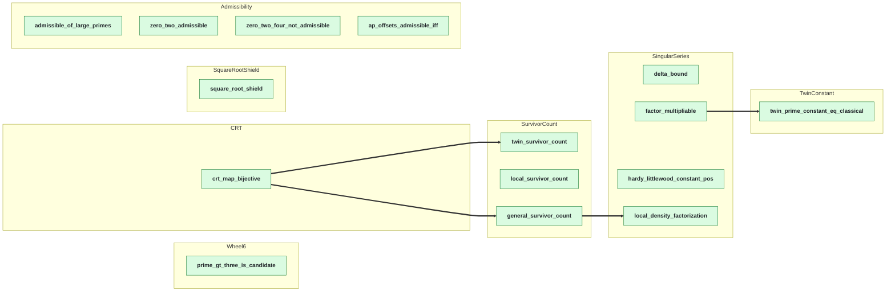

# The network

**Generated file — do not edit.** Regenerated by `python scripts/graph.py`.

This is a map of a Lean 4 / Mathlib formalization of a residue-number-system
(RNS) wheel sieve for primes. Each **node** is a group of related claims.
For each claim the network records what it says, what other claims it rests
on, and how it is justified. You can read off what any result depends on
without opening a single proof.

**Where things stand:** 7 of 20 nodes are built, holding
15 claims, all proved in Lean, joined by 4 checked arrows.
The other 13 nodes are drawn as planned: their claims are already
proved in the original source files, but not yet restated in this network.

## How to read the diagrams

- **Solid green box:** built and proved in Lean. Every proof uses only the
  standard axioms `propext`, `Classical.choice` and `Quot.sound`.
- **Dashed box:** planned, not yet built. A green border means its claims are
  proved in the source file; amber means its results are conditional on an
  open conjecture; blue means it is cited from a published paper.
- **Yellow hexagon:** an open conjecture, held as a named hypothesis rather
  than claimed as true.
- **Thick arrow `A ==> B`:** B's claim assumes A's claim, and Lean checks the
  step. The number on it is how many claims cross it. Each proof file imports
  only claims, never another node's proof; each arrow is proved as a
  separate `…_step` theorem with the upstream claim as a named hypothesis,
  and `RNSSolutions/Assemble.lean` joins the steps up.
- **Dotted arrow:** a planned dependency, not yet checked.

## The network at a glance

```mermaid
graph TD
  N_Wheel6["<b>Wheel6</b><br/>the 6n±1 wheel<br/><i>1 claim</i>"]
  N_CRT["<b>CRT</b><br/>one big cycle is the same as many small wheels<br/><i>1 claim</i>"]
  N_SquareRootShield["<b>SquareRootShield</b><br/>trial division only needs small wheels<br/><i>1 claim</i>"]
  N_Admissibility["<b>Admissibility</b><br/>which offset patterns can repeat forever<br/><i>4 claims</i>"]
  N_SurvivorCount["<b>SurvivorCount</b><br/>the exact number of open positions<br/><i>3 claims</i>"]
  N_SingularSeries["<b>SingularSeries</b><br/>the correction constant exists and is positive<br/><i>4 claims</i>"]
  N_TwinConstant["<b>TwinConstant</b><br/>the classical twin-prime constant is recovered<br/><i>1 claim</i>"]
  N_Pruning["<b>Pruning</b><br/>which starting positions are worth testing<br/><i>planned: proved in source file</i>"]
  N_WheelOrder["<b>WheelOrder</b><br/>what each wheel adds when wheels arrive in order<br/><i>planned: proved in source file</i>"]
  N_ShieldCertificates["<b>ShieldCertificates</b><br/>certifying primes, and why prime runs stop<br/><i>planned: proved in source file</i>"]
  N_Infinitude["<b>Infinitude</b><br/>two independent proofs that primes never run out<br/><i>planned: proved in source file</i>"]
  N_ColumnStructure["<b>ColumnStructure</b><br/>how the two columns multiply<br/><i>planned: proved in source file</i>"]
  N_DirichletColumns["<b>DirichletColumns</b><br/>both columns hold infinitely many primes<br/><i>planned: proved in source file</i>"]
  N_HardyLittlewood["<b>HardyLittlewood</b><br/>the conjecture, and what it would give<br/><i>planned: conditional</i>"]
  N_HensleyRichards["<b>HensleyRichards</b><br/>Hardy and Littlewood's two conjectures clash<br/><i>planned: conditional</i>"]
  N_LinearForms["<b>LinearForms</b><br/>Dickson's conjecture gives Sophie Germain primes<br/><i>planned: conditional</i>"]
  N_GapConjectures["<b>GapConjectures</b><br/>Legendre, Brocard, Oppermann, Andrica<br/><i>planned: conditional</i>"]
  N_SophieGermainWheel["<b>SophieGermainWheel</b><br/>where Sophie Germain primes can sit<br/><i>planned: proved in source file</i>"]
  N_GapTracks["<b>GapTracks</b><br/>which gaps each column allows<br/><i>planned: proved in source file</i>"]
  N_DudekJohnston["<b>DudekJohnston</b><br/>a near-prime between every pair of squares<br/><i>planned: cited from a paper</i>"]
  O_hardy_littlewood_conjecture{{"<i>open</i><br/>hardy_littlewood_conjecture"}}
  O_HL_conjecture_A{{"<i>open</i><br/>HL_conjecture_A"}}
  O_HL_conjecture_B{{"<i>open</i><br/>HL_conjecture_B"}}
  O_LinearForms_conjecture{{"<i>open</i><br/>LinearForms_conjecture"}}
  O_jacobsthal_bound_holds{{"<i>open</i><br/>jacobsthal_bound_holds"}}
  O_four_survivors_bound_holds{{"<i>open</i><br/>four_survivors_bound_holds"}}
  O_oppermann_bound_holds{{"<i>open</i><br/>oppermann_bound_holds"}}
  O_oppermann_conjecture{{"<i>open</i><br/>oppermann_conjecture"}}
  N_CRT ==>|2| N_SurvivorCount
  N_SingularSeries ==>|1| N_TwinConstant
  N_SurvivorCount ==>|1| N_SingularSeries
  N_Admissibility -.-> N_Pruning
  N_SurvivorCount -.-> N_Pruning
  N_Wheel6 -.-> N_WheelOrder
  N_SquareRootShield -.-> N_ShieldCertificates
  N_Admissibility -.-> N_ShieldCertificates
  N_Wheel6 -.-> N_ColumnStructure
  N_ColumnStructure -.-> N_DirichletColumns
  N_SingularSeries -.-> N_HardyLittlewood
  O_hardy_littlewood_conjecture -.-> N_HardyLittlewood
  N_Admissibility -.-> N_HensleyRichards
  O_HL_conjecture_A -.-> N_HensleyRichards
  O_HL_conjecture_B -.-> N_HensleyRichards
  O_LinearForms_conjecture -.-> N_LinearForms
  O_jacobsthal_bound_holds -.-> N_GapConjectures
  O_four_survivors_bound_holds -.-> N_GapConjectures
  O_oppermann_bound_holds -.-> N_GapConjectures
  O_oppermann_conjecture -.-> N_GapConjectures
  N_Wheel6 -.-> N_SophieGermainWheel
  N_WheelOrder -.-> N_SophieGermainWheel
  N_Wheel6 -.-> N_GapTracks
  classDef verified fill:#dafbe1,stroke:#1a7f37,color:#1f2328;
  classDef planned fill:#ffffff,stroke:#1a7f37,color:#57606a,stroke-dasharray: 5 4;
  classDef conditional fill:#ffffff,stroke:#9a6700,color:#57606a,stroke-dasharray: 5 4;
  classDef cited fill:#ffffff,stroke:#0969da,color:#57606a,stroke-dasharray: 5 4;
  classDef openconj fill:#fff8c5,stroke:#9a6700,color:#1f2328;
  class N_Wheel6,N_CRT,N_SquareRootShield,N_Admissibility,N_SurvivorCount,N_SingularSeries,N_TwinConstant verified;
  class N_Pruning,N_WheelOrder,N_ShieldCertificates,N_Infinitude,N_ColumnStructure,N_DirichletColumns,N_SophieGermainWheel,N_GapTracks planned;
  class N_HardyLittlewood,N_HensleyRichards,N_LinearForms,N_GapConjectures conditional;
  class N_DudekJohnston cited;
  class O_hardy_littlewood_conjecture,O_HL_conjecture_A,O_HL_conjecture_B,O_LinearForms_conjecture,O_jacobsthal_bound_holds,O_four_survivors_bound_holds,O_oppermann_bound_holds,O_oppermann_conjecture openconj;
```

## Every claim in the built part

One box per claim, grouped by node. Each thick arrow is a Lean-checked step.

## What each result rests on

The results nothing else builds on, each with everything beneath it.

- [`Wheel6.prime_gt_three_is_candidate`](docs/nodes/Wheel6.md#prime_gt_three_is_candidate) — proved in Lean
- [`SquareRootShield.square_root_shield`](docs/nodes/SquareRootShield.md#square_root_shield) — proved in Lean
- [`Admissibility.admissible_of_large_primes`](docs/nodes/Admissibility.md#admissible_of_large_primes) — proved in Lean
- [`Admissibility.zero_two_admissible`](docs/nodes/Admissibility.md#zero_two_admissible) — proved in Lean
- [`Admissibility.zero_two_four_not_admissible`](docs/nodes/Admissibility.md#zero_two_four_not_admissible) — proved in Lean
- [`Admissibility.ap_offsets_admissible_iff`](docs/nodes/Admissibility.md#ap_offsets_admissible_iff) — proved in Lean
- [`SurvivorCount.twin_survivor_count`](docs/nodes/SurvivorCount.md#twin_survivor_count) — proved in Lean
  - [`CRT.crt_map_bijective`](docs/nodes/CRT.md#crt_map_bijective) — proved in Lean
- [`SurvivorCount.local_survivor_count`](docs/nodes/SurvivorCount.md#local_survivor_count) — proved in Lean
- [`SingularSeries.delta_bound`](docs/nodes/SingularSeries.md#delta_bound) — proved in Lean
- [`SingularSeries.hardy_littlewood_constant_pos`](docs/nodes/SingularSeries.md#hardy_littlewood_constant_pos) — proved in Lean
- [`SingularSeries.local_density_factorization`](docs/nodes/SingularSeries.md#local_density_factorization) — proved in Lean
  - [`SurvivorCount.general_survivor_count`](docs/nodes/SurvivorCount.md#general_survivor_count) — proved in Lean
    - [`CRT.crt_map_bijective`](docs/nodes/CRT.md#crt_map_bijective) — proved in Lean
- [`TwinConstant.twin_prime_constant_eq_classical`](docs/nodes/TwinConstant.md#twin_prime_constant_eq_classical) — proved in Lean
  - [`SingularSeries.factor_multipliable`](docs/nodes/SingularSeries.md#factor_multipliable) — proved in Lean

## What the network takes on trust

**Built part: nothing.** Every built claim is proved in Lean from Mathlib,
using only the three standard axioms, and every arrow between built claims
is itself a Lean-checked step.

**Planned part.** When the planned nodes are built, these will enter the
network as named hypotheses or citations, never as claimed truths:

- `HL_conjecture_A` — open conjecture
- `HL_conjecture_B` — open conjecture
- `LinearForms_conjecture` — open conjecture
- `four_survivors_bound_holds` — open conjecture
- `hardy_littlewood_conjecture` — open conjecture
- `jacobsthal_bound_holds` — open conjecture
- `oppermann_bound_holds` — open conjecture
- `oppermann_conjecture` — open conjecture
- `DudekJohnston` — published theorem, cited: Dudek and Johnston, *Almost primes between all squares*, arXiv:2501.18048 (2025), Theorem 1.2

## Node index

| # | Node | What it says | Status |
|---|---|---|---|
| 1 | [`Wheel6`](docs/nodes/Wheel6.md) | the 6n±1 wheel | proved in Lean |
| 2 | [`CRT`](docs/nodes/CRT.md) | one big cycle is the same as many small wheels | proved in Lean |
| 3 | [`SquareRootShield`](docs/nodes/SquareRootShield.md) | trial division only needs small wheels | proved in Lean |
| 4 | [`Admissibility`](docs/nodes/Admissibility.md) | which offset patterns can repeat forever | proved in Lean |
| 5 | [`SurvivorCount`](docs/nodes/SurvivorCount.md) | the exact number of open positions | proved in Lean |
| 6 | [`SingularSeries`](docs/nodes/SingularSeries.md) | the correction constant exists and is positive | proved in Lean |
| 7 | [`TwinConstant`](docs/nodes/TwinConstant.md) | the classical twin-prime constant is recovered | proved in Lean |
| 8 | [`Pruning`](docs/nodes/Pruning.md) | which starting positions are worth testing | planned: proved in source file |
| 9 | [`WheelOrder`](docs/nodes/WheelOrder.md) | what each wheel adds when wheels arrive in order | planned: proved in source file |
| 10 | [`ShieldCertificates`](docs/nodes/ShieldCertificates.md) | certifying primes, and why prime runs stop | planned: proved in source file |
| 11 | [`Infinitude`](docs/nodes/Infinitude.md) | two independent proofs that primes never run out | planned: proved in source file |
| 12 | [`ColumnStructure`](docs/nodes/ColumnStructure.md) | how the two columns multiply | planned: proved in source file |
| 13 | [`DirichletColumns`](docs/nodes/DirichletColumns.md) | both columns hold infinitely many primes | planned: proved in source file |
| 14 | [`HardyLittlewood`](docs/nodes/HardyLittlewood.md) | the conjecture, and what it would give | planned: conditional |
| 15 | [`HensleyRichards`](docs/nodes/HensleyRichards.md) | Hardy and Littlewood's two conjectures clash | planned: conditional |
| 16 | [`LinearForms`](docs/nodes/LinearForms.md) | Dickson's conjecture gives Sophie Germain primes | planned: conditional |
| 17 | [`GapConjectures`](docs/nodes/GapConjectures.md) | Legendre, Brocard, Oppermann, Andrica | planned: conditional |
| 18 | [`SophieGermainWheel`](docs/nodes/SophieGermainWheel.md) | where Sophie Germain primes can sit | planned: proved in source file |
| 19 | [`GapTracks`](docs/nodes/GapTracks.md) | which gaps each column allows | planned: proved in source file |
| 20 | [`DudekJohnston`](docs/nodes/DudekJohnston.md) | a near-prime between every pair of squares | planned: cited from a paper |
